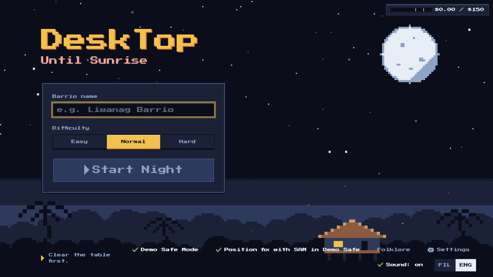
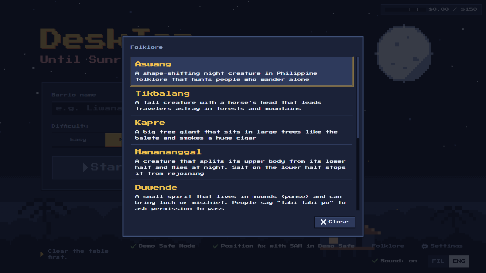
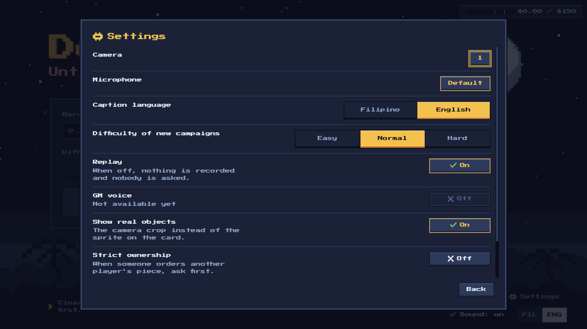
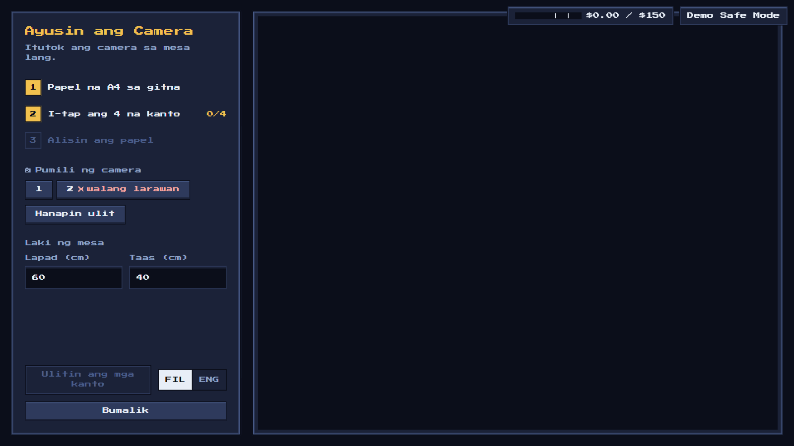
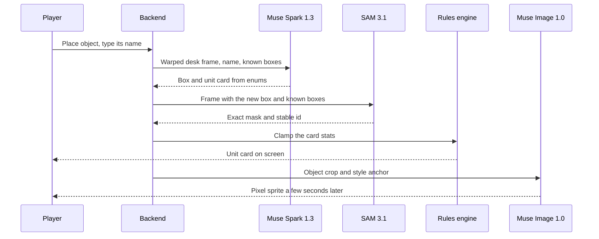
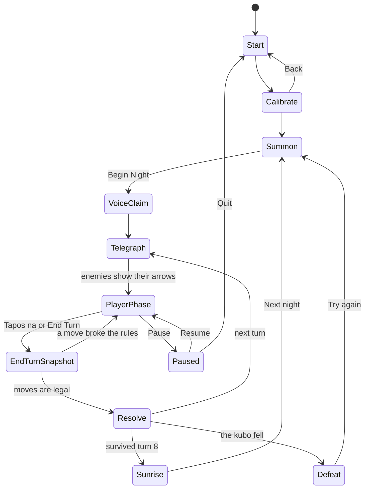
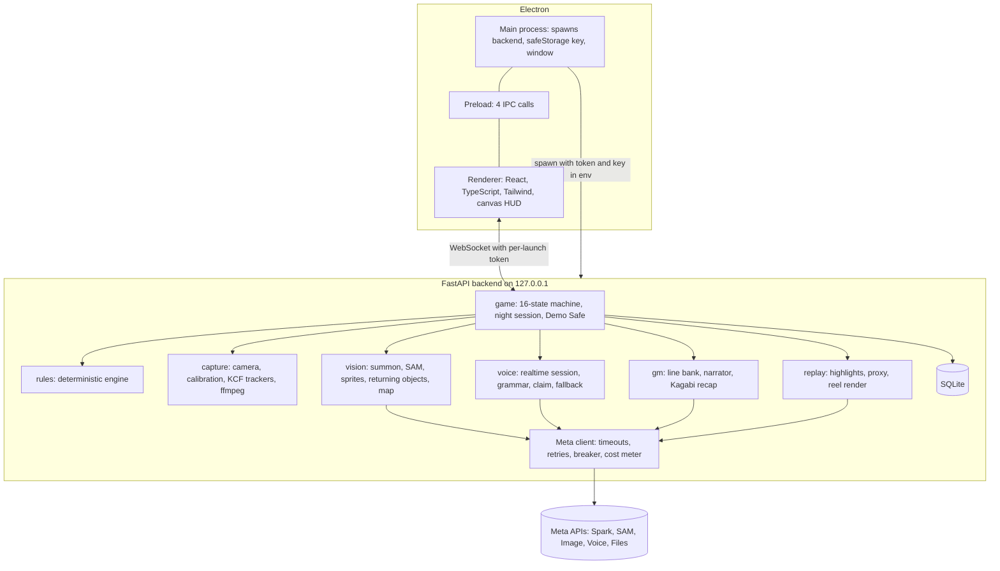
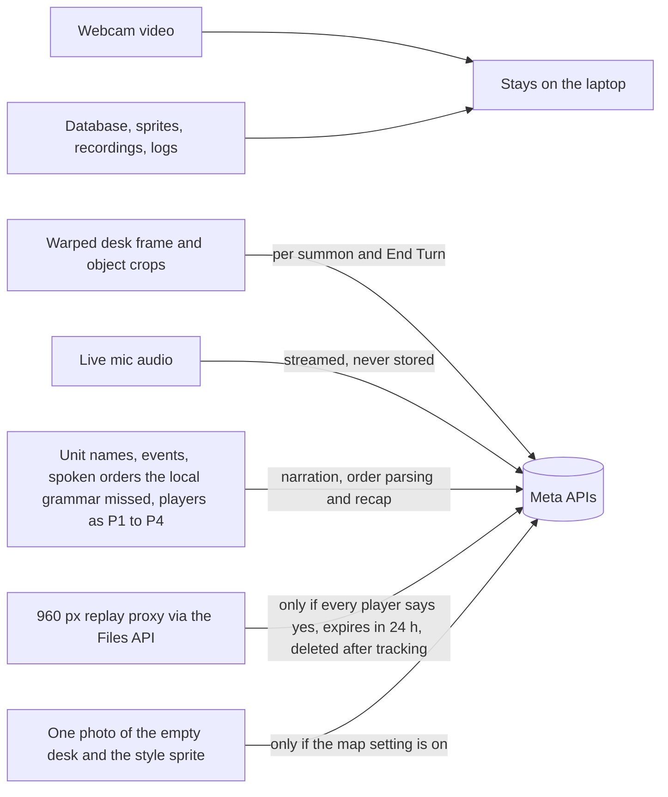

# DeskTop: Hanggang Umaga

A webcam turns the things on your desk into pixel heroes who hold off Filipino folklore creatures until sunrise.

[](LICENSE)
[](docs/how-to-run.md)
[](#how-the-four-meta-models-work-together)

**Demo video:** not recorded yet. The link goes here once it is uploaded.

## What it is

Put a mug, a coin and your keys on the desk, point a webcam straight down, and they become 16-bit units with a card, a power and a sprite. One to four friends at one table slide the real objects by hand and give orders out loud in Taglish or English. For eight turns, aswang, tikbalang, kapre, manananggal and duwende crawl in from the edges of the desk, and you hold the bahay kubo hanggang umaga.

I built it solo in General Santos City for the Meta Global AI Developer Hackathon 2026, Indie track, theme Build for Your World. I wanted a game my barkada could play together at one table, with no phones and no controllers, about the stories we grew up with.

## Screenshots



| | |
|---|---|
|  |  |
|  | Night, summon and sunrise shots need a real camera over a real desk. They come with the demo video. |

## How the four Meta models work together

| Model | Job in the game |
|---|---|
| Muse Spark 1.3 | Finds the new object on the desk and writes its unit card from fixed enums in one call. Narrates each turn as the Game Master in Taglish with English captions. Parses spoken orders the local grammar missed. Writes the Kagabi recap |
| SAM 3.1 | Cuts the exact mask of each object and keeps its id stable. Re-anchors every piece at End Turn. Tracks the recorded night for the replay reel |
| Muse Image 1.0 | Redraws each object as a 16-bit sprite in one shared style. Optionally paints a barrio map from a photo of the empty desk |
| Muse Voice Transcribe 1.0 | Streams live speech with speaker labels, biased to English and Tagalog, for spoken orders and "Ako si..." voice claims |

Here is what happens when you put a new object down:



Local code does everything else. OpenCV KCF trackers follow the objects between turns. A pure Python rules engine decides movement, range, damage, HP, cooldowns, spawns, win and loss. Models only pick from enums and narrate. If a model is slow or down, the game falls back to taps, class default cards, placeholder sprites and a built-in line bank. Details: [Meta API integration](docs/architecture/meta-api-integration.md) and [reliability and fallbacks](docs/architecture/reliability-and-fallbacks.md).

## Quick start

You need a Windows 10 or 11 laptop, a webcam pointed straight down at the desk from about 45 to 70 cm, and one A4 sheet for calibration. A Meta Model API key is optional. Without one, choose Play offline and the whole night runs in Demo Safe Mode with taps and the line bank. You still need the camera.

### From the zip

1. Download `DeskTop-1.0.0-win.zip` from the [Releases page](https://github.com/EHIBE/DeskTop-Hanggang-Umaga/releases) once it is attached.
2. Check the download in PowerShell. The hash must match the one in [release and packaging](docs/delivery/release-and-packaging.md).

   ```powershell
   Get-FileHash .\DeskTop-1.0.0-win.zip -Algorithm SHA256
   ```

3. Unzip it to a folder you can write to and run `DeskTop.exe`. The build is unsigned, so Windows SmartScreen may ask you to confirm. It carries its own Python, so you do not need Node or Python.

The zip is 323.8 MB as Windows Explorer shows it (339,507,320 bytes).

### From source

Needs Git, Node.js 20.19 or newer and Python 3.13.

```powershell
git clone https://github.com/EHIBE/DeskTop-Hanggang-Umaga.git
cd DeskTop-Hanggang-Umaga
npm --prefix app install
py -3.13 -m venv backend\.venv
backend\.venv\Scripts\python -m pip install -r backend\requirements.txt
npm --prefix app run dev
```

ffmpeg is optional. It is only needed for recording a night and the replay reel (`winget install Gyan.FFmpeg`). The full friendly walkthrough is in [how to run DeskTop](docs/how-to-run.md).

## How to play

1. **Pick your language.** Filipino or English. You can switch any time with the FIL and ENG toggle.
2. **Calibrate.** Lay the A4 sheet on the desk and tap its four corners. The desk becomes a top-down board.
3. **Summon.** Place one object at a time and type what it is. The first object is always the bahay kubo. Each one gets a card and a sprite. Objects from earlier nights come back with their badges and scars.
4. **Claim.** Each player says "Ako si Migs, hawak ko ang Mug at Stapler", or taps. Everyone answers whether tonight may be recorded.
5. **Survive eight turns.** Red arrows show who each enemy will hit and for how much. Slide your objects inside their move rings, give orders out loud ("Stapler, atake sa aswang!") or tap, then say "Tapos na" or press End Turn. A tikbalang can shove a unit, a duwende can steal one, and a kapre blows smoke that blocks attacks until Liwanag clears it.
6. **Sunrise.** See the score and the Bayani ng Gabi, pick a badge, and make a replay reel of real hands with the pixel battle on top. Next night, the barrio level goes up.

The turn loop, simplified to the path you see on screen:



Under the hood that path runs through 16 states, including validate, player and enemy resolution, physical effects and the end check. Canonical: [state machine](docs/game/state-machine.md). Full rules: [docs/game](docs/game/core-loop.md).

## Architecture



The backend owns the camera, the mic, the rules, the database and every Meta call. The renderer only draws and sends taps. Canonical: [architecture overview](docs/architecture/overview.md).

## Privacy and safety

What leaves your laptop, and when:



- Full camera video never leaves the laptop. Every Meta response call sets `store: false`. Voice audio is streamed live and never written to disk.
- Players are sent to the models as P1 to P4. Real names are put back locally.
- The replay proxy is uploaded only with every player's consent, expires after 24 hours and is deleted after tracking. If the delete fails, the 24 hour expiry removes it. If the upload is refused with an expiry, nothing is sent.
- The API key is encrypted with Windows safeStorage in `model-key.bin`. It reaches the backend only through its environment, never the renderer, and `backend.log` replaces it with `[redacted]`.
- The backend listens on 127.0.0.1 only, on a new free port each launch. Every HTTP request and the WebSocket need a token that is regenerated on every start. There are no accounts and no cookies.
- The Electron window runs sandboxed with context isolation, no Node integration, all permission requests denied, navigation blocked and a restrictive CSP (self only, plus the local backend). The packaged build has Electron fuses on.
- A cost meter warns at $90 and stops every paid call at $120, then switches to Demo Safe Mode. Each model has a circuit breaker that opens after 3 failures.
- Delete campaign removes its database rows, files, recordings and unshared sprites.

More: [security and privacy](docs/engineering/security-and-privacy.md).

## Tests and evals

Real numbers only, from real runs on 2026-11-04 at commit 4b90671. Full log: [eval results](docs/eval.md).

| Measure | Result |
|---|---|
| Backend tests | 2,182 passed, all offline (end-to-end nights, server fuzz, rules invariants, copy and message contracts). 96% line coverage, `server.py` 100% |
| Renderer tests | 84 passed (`node:test`) |
| Static checks | ruff, mypy --strict (124 files), TypeScript typecheck and ESLint clean. Prettier flags one file, `app/package.json` |
| E7 determinism | 50 of 50 seeded boards resolved twice with identical results (100%) |
| Rules resolve speed | 0.4 ms median for 12 units and 8 enemies, target 50 ms (`test_resolve.py` perf test) |
| Tracker speed | 34.7 ms median per update for 12 KCF trackers on a synthetic 1200x800 frame (`test_tracker.py` benchmark) |
| E1 to E6 | Not run yet. They need live API runs and recorded nights |
| Dependency audit | `npm audit`: 0 findings in runtime dependencies, 32 moderate in dev tooling (ESLint and electron-builder chains). No Python audit tool is set up yet |

Cost per night is an estimate for now: about $0.49 for a typical night and about $1.40 at worst, from list prices in [cost and budget](docs/architecture/cost-and-budget.md). A measured average replaces it after the playtest nights.

## Known limits

- You need a webcam even offline. Demo Safe Mode removes the paid calls, not the camera.
- Summon is by typed name. Voice summon is not built.
- Muse Glimmer recap works only from source with `DESKTOP_GLIMMER_URL` in `backend\.env`. The zip does not pass that setting to its backend.
- GM voice (text to speech) is not built. The setting shows "Not available yet".
- The live shapes of some Meta responses (voice events, SAM video records) are coded from the docs and still need a recorded fixture.
- Tested on one Windows laptop so far. The zip has not yet run on a machine without Python. Lighting and camera height affect tracking.
- The Taglish lines are waiting for review by Filipino playtesters.

More: [scope and cuts](docs/product/scope-and-cuts.md) and the [risk register](docs/delivery/risk-register.md).

## Credits

- Font: Press Start 2P by The Press Start 2P Project Authors, SIL Open Font License 1.1 ([OFL.txt](assets/fonts/OFL.txt)).
- Profanity word lists: LDNOOBW, CC BY 4.0 ([attribution](backend/gm/data/ATTRIBUTION.md)).
- Sound effects: made in code at runtime with WebAudio. No audio files ship.
- Folklore notes and cultural care: [glossary](docs/glossary.md) and [cultural care](docs/design/cultural-care.md).

## License

Code is MIT, see [LICENSE](LICENSE). Original assets made for DeskTop are CC BY-NC 4.0, see [asset licenses](assets/LICENSE-ASSETS.md). Third-party assets keep their own licenses, listed in that file.

Salamat sa pagbabasa! If you try it with your barkada, ingat, and hold on hanggang umaga.
