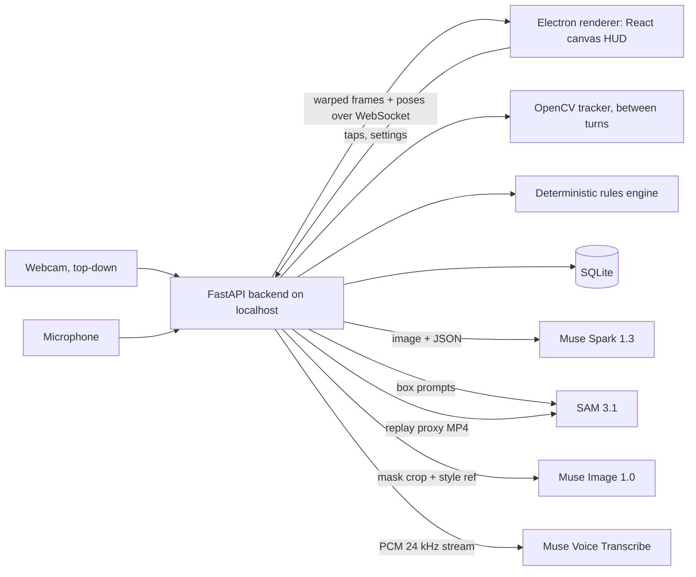
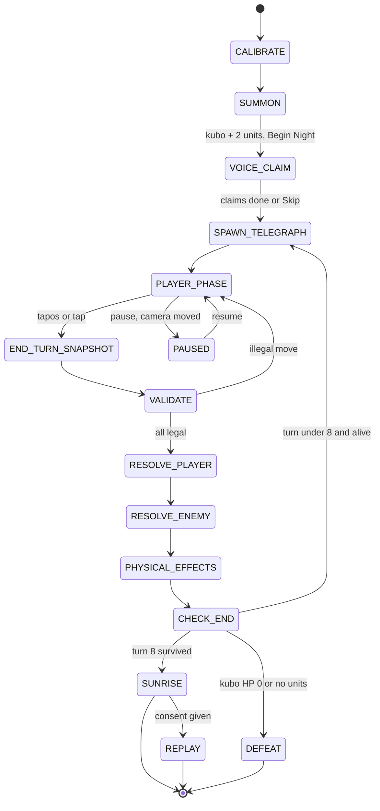
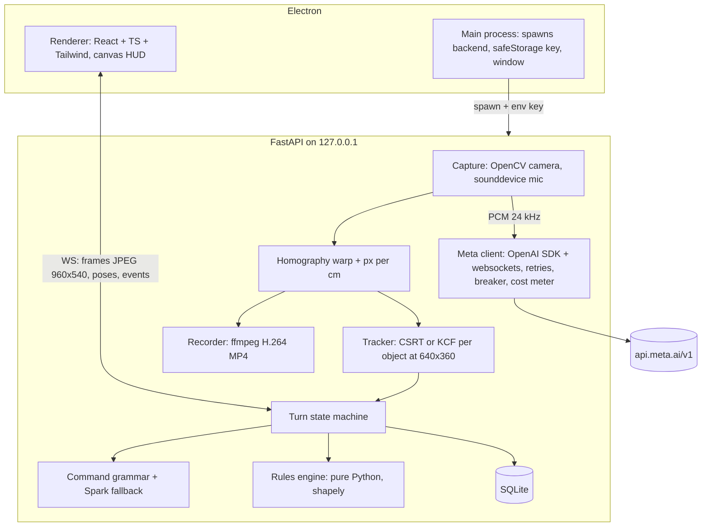

# DeskTop: Hanggang Umaga | Product Requirements Document
> Historical document, kept unchanged since 2026-10-28. Current state lives in [CLAUDE.md](../CLAUDE.md) and the [docs index](README.md).

**DeskTop: any desk is a game board.**

---

## 0. Document header

| Field | Value |
|---|---|
| Product | DeskTop: Hanggang Umaga |
| Version | v1.1 |
| Status | Approved for build |
| Owner | EHIBE (solo builder, PM, design, engineering) |
| Last updated | 2026-10-28 (SGT) |
| Event | Meta Global AI Developer Hackathon 2026 (Meta and Cerebral Valley) |
| Track | Indie developer |
| Theme | Build for Your World |
| Build window opens | Oct 26, 12:00 PM ET per event page header = Oct 26, 17:00 UTC per page data = **Oct 27, 01:00 AM SGT** |
| Submission deadline | Nov 4, 9:00 PM ET (EST, after the Nov 1 clock change) = Nov 5, 02:00 UTC = **Nov 5, 10:00 AM SGT** |
| Internal submit target | Nov 4, 8:00 PM SGT = Nov 4, 12:00 UTC = Nov 4, 7:00 AM ET (14 hours of buffer) |
| Judging | Nov 4 to Nov 8. Closing ceremony and live finals Nov 9 |
| Repo | github.com/EHIBE/DeskTop-Hanggang-Umaga (local path C:\Users\ADMIN\Documents\Projects\Hackathon\DeskTop-Hanggang-Umaga, setup in section 12) |

**Verification status of facts**

| What was checked on 2026-10-25 (SGT) | Result |
|---|---|
| Event page, cerebralvalley.ai/e/meta-ai-developer-hackathon | Dates, tracks and themes unchanged. **Official Rules not yet published.** No video length or repo rule stated |
| Event waiver page | Did not render content. Judging weights, prize table and IP terms stay sourced from the ReconScribe guide that quotes the waiver. Marked "unverified, third-party" |
| dev.meta.ai pricing and rate limits | All prices and limits in this PRD match |
| Speech to text and Voice schemas | Match. Added exact handshake fields and close codes |
| SAM overview and segmenting | Match. Added the 16-object and 15,000-frame limits |
| Image generation | Match. `background` is always opaque |
| Reasoning | Match. `none` effort returns HTTP 400 |
| Structured output | New detail: strict mode needs `additionalProperties: false` on every object and every property listed in `required` |
| File handling | New detail: Files API upload up to 1 GiB, files never expire unless `expires_after` is set (3,600 to 2,592,000 s) |
| Image understanding | New detail: up to 50 images per request, boxes use a normalized 0 to 1000 grid and can slightly exceed it, so clamp |
| Muse Glimmer | Match. 30B, Apache 2.0 |

**Style note**: semicolons appear only inside API syntax in code blocks, because the SAM prompt grammar requires them. Prose has none.

**Change log**

| Version | Date | Change | Why |
|---|---|---|---|
| v0 | 2026-10-24 | Original concept "DeskStage": real-time pixel art RPG on a desk | First idea |
| v0.1 | 2026-10-25 | Renamed to DeskTop | Builder's chosen name |
| v0.2 | 2026-10-25 | Live 5 FPS SAM tracking replaced by hybrid: local OpenCV tracker between turns, one SAM image call per End Turn, SAM video only for the replay | SAM 3.1 takes images and uploaded clips, not a live stream. Each video request bills at least 50 frames, so a live loop lags |
| v0.2 | 2026-10-25 | One SAM concept call for several objects replaced by Muse Spark detection plus SAM box prompts (up to 16 objects, own IDs) | SAM has no multi-concept syntax |
| v0.2 | 2026-10-25 | Transparent sprites replaced by solid #FF00FF background plus local chroma key | Muse Image `background` is always opaque |
| v0.2 | 2026-10-25 | Diarization as the only command path replaced by diarization plus enrollment, with ENDPOINTING, push-to-talk and tap fallbacks | Diarization is not tuned for low-latency commands and labels are session-scoped |
| v0.2 | 2026-10-25 | Muse Glimmer as memory replaced by SQLite. Glimmer moved to a Could stretch | State is a database job. Glimmer as a logger reads as bolted on |
| v0.2 | 2026-10-25 | Per-frame SAM image calls dropped | 5 FPS for 8 hours of image calls costs about $360, over the $150 credit |
| v0.2 | 2026-10-25 | FastAPI on Render and MySQL on Aiven removed | Local app. Cloud hosting adds risk and no value |
| v0.2 | 2026-10-25 | Impact made explicit: Filipino folklore, Taglish voice, zero extra hardware | Impact is the largest judging weight (30%) and was missing |
| v0.3 | 2026-10-25 | Open real-time RPG replaced by turn-based co-op survival tactics "Hanggang Umaga" | Turn-based removes latency failure modes and gives the GM a bounded job |
| v1.0 | 2026-10-25 | Deterministic rules engine made authoritative. Enemy intent telegraphing added. Demo Safe Mode added. Weighted score for the original corrected from "about 63" to 61 | Fairness, reproducibility, live-demo safety. The weighted math of 4, 7, 7, 7 gives 61 |
| v1.1 | 2026-10-28 | Added project setup commands (Command Prompt) and full folder structure to section 12. Fixed FR-10 example to follow the stat sum rule | Build started |

---

## 1. Summary one-pager

| | |
|---|---|
| **Problem** | Friends who sit at the same table play on separate screens. Shared tabletop games cost money, take space and are mostly in English. Nothing turns what is already on the table into a shared game |
| **Solution** | DeskTop turns everyday objects on a real desk into pixel art units in a turn-based co-op game. Players move real objects by hand and give orders out loud in Taglish. An AI Game Master runs the night. Creatures from Filipino folklore attack until sunrise |
| **For whom** | Barkadas, student orgs and classrooms, families, Filipino diaspora players. First market: the Philippines |
| **Why Meta models** | Muse Spark 1.3 sees and names objects and runs the GM. SAM 3.1 gives exact object masks and stable IDs, then tracks the recorded night for a replay reel. Muse Image redraws each object as a matching sprite. Muse Voice Transcribe understands Tagalog code-switching and tells speakers apart |
| **Success metrics** | A full 8-turn night completes on camera with no crash. Object registration correct 9 of 10 times. Voice command to on-screen text in 3 s or less. Cost per night under $1 |
| **In scope** | Calibration, summon, voice claim, 8-turn night, 5 enemy types, deterministic rules, GM narration, autosave, replay reel, Demo Safe Mode |
| **Out of scope** | Real-time action, online multiplayer, mobile app, cloud hosting, accounts, PvP, monetization |
| **Timeline** | Build Oct 27 to Nov 4 SGT. Feature freeze and demo recording Nov 2. Internal submit Nov 4, 8:00 PM SGT (12:00 UTC, 7:00 AM ET). Official deadline Nov 5, 10:00 AM SGT (02:00 UTC, Nov 4 9:00 PM ET) |
| **Top 3 risks** | 1. Schedule: concurrent PayPal AI Hackathon, thesis and client work. 2. Identity mix-ups between similar objects at re-anchor. 3. Diarization reliability in a noisy room |

---

## 2. Working Backwards press release and FAQ

### Press release

**DeskTop turns any desk into a Filipino folklore battlefield**
*A solo student build from General Santos City lets friends fight aswang with mugs, coins and pens, in Taglish, using Meta's newest models*

**GENERAL SANTOS CITY, Philippines, November 9, 2026.** Most game nights now happen on separate phones. DeskTop brings players back to one table. Players put ordinary things on a desk, say what each one is, and the laptop camera turns them into pixel art defenders of a small barrio. A mug becomes the bahay kubo. A coin becomes an anting-anting. Keys become the albularyo. When night falls, aswang, tikbalang and a manananggal crawl in from the edges of the desk, and the group has eight turns to survive until morning.

There is no controller. Players slide the real objects to move their units and shout orders the way they normally talk: "Pre, ilipat mo yung albularyo! Spearman, saksakin ang aswang!" DeskTop understands Tagalog mixed with English, knows which player is speaking, and an AI Game Master narrates every turn. When the sun rises, DeskTop cuts a replay reel of the night that shows real hands moving real objects with the pixel battle drawn on top.

DeskTop runs on Meta's Muse Spark 1.3, SAM 3.1, Muse Image and Muse Voice Transcribe. It needs only a laptop, a webcam pointed at the desk and a sheet of A4 paper for setup.

> "Kagabi muntik nang mamatay yung kubo namin dahil sa duwende. Nag-sigawan kami sa buong last turn. Ngayon lang ulit kami naglaro ng magkakasama sa iisang mesa." *(Fictional player quote, written for this PR/FAQ. Not a real person.)*

> "I wanted a game that uses what is already on the table and the language my friends actually speak. Every desk becomes a different map, so no two nights look the same." *(Builder quote, draft for EHIBE to approve.)*

**How to get it**: download the Windows build from the GitHub repo, add a Meta Model API key, point a webcam at a desk, and press Start Night.

### External FAQ (players and press)

| # | Question | Answer |
|---|---|---|
| 1 | What do I need? | A Windows laptop, a webcam or phone camera on a stand looking down at the desk, a plain desk, normal indoor light, one A4 sheet, and a Meta Model API key |
| 2 | How many players? | 2 to 4 around one table. One player can also play alone |
| 3 | What objects work? | Most everyday things about coin size to mug size: mugs, coins, keys, pens, erasers, phones, tape, bottle caps. Up to 12 objects per night |
| 4 | Do I have to speak Tagalog? | No. English, Tagalog and Taglish all work. Every voice action also has a tap button |
| 5 | How long is a game? | One night is 8 turns, about 15 minutes, plus 3 minutes of setup |
| 6 | Is it scary? | Spooky, not gory. Rated for a general audience. Creatures are drawn in a cute 16-bit style |
| 7 | Is my video uploaded? | Gameplay video stays on your computer. Single desk frames and object crops go to Meta's API to find and draw objects, and mic audio is streamed for transcription. If you turn on the replay, a short low-resolution highlight clip is uploaded, processed, and deleted within 24 hours. Every player is asked for consent first |
| 8 | Does it remember my stuff? | Yes. Campaigns save after every turn. Put the same mug down next night and DeskTop tries to recognize it as your kubo |
| 9 | What does it cost to play? | About $0.50 of API usage per night at expected use (estimate, section 12). Hackathon credits cover development |
| 10 | Are the creatures accurate to folklore? | They follow common Philippine folklore descriptions and a glossary in the app explains each one |

### Internal FAQ (judges, feasibility, cost, risk)

| # | Question | Answer |
|---|---|---|
| 1 | Why is this Build for Your World? | The builder is Filipino, in General Santos City, and builds for his own barkada and campus orgs. The content, language and setting come from his world |
| 2 | Can SAM 3.1 track a live webcam? | No. DeskTop does not ask it to. A local OpenCV tracker moves sprites between turns. One SAM image call per End Turn sets exact positions. SAM video tracking runs only on the recorded replay clip |
| 3 | Why turn-based? | Every model call fits inside a turn boundary, so latency never breaks play. It also keeps the GM on a bounded job |
| 4 | Who decides combat? | Deterministic code. The GM narrates and maps speech to intents. It never changes a number |
| 5 | How many Meta models are used, and how? | Four required: Muse Spark 1.3 (vision detection, unit cards, GM, command parsing, recap), SAM 3.1 (box-prompt masks with stable IDs, End Turn re-anchor, video tracking for the reel), Muse Image (sprite restyle with reference image), Muse Voice Transcribe (Taglish, diarization, endpointing). Muse Code for development. Muse Glimmer is an optional stretch |
| 6 | What if a model fails during the live demo? | Demo Safe Mode: cached sprites and cards, local narration lines, local command grammar, tap controls. The night still plays |
| 7 | Will it fit in $150 of credits? | Expected total about $43, worst case about $99 (section 12). A spend tracker hard-stops paid calls at $120 |
| 8 | Can one person build this in 10 days? | Tight but yes, with the cuts in this PRD. Must features total about 39 hours by the estimates in section 20.3, against 50 to 60 available hours. Should features add about 12 hours and are the first to drop. The builder already shipped an Electron app with real-time voice (Merky) |
| 9 | What is the biggest risk? | Builder time. Two hackathons and a thesis overlap. Kill switches and a Nov 2 freeze protect the submission |
| 10 | Is there a real market? | Unproven. Evidence today is the builder's own context and the gap described in section 3. Playtests in section 18 collect the first qualitative signal |

---

## 3. Problem alignment

### Problem statement

| Part | Statement |
|---|---|
| Who | Groups of friends, students and families in the Philippines who are physically together but play on separate screens |
| What | Shared tabletop games need bought pieces, setup time and usually English rules. Video games need consoles or one screen per person. Nothing uses what is already on the table |
| Evidence | Builder's firsthand experience with his own barkada and campus orgs (assumption until playtests). No survey data exists. No statistics are claimed |
| Why it matters | Shared in-person play builds friendship and is cheaper than buying games. Local folklore and Taglish are rarely the core of any game, which makes this content feel personal to Filipino players |
| Why now | Models now exist that can see objects, segment them precisely, redraw them in a game style and understand code-switched Tagalog speech. A year ago this needed a research lab |

### Customer insights

| Insight | Type |
|---|---|
| Friends gather at tables at school, at home and at cafes but each person ends up on a phone | Assumption from builder experience |
| Filipino players respond strongly to aswang, tikbalang and kapre stories they grew up with | Assumption from builder experience |
| Taglish is the natural spoken mode for many young Filipinos in casual play | Assumption from builder experience |
| A laptop and webcam are more common in student groups than a console | Assumption |
| Muse Voice Transcribe supports Tagalog with code-switching | Evidence: dev.meta.ai speech to text docs |
| SAM 3.1 keeps stable object identity in video and supports up to 16 prompted objects | Evidence: dev.meta.ai SAM docs |

### Why standard chat AI cannot do this

- A chat model sees one picture at a time and gives approximate boxes. It cannot give pixel masks or keep the same ID for the same object across a recorded video. SAM 3.1 can
- A chat model cannot turn a real object into a sprite that matches a shared art style. Muse Image edits from a reference image and keeps style across turns
- A chat model cannot listen to a room, split speakers and follow Tagalog mixed with English in real time. Muse Voice Transcribe can
- A chat window has no game state, no rules and no physical board. DeskTop joins all four models to a deterministic rules engine and the real desk

---

## 4. Goals, non-goals and success metrics

### Hackathon goals by judging criterion

| Criterion | Weight | Goal | How DeskTop earns it |
|---|---|---|---|
| Impact | 30% | Judges see a real group of people who would use this | Filipino setting, Taglish, zero extra hardware, real playtest footage, a clear user (barkada, classroom) |
| Use of Meta AI Tooling | 25% | Judges see 4 models used beyond basic integration | Spark detection feeding SAM box prompts, SAM video tracking for the reel, Muse Image reference edits with palette lock, Voice diarization with Tagalog bias and keywords |
| Demo | 25% | A complete night works live and on video | Turn-based loop, Demo Safe Mode, demo recorded Nov 2, a 2.5 minute video with a hook in the first 8 seconds |
| Technical Depth and Execution | 20% | Judges see sound engineering | Hybrid tracking with drift reconcile, deterministic rules engine with tests, strict JSON contracts, eval numbers, cost tracker |

### Product goals

| ID | Goal |
|---|---|
| PG-1 | Any group can go from an empty desk to the first turn in under 5 minutes |
| PG-2 | Players never wait on the AI to take their turn |
| PG-3 | Every outcome is explainable from the rules, never random or made up |
| PG-4 | The game sounds and feels Filipino without needing Tagalog to play |
| PG-5 | Each night produces a replay players want to share |

### Non-goals (v1)

- No real-time action. Everything resolves at End Turn
- No online multiplayer. One table, one laptop
- No mobile app
- No cloud hosting or server. The backend runs on localhost
- No competitive PvP. Players are always co-op against the night
- No user accounts or login
- No monetization
- No voice output in Tagalog (TTS) as a requirement. Captions carry narration
- No regional languages beyond what Muse Voice Transcribe lists (Cebuano and Hiligaynon are not in the 25 languages)

### Success metrics

| Metric | Target | How measured | When |
|---|---|---|---|
| Full night completes with no crash | 3 of 3 consecutive runs | Dry-run log | Nov 2 before recording |
| Object registration correct (right object, mask IoU 0.5 or more vs hand label) | 90% or more | Eval set in section 13 | Oct 29 and Nov 2 |
| Re-anchor identity correct | 95% or more over 100 End Turns | Eval script on recorded turns | Oct 30 and Nov 2 |
| End Turn to first resolution animation | 4 s or less (p90) | Timestamps in turn_log | Nov 2 |
| Voice command to on-screen command chip | 3 s or less after speech ends (p90) | Timestamps in turn_log | Nov 1 |
| Taglish command intent accuracy | 85% or more on 50-utterance test set | Eval script | Nov 1 |
| Sprite accepted on first try | 80% or more | Builder rating on 20 objects | Oct 28 |
| Setup time, empty desk to turn 1 | 5 min or less | Stopwatch in playtests | Oct 31 and Nov 2 |
| Night length | 12 to 18 min | turn_log | Playtests |
| Replay share intent | 2 of 2 playtest groups say they would post it | Post-playtest question | Nov 2 |
| Playtester fun rating | Average 4 of 5 or higher (qualitative, small sample) | Post-playtest question | Oct 31 and Nov 2 |

### Guardrail metrics

| Guardrail | Limit | Action when hit |
|---|---|---|
| Total credit spend | Warn at $90, hard-stop paid calls at $120 | Switch to Demo Safe Mode, log it |
| Cost per night | Expected under $1, alert above $3 | Inspect api_usage table |
| Crash rate | 0 crashes in the last 3 runs before recording | Fix before recording, no new features |
| GM blocking play | Never. Narration timeout 20 s then local line | Enforced in code |
| Uploaded footage retention | 24 hours max, deleted after processing | `expires_after` plus explicit DELETE |

---

## 5. Users, personas and job stories

### Personas (fictional)

| Persona | Profile | Needs | Frustration today |
|---|---|---|---|
| **Migs, the barkada host** | 21, college student, hosts friends after class, owns a laptop, no console | Something the whole group plays together in 15 minutes | Everyone ends up on their own phone |
| **Ma'am Joy, the org or class facilitator** | Org adviser or teacher who runs icebreakers for 20 to 40 students | A short, safe, local activity that gets groups talking | Icebreakers feel generic and English-only |
| **Bea, the casual first-timer** | Never plays tabletop games, joins because friends are playing | To understand the game in one minute and not feel slow | Rulebooks, setup, and feeling lost |
| **The judge** | Meta or partner engineer, watches the video and may try the build | To see in one minute that it works, uses the models well and matters to someone | Demos that fake the hard part or break live |

### Job stories

| ID | Job story |
|---|---|
| JS-01 | When my friends come over with nothing planned, I want to start a game with what is already on the table, so I can skip buying or setting up a board game |
| JS-02 | When I put an object on the desk, I want it to become a character that looks like it, so I can feel the game is made from my stuff |
| JS-03 | When I plan with friends, I want to talk normally in Taglish, so I can play without learning commands in English |
| JS-04 | When I give an order, I want to see it written on screen before it happens, so I can cancel it if the game misheard me |
| JS-05 | When I move a piece by hand, I want to see right away whether the move is legal, so I can fix it before ending the turn |
| JS-06 | When an enemy is about to attack, I want to see who it will hit, so I can move that unit out of range or protect it |
| JS-07 | When my hand covers a piece, I want the game to wait instead of losing it, so I can play naturally |
| JS-08 | When we survive the night, I want a replay clip of our real hands and the pixel battle, so I can post it and show friends |
| JS-09 | When we play again tomorrow, I want the game to remember our kubo and units, so I can feel progress |
| JS-10 | When the internet is slow, I want the game to keep going, so I can finish the night |
| JS-11 | When I run an activity for a group, I want a 15 minute session with clear win or lose, so I can fit it into a meeting |
| JS-12 | When I am new, I want the first turn to teach me with one easy enemy, so I can learn by playing |
| JS-13 | When I am judging, I want to see which model does what, so I can score tooling fairly |
| JS-14 | When I cannot or do not want to speak, I want a tap button for every action, so I can play fully |

---

## 6. Appetite and constraints

| Constraint | Value |
|---|---|
| Appetite | 10 calendar days, fixed. Scope moves, the date does not |
| People | 1 (solo) |
| Daily hours | About 5 to 6 hours per day (estimate), total about 50 to 60 hours, because the PayPal AI Hackathon, thesis and client work run in the same window |
| Credits | $150 Meta Model API. Partner credits (Modal, Baseten, Fireworks) only if granted, used only for the Glimmer stretch |
| Code start | After kickoff, Oct 27 01:00 AM SGT (Oct 26 17:00 UTC, 12:00 PM ET per event page), in a new repo, unless the Official Rules allow earlier code |
| Hardware | Windows laptop with a 4-core CPU or better, 8 GB RAM or more. Webcam 720p or 1080p mounted 45 to 70 cm above the desk looking straight down (stand, clamp, or a phone used as a webcam). Plain, matte, single-color desk or mat. Even indoor light. One A4 sheet |
| Play area | About 60 cm by 40 cm (default, set by calibration) |
| Locale | Philippines. UI and narration in Taglish with English captions available |
| Network | Normal home or campus internet. Game must survive slow or dropped API calls |
| GPU | Not required. Muse Glimmer stretch needs Modal credits or a 24 GB class GPU |


---

## 7. Solution overview and key flows

### System at a glance



**One-line model map**

| Model | Job in DeskTop |
|---|---|
| Muse Spark 1.3 | Sees and names the new object, writes its unit card, narrates each turn, parses free-form commands, writes the recap |
| SAM 3.1 | Exact mask and stable ID for every object (image box prompts), End Turn re-anchor, video tracking for the replay reel |
| Muse Image 1.0 | Redraws each object as a 16-bit sprite in one shared style |
| Muse Voice Transcribe 1.0 | Listens to the room, Taglish with code-switching, speaker labels, turn detection |
| OpenCV (local) | Moves sprites smoothly between turns. No cost |
| Rules engine (local) | Decides every number: movement legality, ranges, damage, HP, win and lose |

### Flow F1: First launch and camera calibration

| Step | Player action | System action | Model called | Data written |
|---|---|---|---|---|
| 1 | Opens DeskTop | Electron main starts FastAPI child process, health check | None | settings |
| 2 | Pastes Meta Model API key (first run only) | Key encrypted with Electron safeStorage, passed to backend as an env var at spawn | None | Encrypted key file in user data dir |
| 3 | Picks camera and mic | Backend lists devices, opens camera at 1280x720 or 1920x1080 | None | settings |
| 4 | Places one A4 sheet on the desk | Shows live feed with "Ilagay ang isang A4 na papel sa gitna ng mesa." | None | None |
| 5 | Taps the 4 corners of the sheet on screen (auto-detect attempt first) | Computes homography to a top-down plane and px per cm from 21.0 x 29.7 cm | SAM 3.1 concept prompt "white paper" for auto-detect (one image, $0.0025). Manual taps if zero matches | calibration (homography, px_per_cm) |
| 6 | Drags the play area rectangle (default 60 x 40 cm) | Draws forest border zone (outer 5 cm) | None | calibration (play_w_cm, play_h_cm) |
| 7 | Removes the sheet, presses Done | Stores empty-desk baseline frame | None | calibration baseline image path |

### Flow F2: Set the table

| Step | Player action | System action | Model called | Data written |
|---|---|---|---|---|
| 1 | Presses New Campaign or Continue | Loads campaign or creates one, picks difficulty | None | campaign |
| 2 | Clears the desk, presses Start Night | Checks camera has not moved (baseline frame diff). Paints pre-made pixel barrio tiles over the warped feed at 35% opacity. Forest edge darkens | None | night (started_at) |
| 3 | Optional: says "Tabi tabi po" | Small folklore bonus: no duwende on turn 2 | Voice (summon session) | night.flags |

### Flow F3: Summon

| Step | Player action | System action | Model called | Data written |
|---|---|---|---|---|
| 1 | First summon must be the kubo. Player places object, says "Ito yung bahay kubo" (or types the name) | Voice session in ENDPOINTING mode gives `speechComplete`. Takes a warped snapshot 1 s after the hand leaves the frame (tracker motion check) | Muse Voice Transcribe | turn_log (utterance) |
| 2 | Waits | Sends snapshot, spoken name and known object boxes. Spark returns the new object box (0 to 1000 grid), label and unit card JSON | Muse Spark 1.3, effort medium | turn_log |
| 3 | Waits | Rules engine clamps the card to the class template | None | unit (draft) |
| 4 | Waits | SAM image call with box prompts for every known object plus the new one (IDs 1 to 16). Gets masks and confidence | SAM 3.1 | night_unit, object_signature |
| 5 | Sees a unit card with a placeholder class sprite within about 8 s | Card shows name, class, HP, ATK, move, power in Taglish and English | None | unit |
| 6 | Keeps placing the next object | Background job: crop, Muse Image restyle, chroma key, palette lock. Swaps the placeholder for the real sprite when ready | Muse Image 1.0 | sprite |
| 7 | Says "Tapos na" or taps Begin Night | Requires exactly one kubo and at least 2 other units. Max 12 objects | None | night.unit_count |

Fallback: if Spark cannot tell which object is new, the screen says "Alin ang bago? I-tap mo." and the player taps it.

### Flow F4: Voice claim

| Step | Player action | System action | Model called | Data written |
|---|---|---|---|---|
| 1 | Waits | Closes the summon voice session. Opens the night session in DIARIZATION mode with keywords for every unit name, player name and creature name | Muse Voice Transcribe | None |
| 2 | Each player says "Ako si [name], hawak ko ang [units]." | Maps speaker label (A, B, C, D) to the player and to the units named. Shows "Player A: Migs" chips | Voice. Spark minimal effort only if the local parser cannot read the unit names | player, voice_map, unit.player_id |
| 3 | Taps Skip if voice fails | Players tap their name chips and drag units to them | None | voice_map empty, ownership by tap |

### Flow F5: One full turn

| Step | Phase | Player action | System action | Model called | Data written |
|---|---|---|---|---|---|
| 1 | Spawn and telegraph | Watches | Rules engine spawns this turn's wave at the forest edge, moves all enemies by their AI, draws red intent arrows to their targets | None | enemy, turn_log |
| 2 | Narration | Reads caption | GM narrates the threats in Taglish, English caption below | Muse Spark 1.3, effort low, `previous_response_id` | turn_log |
| 3 | Planning and moving | Talk, slide real objects, give orders by voice or tap | Tracker moves sprites. Move circles show green or red. Each understood order appears as a chip: "Spearman → atake sa Aswang 2" | Voice. Spark minimal only for free-form orders | turn_log (intents) |
| 4 | End Turn | Says "Tapos" or taps End Turn | Freezes input. Waits for hands to leave the frame. SAM image call with box prompts re-anchors every object | SAM 3.1 | night_unit positions |
| 5 | Validate | Fixes any piece that went too far | If a unit moved beyond its circle, blocks with "May piyesang lumampas. Ibalik muna bago tapusin." and shows a ghost of the start position | None | None |
| 6 | Player resolution | Watches | Executes intents in the order given: powers, heals, attacks. Animations play from rules events right away | None | unit, enemy, turn_log |
| 7 | Enemy attack | Watches | Each surviving enemy attacks its telegraphed target only if the target is still in range. Out of range shows "Nakaiwas!" | None | unit, turn_log |
| 8 | Physical effects | Moves or removes objects when told | Tikbalang push, duwende steal (section 8). Waits for the object to reach the ghost outline or leave the desk, 20 s timeout | None | turn_log |
| 9 | Resolution narration | Reads caption | GM narrates what happened. Never blocks the next turn. Timeout 20 s then a local line | Muse Spark 1.3 | turn_log |
| 10 | Check | Watches | Rules engine checks win and lose. Autosaves | None | night, campaign |

Narration calls in steps 2 and 9 are merged into one call per turn in practice: the resolution narration of turn N and the telegraph narration of turn N+1 come back in one response.

### Flow F6: Enemy phase detail

| Step | System action |
|---|---|
| 1 | Spawn new enemies at the forest edge sides listed in the wave table |
| 2 | Each enemy picks a target by its AI rule (section 8) |
| 3 | Each enemy moves up to its move distance toward the target, stopping at attack range. Walls block the path. Repel auras block ending a move inside them |
| 4 | Intent arrow drawn from enemy to target with a damage number |

### Flow F7: Sunrise

| Step | Player action | System action | Model called | Data written |
|---|---|---|---|---|
| 1 | Survives turn 8 resolution | Sky shifts to dawn palette over 3 s, enemies flee, "Sumikat na ang araw! Ligtas ang baryo." | None | night.result = win |
| 2 | Reads the score screen | Units alive, kubo HP, enemies defeated, "Bayani ng Gabi" (player with most damage, by speaker or tap credit) | Muse Spark 1.3 for one recap line | night.recap_text |
| 3 | Taps Replay (if recording consent was given) | Builds the highlight reel (F8) | SAM 3.1 video | night.replay_path |

Loss path: kubo HP reaches 0 or all non-kubo units are down. "Nasira ang kubo... Subukan ulit bukas ng gabi."

### Flow F8: Replay

| Step | System action | Model called | Data written |
|---|---|---|---|
| 1 | During the night, backend writes the warped feed to a local H.264 MP4 through ffmpeg (only if all players consented) | None | Local file |
| 2 | At sunrise, picks 4 to 6 highlight moments from turn_log (kills, kubo hits, manananggal split, last turn) about 8 s each | None | None |
| 3 | Cuts and joins them into a 10 FPS, 960 px wide proxy MP4 with faststart (about 400 frames) | None | Temp file |
| 4 | Uploads the proxy with `purpose: user_data` and `expires_after: {anchor: created_at, seconds: 86400}` | Files API | None |
| 5 | One SAM video request with box prompts on the first frame of each segment, `propagation_direction: forward` | SAM 3.1 | Mask track JSON |
| 6 | Deletes the uploaded file with `DELETE /v1/files/{id}` | Files API | None |
| 7 | Renders the reel locally at 1080p 30 FPS: real footage, sprites pinned to SAM tracks (boxes interpolated between 10 FPS frames), damage numbers from turn_log, dawn title card. Max 60 s | None | night.replay_path |

### Flow F9: Resume next night

| Step | Player action | System action | Model called | Data written |
|---|---|---|---|---|
| 1 | Presses Continue | Loads campaign, units, scars | None | None |
| 2 | Places the same mug | Signature match (label, color histogram, size). Ties or low scores: Spark compares the new crop with up to 6 stored crops | Muse Spark 1.3, effort low (Could) | night_unit |
| 3 | Sees "Welcome back, Bahay Kubo. Kulang ng 2 HP mula kagabi." | Reuses the cached sprite. No Muse Image call | None | None |
| 4 | Reads the "Kagabi..." recap | Uses night.recap_text from the last night | None (Glimmer optional) | None |

### Flow F10: Error recovery

| Trigger | System action | Player sees |
|---|---|---|
| Model call fails or times out | Retry up to 2 times with exponential backoff (0.5 s, 1 s, plus jitter up to 250 ms), honor `Retry-After` | Nothing unless all retries fail |
| 3 consecutive failures for one model | Circuit breaker opens that model's fallback for 2 minutes | "Offline muna ang [feature]. Tuloy pa rin tayo." |
| Camera moved | Baseline diff over threshold | "Gumalaw ang camera! I-calibrate ulit." Game pauses |
| Backend crash | Electron restarts it, reloads last autosave | "Sandali, ibinabalik ko ang laro..." |

---

## 8. Game design specification

### Core loop

**Place → name → night falls → see threats → talk → move by hand → order → End Turn → watch → repeat 8 times → sunrise → replay.**

| Item | Value |
|---|---|
| Night length | 8 turns |
| Target turn time | 90 to 120 s |
| Session | About 3 min setup plus 12 to 18 min night |
| Players | 1 to 4, co-op |
| Units | 1 kubo plus 2 to 11 more, 12 objects max (SAM limit is 16, the margin is for safety) |
| Randomness | None in combat. Wave order is fixed per difficulty. Same inputs give the same outcome |

### Turn state machine



| State | Entry | Exit | Timeout |
|---|---|---|---|
| CALIBRATE | First launch or camera moved | Homography saved | None |
| SUMMON | Start Night | Begin Night with valid roster | None |
| VOICE_CLAIM | Roster valid | All players claimed or Skip | 60 s then Skip |
| SPAWN_TELEGRAPH | Turn start | Arrows drawn | Instant (local) |
| PLAYER_PHASE | Telegraph done | End Turn | None (players set the pace) |
| END_TURN_SNAPSHOT | End Turn | SAM result or fallback | 10 s then tracker positions with "?" badge |
| VALIDATE | Snapshot | All moves legal | None |
| RESOLVE_PLAYER | Valid | Events emitted | Instant |
| RESOLVE_ENEMY | Player done | Events emitted | Instant |
| PHYSICAL_EFFECTS | Push or steal event | Object at target or removed | 20 s then accept |
| CHECK_END | Effects done | Next state | Instant |
| PAUSED | Pause, camera moved, backend restart | Resume | None |

### Unit system

**How objects become units**: the spoken name and the object's look go to Muse Spark, which picks **one class** and **one power** from fixed lists and writes the flavor text. The rules engine owns the numbers.

**Class templates**

| Class | HP | ATK | Move | Range | Allowed powers | Example objects |
|---|---|---|---|---|---|---|
| Kubo (objective) | 10 | 0 | 0 | none | none | Mug, tumbler, box |
| Charm | 3 | 0 | 0 | none | P06, P07, P08, P12 | Coin, ring, bottle cap |
| Healer | 4 | 1 | Short | Melee | P01, P02 | Keys, lip balm, small bottle |
| Fighter | 6 | 2 | Medium | Melee | P03, P05, P11 | Stapler, phone, calculator |
| Reach | 4 | 2 | Medium | Reach | P04, P09 | Pen, pencil, ruler |
| Ranged | 3 | 1 | Medium | Far | P04, P10, P12 | Highlighter, earbuds case |
| Scout | 3 | 1 | Long | Melee | P08, P11 | Eraser, USB stick |
| Wall | 7 | 0 | Short | none | P02, P06 | Book, wallet, tape roll |

**Distances (real-world, from calibration)**

| Name | Value |
|---|---|
| Move Short / Medium / Long | 8 cm / 12 cm / 16 cm |
| Range Melee / Reach / Far | 5 cm / 9 cm / 15 cm |
| Distance measure | Edge to edge between footprints (object mask convex hull, enemy circle of radius 2 cm) |
| Move measure | Centroid displacement from turn start position |
| Noise tolerance | +1 cm on every check |

**Balance caps (the GM cannot break these)**

- Exactly one kubo per night. It is always the first summon
- Spark may set `hp_delta` and `atk_delta` to -1, 0 or +1, with the sum 0 or less. A unit can be tougher or stronger, never both
- Power must be from the class's allowed list. Anything else is replaced with the first allowed power
- HP floor 1, ATK floor 0, ATK cap 3
- Max 2 Charms and 2 Walls per night

### Power catalog

| ID | Name (Tagalog) | Effect | Target | Cooldown (turns) |
|---|---|---|---|---|
| P01 | Gamot | Heal 2 HP, cannot exceed max | Ally within 10 cm | 0 |
| P02 | Kalasag | Ally absorbs the next 2 damage this turn | Ally within 10 cm | 1 |
| P03 | Tulak | Push enemy 8 cm straight away | Enemy in melee | 1 |
| P04 | Tigil | Enemy skips its next attack | Enemy in range | 2 |
| P05 | Hampas | 1 damage to every enemy within 6 cm | Area | 1 |
| P06 | Bantay | Kubo absorbs the next 3 damage this turn | Kubo, any distance | 2 |
| P07 | Taboy | Passive aura: enemies cannot end a move within 8 cm | Self aura | Passive |
| P08 | Liwanag | Clears kapre smoke within 12 cm | Area | 1 |
| P09 | Tusok | Hits target and one more enemy within 5 cm behind it | Line | 1 |
| P10 | Sigaw | Allies within 10 cm get +1 ATK this turn | Area | 2 |
| P11 | Habol | +2 damage against a duwende | Enemy in melee | 0 |
| P12 | Asin | 3 damage to a manananggal lower half | Enemy in range | 2 |

Asin (salt) follows the common folklore that salt on the lower half stops a manananggal.

### Combat math (deterministic)

| Rule | Formula |
|---|---|
| Actions per unit per turn | 1 move (by hand) and 1 action (attack, power or nothing) |
| Hit | Always hits if the target is within range at End Turn snapshot. No dice |
| Damage | `max(1, ATK + bonuses - shield)`. Shield absorbs first, then HP |
| Attack with ATK 0 | Not allowed. The command chip shows "Walang atake si [unit]" |
| Order | Player intents resolve in the order they were confirmed. Then enemies in spawn order |
| Enemy attack check | Re-measured after player moves. Out of range = miss ("Nakaiwas!") |
| Down | HP 0. Sprite greys out, object stays on desk, cannot act. Healable only next night (scar) |
| Line of sight | None in v1. Walls block enemy movement paths only |
| Status effects | Shielded (absorb N this turn), Stunned (skip next attack), Smoked (inside kapre smoke), Stolen (removed by duwende), Lost (off desk) |

### Enemy roster (Normal difficulty)

| Enemy | HP | ATK | Move | Range | AI target rule | Special | Physical desk interaction |
|---|---|---|---|---|---|---|---|
| Aswang | 3 | 2 | 15 cm | 5 cm | Isolated unit (no ally within 10 cm), else lowest HP unit, else kubo | Fast | None |
| Tikbalang | 5 | 1 | 10 cm | 5 cm | Nearest unit | Hit pushes target 8 cm straight away | Ghost outline shows the new spot. Player slides the object there. Pushed past the desk edge = Lost for 1 turn |
| Kapre | 8 | 3 | 5 cm | 9 cm | Kubo | On its 2nd and 4th turn alive, smoke circle 10 cm radius for 1 turn | None physical. Units inside cannot attack out and enemy arrows inside are hidden |
| Manananggal (upper) | 4 | 2 | 20 cm, flies over walls | 5 cm | Kubo, else nearest | If the upper half dies and the lower lives, it re-forms after 2 turns | None |
| Manananggal (lower) | 3 | 0 | 0 | none | none | Stays at spawn. Killing it ends both halves at end of turn | None |
| Duwende | 2 | 0 | 12 cm | 5 cm | Charm, else lowest HP non-kubo unit | Hit steals the unit, then flees 12 cm per turn to the nearest edge | "Ninakaw ng duwende ang [unit]! Tanggalin muna sa mesa." Player removes the object. Duwende killed: unit returns, player puts the object back at the shown spot. Duwende escapes: unit lost for the night |

All enemies are virtual sprites on screen. Only player units are real objects.

### Wave schedule (Normal, 2 players)

| Turn | Spawns | Spawn edges | Design purpose |
|---|---|---|---|
| 1 | Aswang x1 | North | Teach movement and attack |
| 2 | Aswang x1, Duwende x1 (skipped if "Tabi tabi po" was said) | East, West | Teach protecting charms |
| 3 | Tikbalang x1, Aswang x1 | South, North | Teach the physical push |
| 4 | Kapre x1 | Any edge farthest from the kubo | Teach smoke and reveal |
| 5 | Aswang x2 | Two edges | Pressure spike |
| 6 | Manananggal (upper + lower) | Lower at an edge, upper beside it | Boss, needs a plan |
| 7 | Tikbalang x1, Duwende x1, Aswang x1 | Three edges | Chaos turn |
| 8 | Aswang x2 ("Huling dilim") | Two edges | Survive this resolution and the sun rises |

**Scaling**

| Setting | Change |
|---|---|
| 3 to 4 players | +1 Aswang on turns 3 and 6 |
| Madali (easy) | Enemy HP -1 (min 1), kubo HP 12 |
| Normal | As above |
| Mahirap (hard) | +1 Aswang on turns 3, 5 and 7, enemy ATK +1, kubo HP 8 |

### Win and lose

| Result | Condition |
|---|---|
| Win | Kubo HP above 0 after turn 8 resolution |
| Lose | Kubo HP 0 at any time, or every non-kubo unit is down |
| Score | Units alive x 10 + kubo HP x 5 + enemies defeated x 3. Shown at sunrise |
| Bayani ng Gabi | Player credited with the most damage (credit by speaker label, else by unit owner) |

### Campaign progression (Could)

| Rule | Value |
|---|---|
| Barrio level | +1 per night survived, max 5 |
| Per level | One badge per surviving unit. The 12-object cap does not change |
| Badge options | +1 max HP or -1 cooldown on its power. Chosen by tap at sunrise |
| Scar | A unit that went down starts the next night with -1 max HP (floor 1) and a scar mark on its sprite |
| Recognition | Returning objects keep name, class, power, badges, scars and sprite |

### Content list

**Folklore glossary (in-app)**

| Term | In-app description |
|---|---|
| Aswang | A shape-shifting night creature in Philippine folklore that hunts people who wander alone |
| Tikbalang | A tall creature with a horse's head that leads travelers astray in forests and mountains |
| Kapre | A big tree giant that sits in large trees like the balete and smokes a huge cigar |
| Manananggal | A creature that splits its upper body from its lower half and flies at night. Salt on the lower half stops it from rejoining |
| Duwende | A small spirit that lives in mounds (punso) and can bring luck or mischief. People say "tabi tabi po" to ask permission to pass |
| Albularyo | A traditional folk healer |
| Anting-anting | An amulet believed to give protection |
| Bahay kubo | A traditional Filipino house made of bamboo and nipa |

**GM line bank (local fallback, also style reference for Spark)**

| Moment | Taglish | English caption |
|---|---|---|
| Night start | "Lumulubog na ang araw. Hanggang umaga, kapit lang!" | "The sun is setting. Hold on until morning!" |
| Tabi tabi po | "Narinig ka ng mga duwende. Mukhang mabait sila ngayong gabi." | "The duwende heard you. They seem kind tonight." |
| Aswang spawn | "May aswang na paparating mula sa hilaga. Bantayan ang nag-iisa!" | "An aswang is coming from the north. Watch whoever is alone!" |
| Tikbalang spawn | "Ramdam mo ba 'yung yabag? Tikbalang 'yan." | "Feel those footsteps? That's a tikbalang." |
| Kapre spawn | "Amoy tabako... may kapre sa puno." | "Smells like tobacco... there's a kapre in the tree." |
| Manananggal spawn | "Tumingala kayo. May lumilipad." | "Look up. Something is flying." |
| Duwende spawn | "Ingat sa anting-anting, may maliit na kamay na gustong humawak." | "Guard the charm, a little hand wants it." |
| Player hit lands | "Tinamaan! Ganyan nga!" | "Hit! That's it!" |
| Dodge | "Nakaiwas! Muntik na." | "Dodged! That was close." |
| Kubo hit | "Tinamaan ang kubo! [HP] na lang." | "The kubo was hit! [HP] left." |
| Unit down | "Bagsak si [unit]. Bawi tayo." | "[unit] is down. Let's get it back." |
| Last turn | "Huling dilim na. Konting tiis na lang!" | "Last stretch of dark. Just a little longer!" |
| Win | "Sumikat na ang araw! Ligtas ang baryo." | "The sun is up. The barrio is safe." |
| Lose | "Nasira ang kubo... Subukan ulit bukas ng gabi." | "The kubo fell... Try again tomorrow night." |

**Unit card copy template**

```
[Sprite]  [Unit name]            Class: [class]
HP [n]  ATK [n]  Galaw: [Maikli|Katamtaman|Malayo]  Abot: [Lapit|Abot|Layo]
Kapangyarihan: [power_name_tl]: [card_text_tl]
EN: [card_text_en]
Owner: [player or "Wala pa"]
```

Example (illustrative): **Albularyo ni Lola** | Healer | HP 4 ATK 1 | Galaw: Maikli | Gamot: "Hilot at dasal. Magpapagaling ng 2 HP sa kakampi." EN: "Heals an ally for 2 HP."

### Cultural care

- Creatures follow common, widely told versions of each story. No region or real community is named as the home of a monster, because some places in the Philippines face real stigma from aswang stories
- No gore, blood splatter or body horror. Defeated creatures puff into smoke. Rated for a general audience
- No slurs, no real people, no politics, no religion mocked. Albularyo and anting-anting are shown with respect
- Taglish lines reviewed by at least 2 Filipino playtesters before recording
- Player-entered names pass a local profanity filter (English and Tagalog list) before they appear on cards or in the reel

---

## 9. Functional requirements

★ = demo-critical path. Feature group (F01 to F23) links each requirement to its RICE row in section 20.3.

| ID | Requirement | Job story | Priority | Acceptance criteria (Given / When / Then) | Model or component | Depends on |
|---|---|---|---|---|---|---|
| FR-01 ★ | List cameras and mics and open the chosen camera at 1280x720 or higher | JS-01 | Must (F01) | Given 1 or more cameras, when the player picks one, then a live preview appears within 3 s | Backend OpenCV, renderer | None |
| FR-02 ★ | Calibrate with an A4 sheet: auto-detect corners, manual 4-tap fallback, compute homography and px per cm | JS-01 | Must (F01) | Given an A4 sheet on the desk, when calibration runs, then a 10 cm on-screen ruler matches a real ruler within 0.5 cm at the center of the play area | OpenCV, SAM 3.1 (optional auto) | FR-01 |
| FR-03 ★ | Define a play area (default 60 x 40 cm) with a 5 cm forest edge zone | JS-01 | Must (F01) | Given calibration done, when Done is tapped, then the play area and forest border render on the warped feed | Renderer | FR-02 |
| FR-04 | Store an empty-desk baseline and detect camera movement | JS-10 | Must (F01) | Given a stored baseline, when the camera is bumped so the A4-scale grid shifts more than 2 cm, then the game pauses and asks to recalibrate | OpenCV | FR-02 |
| FR-05 | New campaign or continue, with difficulty Madali, Normal, Mahirap | JS-09, JS-11 | Must (F06) | Given the start screen, when New is tapped, then a campaign row exists with the chosen difficulty | SQLite | None |
| FR-06 ★ | Summon one object at a time by voice or typed name | JS-02 | Must (F02) | Given the summon screen, when a player places an object and says or types a name, then a unit card appears within 8 s (p90) | Voice, Spark, SAM | FR-03, FR-17 |
| FR-07 ★ | Detect the new object box and label with Muse Spark image understanding, boxes on a 0 to 1000 grid, clamped | JS-02 | Must (F02) | Given a snapshot with 1 new and N known objects, when Spark returns, then the new box overlaps the true object with IoU 0.5 or more in 90% of eval cases | Muse Spark 1.3 | FR-06 |
| FR-08 ★ | Get exact masks for all objects with one SAM image call using box prompts and app object IDs 1 to 16 | JS-02 | Must (F02) | Given boxes for up to 12 objects, when SAM returns, then every ID has a mask and a confidence value | SAM 3.1 | FR-07 |
| FR-09 ★ | Generate a unit card: class and power from fixed lists, deltas, Taglish and English text | JS-02 | Must (F02) | Given a spoken name and crop, when Spark returns, then the card validates against the unit_card schema | Muse Spark 1.3 | FR-07 |
| FR-10 ★ | Clamp every card to the class template and balance caps | JS-02 | Must (F02) | Given a card with hp_delta +1 and atk_delta +1, when clamped, then atk_delta becomes -1 so the sum is 0 | Rules engine | FR-09 |
| FR-11 ★ | Show a pre-made class placeholder sprite immediately | JS-02 | Must (F03) | Given a new unit, when the card appears, then a placeholder sprite is drawn on the object in the same frame | Renderer, assets | FR-09 |
| FR-12 ★ | Generate the real sprite with Muse Image from the mask crop, chroma key, palette lock | JS-02 | Must (F03) | Given a crop, when Muse Image returns, then a keyed 48x48 sprite with alpha coverage between 15% and 90% replaces the placeholder | Muse Image 1.0, Pillow, NumPy | FR-08 |
| FR-13 | Cache sprites by key and reuse without an API call | JS-09 | Must (F03) | Given a cached key, when the same object and name return, then no Muse Image call is logged | SQLite, disk | FR-12 |
| FR-14 | Tap-to-select fallback when the new object is unclear | JS-02 | Must (F02) | Given Spark marks no new object, when the player taps an object, then that object is registered | Renderer | FR-07 |
| FR-15 ★ | Require exactly one kubo as the first summon | JS-12 | Must (F02) | Given no kubo, when Begin Night is tapped, then it is blocked with "Kailangan muna ng bahay kubo." | Rules engine | FR-06 |
| FR-16 | Cap physical objects at 12, max 2 Charms and 2 Walls | JS-02 | Must (F02) | Given 12 objects, when a 13th is placed, then it is ignored with "Puno na ang baryo. Hanggang 12 lang." | Rules engine | FR-06 |
| FR-17 ★ | Run a realtime voice session per phase: summon in ENDPOINTING, night in DIARIZATION, with languageBias English and Tagalog and keywords | JS-03 | Must (F10) | Given a mic, when a player speaks, then partial captions appear within 1.5 s and a final transcript arrives per turn | Muse Voice Transcribe | FR-01 |
| FR-18 | Voice claim: map speaker labels to players and units from "Ako si [name], hawak ko ang [units]" | JS-03 | Should (F11) | Given 2 players claim, when each speaks, then 2 labels map to 2 player names shown as chips | Voice, local parser | FR-17 |
| FR-19 ★ | Live captions of partial and final transcripts with the speaker chip | JS-04 | Must (F10) | Given speech, when a partial arrives, then the caption replaces the previous partial (cumulative mode) | Renderer | FR-17 |
| FR-20 ★ | Local command grammar for unit names, verbs and targets in Taglish and English | JS-03 | Must (F10) | Given "Spearman, saksakin ang aswang", when parsed, then intent is attack from Spearman to the nearest Aswang in under 20 ms | Backend parser | FR-17 |
| FR-21 | Spark fallback parser for orders the grammar cannot read | JS-03 | Should (F12) | Given "pre, yung may susi, gamutin mo yung kubo", when the grammar fails, then Spark returns heal from Albularyo to Kubo | Muse Spark 1.3, effort minimal | FR-20 |
| FR-22 ★ | Show each order as a chip before it resolves. "Hindi" or tap X cancels it | JS-04 | Must (F10) | Given a chip, when "hindi" is heard within the same player phase, then the last chip from that speaker is removed | Renderer, parser | FR-20 |
| FR-23 | Detect two speakers at once and ask "Isa-isa lang!" | JS-03 | Should (F11) | Given two open turnIds overlap, when both complete, then neither order is queued and the prompt shows | Voice events | FR-17 |
| FR-24 ★ | Push-to-talk fallback (hold Space) and a mode switch to ENDPOINTING | JS-10 | Must (F10) | Given diarization is off, when Space is held, then speech is transcribed as one order | Voice | FR-17 |
| FR-25 ★ | Tap action menu for every voice action: attack, power, heal, end turn, cancel | JS-14 | Must (F13) | Given no voice, when a player taps a unit then a target, then the same intent chip appears | Renderer | FR-31 |
| FR-26 ★ | Track each object locally between turns and move its sprite smoothly | JS-05 | Must (F04) | Given 10 objects, when one is slid 10 cm, then its sprite follows with tracker updates at 10 Hz or more and rendering at 30 FPS or more | OpenCV CSRT or KCF | FR-08 |
| FR-27 ★ | Freeze a sprite when its tracker loses the object (hand cover) and recover when visible | JS-07 | Must (F04) | Given a hand covers an object, when the tracker fails, then the sprite stays still and re-locks within 1 s after the hand leaves | OpenCV, SAM fallback | FR-26 |
| FR-28 ★ | Re-anchor all objects with one SAM image call at End Turn | JS-05 | Must (F05) | Given End Turn, when SAM returns, then every unit position updates from SAM masks within 3 s (p90) | SAM 3.1 | FR-26 |
| FR-29 ★ | Reconcile drift and recover identity (point prompt retry, concept prompt, tap confirm) | JS-07 | Must (F05) | Given a low-confidence object, when recovery runs, then the object is either re-found or marked "?" and the player is asked to tap it | SAM 3.1, rules | FR-28 |
| FR-30 | Detect an object leaving the play area and mark the unit Lost | JS-05 | Should (F22) | Given a unit centroid outside the play area at snapshot, then it is Lost with "Ang [unit] ay nawala sa gubat!" and returns when placed back | Rules engine | FR-28 |
| FR-31 ★ | Turn state machine exactly as in section 8 | JS-11 | Must (F06) | Given a scripted night, when run in the test harness, then every state transition in the table occurs in order | Backend | FR-05 |
| FR-32 ★ | Draw move circles: solid green ring with check when legal, dashed red ring with X when too far | JS-05 | Must (F06) | Given a unit moved 13 cm with Medium move, then its ring is dashed red with X | Renderer, rules | FR-26 |
| FR-33 ★ | Block End Turn while any move is illegal and show the start-position ghost | JS-05 | Must (F06) | Given an illegal move, when End Turn is called, then state returns to PLAYER_PHASE with the message and ghost | Rules engine | FR-32 |
| FR-34 ★ | Resolve combat deterministically per section 8 | JS-06 | Must (F06) | Given a fixed board state and intents, when resolved twice, then both event lists are identical | Rules engine | FR-31 |
| FR-35 ★ | Spawn waves, move enemies and draw intent arrows for Aswang and Manananggal | JS-06 | Must (F07) | Given turn 6, when spawn runs, then both manananggal halves appear and an arrow points to the target with a damage number | Rules engine, renderer | FR-31 |
| FR-36 | Tikbalang push, Duwende steal and Kapre smoke with physical compliance checks | JS-06 | Should (F08) | Given a push event, when the object reaches the ghost within 2 cm, then the effect completes. Timeout 20 s accepts the current spot | Rules, tracker | FR-35 |
| FR-37 ★ | Detect win and lose and show sunrise or defeat | JS-11 | Must (F06) | Given kubo HP above 0 after turn 8, then SUNRISE runs | Rules engine | FR-34 |
| FR-38 ★ | GM narration per turn with strict JSON output in Taglish and English | JS-03 | Must (F09) | Given a turn result, when Spark returns, then output validates against gm_turn and captions show within 6 s (p90) | Muse Spark 1.3, effort low | FR-34 |
| FR-39 ★ | Local line bank fallback for every narration moment | JS-10 | Must (F09) | Given Spark timeout of 20 s, when narration is needed, then a matching local line shows | Backend | FR-38 |
| FR-40 ★ | HUD: turn counter, kubo HP, unit HP bars, cooldowns, enemy intents, speaker indicator, phase banner | JS-06 | Must (F06) | Given any state, then all HUD items render and update within 1 frame of the state change | Renderer | FR-31 |
| FR-41 | Autosave after every turn and restore after a crash | JS-10 | Must (F14) | Given a crash at turn 5, when the app restarts, then the night resumes at the start of turn 5 PLAYER_PHASE | SQLite | FR-31 |
| FR-42 | Recognize returning objects on the next night | JS-09 | Could (F16) | Given a stored mug, when placed next night, then it matches its old unit in 8 of 10 trials | Signature match, Spark | FR-41 |
| FR-43 | "Kagabi..." recap at the start of the next night | JS-09 | Could (F16) | Given a saved recap, when Continue is tapped, then the recap shows | Spark, SQLite | FR-41 |
| FR-44 | Ask every player for recording consent before the night if replay is on | JS-08 | Should (F15). Must whenever recording ships | Given replay on, when Start Night is tapped, then recording starts only after all claimed players tap Payag or one host confirms for the group | Renderer | FR-18 |
| FR-45 | Record the warped feed to a local H.264 MP4 during the night | JS-08 | Should (F15) | Given consent, then a playable MP4 exists after sunrise | ffmpeg | FR-44 |
| FR-46 | Pick 4 to 6 highlights from turn_log | JS-08 | Should (F15) | Given a finished night, then highlights include the last turn and every kubo hit (up to 6) | Backend | FR-45 |
| FR-47 | SAM video tracking on a 10 FPS proxy and reel render | JS-08 | Should (F15) | Given highlights, when SAM returns, then sprites stay on their objects in 90% of sampled reel frames | SAM 3.1, Files API | FR-46 |
| FR-48 | Export the reel as 1080p MP4, 60 s max, with a dawn title card | JS-08 | Should (F15) | Given a rendered reel, then the file opens in Windows Media Player | ffmpeg | FR-47 |
| FR-49 | Settings screen: devices, language of captions, difficulty, replay on or off, TTS on or off, show real objects | JS-14 | Could (F23) | Given settings changed, then they persist after restart | SQLite | FR-05 |
| FR-50 ★ | Demo Safe Mode: cached sprites and cards, local narration, local parser, tap controls, no paid calls except SAM re-anchor (toggle for that too) | JS-10, JS-13 | Must (F17) | Given network off, when a night is played in Demo Safe Mode, then it completes all 8 turns | Backend | FR-13, FR-39 |
| FR-51 | API usage and cost tracker with warn at $90 and hard-stop at $120 | JS-13 | Must (F18) | Given usage rows summing to $120, when a paid call is attempted, then it is blocked and Demo Safe Mode turns on | SQLite api_usage | None |
| FR-52 | Delete campaign data: DB rows, sprites, recordings | JS-10 | Must (guardrail) | Given Delete, when confirmed, then no files for that campaign remain on disk | Backend | FR-41 |
| FR-53 | Muse Glimmer local recap or NPC banter | JS-09 | Could (F19) | Given Glimmer reachable, when sunrise runs, then the recap comes from Glimmer and is labeled as such | Muse Glimmer via Ollama or Modal | FR-43 |
| FR-54 | Muse Image generated barrio map from the empty desk photo | JS-02 | Could (F20) | Given a baseline frame, then a map image aligned to the play area renders under sprites | Muse Image 1.0 | FR-03 |
| FR-55 | Strict ownership: only the owner's voice label can command a unit | JS-03 | Could (F21) | Given strict on, when label B orders A's unit, then it asks "Kay [player] ang [unit]. Ituloy?" | Rules | FR-18 |
| FR-56 | Barrio level, badges and scars | JS-09 | Could (F16) | Given a survived night, then badges can be picked and scars appear next night | Rules, SQLite | FR-41 |

**Won't (v1)**: online multiplayer, accounts, mobile app, cloud sync, PvP, store, level editor.

**Ownership default**: commands are accepted from any voice. Speaker labels give credit and drive the speaker indicator. This keeps play working if diarization labels are wrong. FR-55 adds strict ownership as a Could.

---

## 10. Non-functional requirements

Latency numbers are targets based on model behavior described in the docs (reasoning models have an initial delay, diarization is not low-latency). They are estimates until measured on Oct 27 to 28. Any target missed by more than 50% moves the feature behind a placeholder or fallback.

| ID | Category | Requirement | Measurable target |
|---|---|---|---|
| NFR-01 | Latency | Summon: object placed to unit card with placeholder sprite | 8 s or less p90 |
| NFR-02 | Latency | Real sprite ready in background | 30 s or less p90. Never blocks play |
| NFR-03 | Latency | End Turn to first resolution animation (SAM snapshot plus rules) | 4 s or less p90 |
| NFR-04 | Latency | Rules engine resolution | 50 ms or less for 12 units and 8 enemies |
| NFR-05 | Latency | Speech end to command chip, local grammar path | 3 s or less p90 |
| NFR-06 | Latency | Speech end to command chip, Spark fallback path | 6 s or less p90 |
| NFR-07 | Latency | Partial caption after speech starts | 1.5 s or less p90 |
| NFR-08 | Latency | GM narration caption after resolution | 6 s or less p90. Animations never wait for it |
| NFR-09 | Performance | Overlay render rate | 30 FPS or more at 1080p on the target laptop |
| NFR-10 | Performance | Tracker update rate | 10 Hz or more with 12 objects at 640x360 tracking resolution |
| NFR-11 | Performance | Backend CPU | Under 70% average on a 4-core laptop during PLAYER_PHASE |
| NFR-12 | Reliability | Timeouts per call | Spark 20 s, SAM image 10 s, SAM video 120 s, Muse Image 45 s, Files upload 60 s |
| NFR-13 | Reliability | Retries | Up to 2 retries, exponential backoff 0.5 s then 1 s, jitter up to 250 ms, honor `Retry-After`. No retry on HTTP 400 |
| NFR-14 | Reliability | Circuit breaker | 3 consecutive failures on one model opens its fallback for 2 minutes |
| NFR-15 | Reliability | Graceful degradation | SAM down: tracker positions with "?" badge and tap confirm. Muse Image down: placeholder sprites. Spark down: line bank and local grammar. Voice down: tap and push-to-talk banner |
| NFR-16 | Reliability | Voice session limits | Reconnect on close code 1011 with "Max session duration reached" (60 min), back off on 1013, fix config on 1008. Stream PCM silence during pauses because idle input closes the stream |
| NFR-17 | Reliability | Crash recovery | Resume at the start of the current turn within 15 s |
| NFR-18 | Cost | Per night | Expected $0.50 or less, worst case $1.40 or less (section 12) |
| NFR-19 | Cost | Total ceiling | Warn $90, hard-stop $120 of the $150 credit |
| NFR-20 | Privacy | Consent | Recording only after consent each night. A red REC dot shows while recording |
| NFR-21 | Privacy | Local-first | Full video, audio and DB stay on the laptop. Sent to Meta: single warped frames, mask crops, live mic audio, and (with consent) a highlight proxy clip |
| NFR-22 | Privacy | Retention | Replay proxy uploaded with `expires_after` 86,400 s and deleted right after processing. Delete campaign removes all local files |
| NFR-23 | Privacy | Mode | Standard mode on every model call. Never Contributor mode. Muse Code used in Standard mode only |
| NFR-24 | Security | API key | Stored encrypted with Electron safeStorage. Only the backend process reads it. Never in the renderer bundle, logs or the repo. `.env` in `.gitignore` |
| NFR-25 | Security | Local server | FastAPI binds to 127.0.0.1 only with a random per-launch token checked on every request |
| NFR-26 | Accessibility | Text | Pixel font at 16 px minimum at 1080p (8 px font at 2x), captions always on |
| NFR-27 | Accessibility | Color | Move rings use shape plus color (solid with check, dashed with X). Intent arrows have an icon and a number |
| NFR-28 | Accessibility | Input | Every voice action has a tap path (FR-25) |
| NFR-29 | Portability | OS | Windows 10 and 11 first. macOS not tested in v1 |
| NFR-30 | Content | Safety | All generated text passes the local profanity filter. Muse Image `content_policy_violation` falls back to the placeholder sprite |
| NFR-31 | Maintainability | Tests | Rules engine unit test coverage 90% or more of rule functions. Every model integration has a recorded fixture test |

---

## 11. UX and UI

### Screens

| Screen | Purpose | Key elements |
|---|---|---|
| Start | Begin or continue | Logo, tagline, New Campaign, Continue, Settings, Demo Safe Mode toggle, credit meter (dev build only) |
| Calibration | Map the desk | Live feed, A4 outline guide, 4 corner handles, play-area rectangle, ruler check, Done |
| Summon | Create units | Warped feed, "Maglagay ng isang bagay at sabihin kung ano siya.", roster sidebar (max 12), kubo slot highlighted first, Begin Night |
| Unit card | Show a new unit | Sprite, name, class, HP, ATK, move, range, power, Taglish and English text, owner chip, Rename and Re-roll (1 re-roll per unit) |
| Voice claim | Map voices | Prompt line, speaker chips A to D with names, Skip |
| Turn HUD | Play the night | See HUD layout below |
| Resolution | Show outcomes | Animations, floating damage numbers, "Nakaiwas!", narration caption |
| Sunrise | End of night | Dawn sky, score, Bayani ng Gabi, badges (Could), Replay, Next Night, Quit |
| Defeat | Lost night | Fallen kubo art, score, Try Again |
| Replay | Watch and export | Player with the reel, Export MP4, Delete clip |
| Campaign menu | Manage saves | Campaign list, nights survived, units, Delete campaign |
| Settings | Preferences | Camera, mic, caption language, difficulty, replay on or off, TTS on or off (default off), show real objects, recalibrate |

### HUD layout (1920x1080)

```
+--------------------------------------------------------------+
| GABI 3 / 8   [Phase: Galaw at Utos]        KUBO ######--  7/10|
|                                                              |
|  forest edge (dark)                                          |
|        [enemy sprite] --red arrow 2--> [unit sprite]         |
|               (solid green ring)  (dashed red ring X)        |
|                                                              |
|                     WARPED DESK FEED + SPRITES               |
|                                                              |
| [Speaker: A Migs]  caption: "Spearman, saksakin ang aswang!" |
| Orders: [Spearman → atake Aswang 2  x] [Albularyo → gamot  x]|
| Units: Spearman 4/4 | Albularyo 3/4 (CD 0) | Anting 3/3 (CD 1)|
|                                      [ TAPOS / END TURN ]    |
+--------------------------------------------------------------+
```

| Element | States |
|---|---|
| Move ring | Hidden (unit cannot move), solid green with check (legal), dashed red with X (too far), grey (unit down) |
| Turn indicator | Phase banner: Dumarating sila (spawn), Galaw at Utos (player phase), Sinusuri (snapshot), Labanan (resolution) |
| Speaker indicator | Chip with label and name. Pulses while speaking. "?" when the label is unknown |
| Intent arrow | Red, icon "!" at the head, damage number. Hidden inside kapre smoke |
| Unit badge | "?" when position is uncertain. Lock icon when stolen. Scar mark (Could) |

### Copy deck

| Key | Taglish | English |
|---|---|---|
| start.ready | Handa na ba ang mesa? Linisin muna, tapos pindutin ang Start Night. | Is the table ready? Clear it, then press Start Night. |
| calib.place | Ilagay ang isang A4 na papel sa gitna ng mesa. | Place one A4 sheet in the middle of the desk. |
| calib.tap | I-tap ang apat na kanto ng papel. | Tap the four corners of the sheet. |
| calib.done | Ayos! Kita ko na ang buong mesa. | Got it. I can see the whole table. |
| calib.dark | Masyadong madilim. Dagdagan ang ilaw. | Too dark. Add more light. |
| summon.prompt | Maglagay ng isang bagay at sabihin kung ano siya. | Place one object and say what it is. |
| summon.kubo_first | Kailangan muna ng bahay kubo. Ano ang poprotektahan natin? | You need a bahay kubo first. What are we protecting? |
| summon.new_unit | Bagong kakampi: [name]! | New ally: [name]! |
| summon.which | Alin ang bago? I-tap mo. | Which one is new? Tap it. |
| summon.full | Puno na ang baryo. Hanggang 12 lang. | The barrio is full. 12 objects max. |
| summon.stack | Huwag ipatong ang mga piyesa. | Don't stack the pieces. |
| claim.prompt | Isa-isa: "Ako si [pangalan], hawak ko ang..." | One at a time: "I'm [name], I hold..." |
| claim.who | Sino 'yon? I-tap ang pangalan mo. | Who was that? Tap your name. |
| night.start | Lumulubog na ang araw. Hanggang umaga, kapit lang! | The sun is setting. Hold on until morning! |
| move.too_far | Too far! Ibalik mo. | Too far! Move it back. |
| endturn.blocked | May piyesang lumampas. Ibalik muna bago tapusin. | A piece moved too far. Fix it before ending the turn. |
| endturn.checking | Sandali, tinitingnan ko ang mesa... | Hold on, checking the table... |
| endturn.hands | Tanggalin muna ang kamay sa mesa. | Hands off the table first. |
| cmd.heard | [unit] → [action] sa [target]. Sabihin "hindi" para ikansela. | [unit] → [action] on [target]. Say "hindi" to cancel. |
| cmd.cancel | Sige, kinansela. | Okay, canceled. |
| cmd.unknown | Di ko nakuha. Ulitin mo o i-tap na lang. | Didn't catch that. Say it again or tap. |
| cmd.overlap | Isa-isa lang! | One at a time! |
| cmd.no_atk | Walang atake si [unit]. | [unit] can't attack. |
| track.uncertain | Hindi ko sigurado kung nasaan si [unit]. I-tap mo siya. | I'm not sure where [unit] is. Tap it. |
| track.similar | Magkamukha ang dalawang ito. I-tap kung alin si [unit]. | These two look alike. Tap which one is [unit]. |
| lost.out | Ang [unit] ay nawala sa gubat! | [unit] got lost in the forest! |
| lost.back | Bumalik si [unit]! | [unit] is back! |
| enemy.dodge | Nakaiwas! | Dodged! |
| tik.push | Tinulak ng tikbalang si [unit]! Usugin ang [object] sa may anino. | The tikbalang shoved [unit]! Slide the [object] onto the shadow. |
| duw.steal | Ninakaw ng duwende si [unit]! Tanggalin muna sa mesa. | The duwende stole [unit]! Take it off the table. |
| duw.back | Nabawi si [unit]! Ibalik sa may marka. | [unit] is free! Put it back on the mark. |
| duw.escape | Nakatakas ang duwende kasama si [unit]. | The duwende escaped with [unit]. |
| kapre.smoke | Usok ng kapre! Di ko makita ang nasa loob. | Kapre smoke! I can't see inside it. |
| mana.split | Humiwalay ang katawan! Hanapin ang ibabang kalahati! | It split in two! Find the lower half! |
| kubo.hit | Tinamaan ang kubo! [HP] na lang. | The kubo was hit! [HP] left. |
| unit.down | Bagsak si [unit]. | [unit] is down. |
| win | Sumikat na ang araw! Ligtas ang baryo. | The sun is up. The barrio is safe. |
| lose | Nasira ang kubo... Subukan ulit bukas ng gabi. | The kubo fell... Try again tomorrow night. |
| rec.consent | Ire-record ang gabing ito para sa replay. Payag ba lahat? | Tonight will be recorded for the replay. Does everyone agree? |
| rec.on | Nagre-record | Recording |
| replay.making | Ginagawa ang replay... | Making the replay... |
| net.slow | Medyo mabagal ang koneksyon. Tuloy pa rin tayo. | The connection is slow. We'll keep going. |
| net.down | Offline muna ang [feature]. Gamitin ang tap controls. | [feature] is offline. Use tap controls. |
| credits.low | Paubos na ang credits. Naka-Demo Safe Mode na. | Credits are running low. Demo Safe Mode is on. |
| cam.moved | Gumalaw ang camera! I-calibrate ulit. | The camera moved! Calibrate again. |
| player.left | Sino'ng hahawak sa mga piyesa ni [player]? | Who will take [player]'s pieces? |
| restore | Sandali, ibinabalik ko ang laro... | Hold on, restoring the game... |
| welcome_back | Welcome back, [unit]. Kulang ng [n] HP mula kagabi. | Welcome back, [unit]. [n] HP short from last night. |

### Art direction

| Item | Spec |
|---|---|
| Style | Top-down 16-bit pixel art, cute-spooky, readable silhouettes |
| Palette "Gabi 16" (locked core) | #0B0E1A, #1B2238, #2E3A5C, #4A5D8A, #8FA3C7, #E8EEF7, #F2C14E, #E07A2E, #B33A3A, #6B2D5C, #3E7D4F, #7FB069, #8C5A3C, #C99A6B, #F4A6A0, #FFD9A0 |
| Sprite quantization | 16 core colors plus up to 8 colors sampled from the object, so sprites match each other and still look like their object |
| Sprite size | 48x48 px canvas, drawn at an integer scale that fits the object footprint (minimum 2x), nearest-neighbor only |
| Map tiles | 16x16 px tileset (grass, dirt path, bamboo fence, nipa huts at the edges), pre-made during development with Muse Image, shipped as assets |
| Desk feed | Dimmed to 40% with a night blue tint. "Show real objects" setting raises it to 80% |
| Night lighting | Vignette at the forest edge, lantern glow around the kubo, moon highlight top-right |
| Dawn lighting | 3 s transition to #F4A6A0 and #FFD9A0 sky gradient, sprites lose the blue tint |
| Enemy sprites | Pre-generated during development, 2-frame bob animation, poof-of-smoke defeat |
| Font | Open-license pixel font, 8 px base rendered at 2x |
| Audio | CC0 or properly licensed: crickets and frogs ambience, footsteps per enemy, gong sting on spawn, soft bell on End Turn, rooster at sunrise. Volume ducked while players talk is not needed because the game makes no speech by default |
| TTS | Off by default. Windows has no built-in Tagalog voice that has been verified, and speaker output would leak into the mic |

---

## 12. Technical architecture

### Components and data flow



**Key decisions**

| Decision | Reason |
|---|---|
| Backend owns the camera and mic | Windows often gives a webcam to one process at a time. OpenCV in Python needs the frames for tracking and recording. The renderer gets warped JPEG frames over a local WebSocket |
| Backend records with ffmpeg to H.264 MP4 | Browser MediaRecorder makes WebM, which SAM 3.1 rejects |
| Rules engine in pure Python with no I/O | Deterministic, easy to unit test, identical results on replay |
| All Meta calls from the backend | API key never reaches the renderer |
| OpenAI Python SDK with `base_url="https://api.meta.ai/v1"` for Responses and Files. `websockets` for realtime voice | Docs confirm OpenAI SDK compatibility |
| `meta-sam-parser` (Python, 0.0.6 or later) for SAM output | Needed for confidence fields. Avoids hand-parsing the token grammar |

### Project setup and folder structure

**Location**: `C:\Users\ADMIN\Documents\Projects\Hackathon\DeskTop-Hanggang-Umaga`. One public GitHub repo, two parts: `app/` (Electron + React screen) and `backend/` (FastAPI: camera, Meta calls, rules).

**Prerequisites**: Git, Node.js 20 or newer, Python 3.11 (`py -3.11`), ffmpeg on PATH.

**Create the project in Command Prompt (cmd.exe)**

Run in two parts. Part 1 asks questions, so paste it alone. Answer No to the updater and mirror prompts. Then paste Part 2.

Part 1: create the folder and the Electron + React app

```bat
mkdir "C:\Users\ADMIN\Documents\Projects\Hackathon\DeskTop-Hanggang-Umaga" 2>nul
cd /d "C:\Users\ADMIN\Documents\Projects\Hackathon\DeskTop-Hanggang-Umaga"
git init
npm create @quick-start/electron@latest app -- --template react-ts
```

Part 2: everything else (no prompts)

```bat
cd /d "C:\Users\ADMIN\Documents\Projects\Hackathon\DeskTop-Hanggang-Umaga\app"
call npm install
call npm install tailwindcss @tailwindcss/vite
cd ..

for %d in (capture vision voice gm rules game replay db smoke tests) do (mkdir backend\%d 2>nul & type nul > backend\%d\__init__.py)
for %d in (assets\sprites\placeholders assets\sprites\enemies assets\tiles assets\fonts assets\sfx fixtures eval\objects eval\voice docs) do mkdir %d 2>nul

copy "C:\Users\ADMIN\Downloads\meta-ai-hackathon\DeskTop_PRD.md" docs\
copy "C:\Users\ADMIN\Downloads\meta-ai-hackathon\DeskTop_Build_Guide.md" docs\
echo # Official Rules notes> docs\rules-notes.md
echo # Playtests> docs\playtests.md
echo # Eval results> docs\eval.md

(
echo .env
echo *.key
echo node_modules/
echo .venv/
echo __pycache__/
echo out/
echo dist/
echo recordings/
echo userdata/
echo *.sqlite
) > .gitignore

py -3.11 -m venv backend\.venv
backend\.venv\Scripts\python -m pip install --upgrade pip
backend\.venv\Scripts\python -m pip install fastapi "uvicorn[standard]" websockets openai opencv-contrib-python numpy pillow shapely pydantic sounddevice meta-sam-parser python-dotenv rapidfuzz pytest
backend\.venv\Scripts\python -m pip freeze > backend\requirements.txt

echo MODEL_API_KEY=> backend\.env
echo MODEL_API_KEY=> backend\.env.example
(
echo from fastapi import FastAPI
echo.
echo app = FastAPI(^)
echo.
echo @app.get("/health"^)
echo def health(^):
echo     return {"ok": True}
) > backend\server.py

git add .
git commit -m "Scaffold: Electron app, FastAPI backend, docs"
```

Notes
- Typed or pasted at the prompt, `for` uses `%d`. Inside a `.bat` file it must be `%%d`
- `^)` escapes the closing bracket inside an `echo` block
- Run Part 2 once on a fresh project. It overwrites the starter files it creates
- If `git commit` asks who you are: `git config --global user.name "EHIBE"` and `git config --global user.email "<your email>"`, then commit again

**Then, by hand**

| Step | Action |
|---|---|
| 1 | Put your key after `MODEL_API_KEY=` in `backend\.env` (git-ignored) |
| 2 | In `app\electron.vite.config.ts`, add `import tailwindcss from '@tailwindcss/vite'` and `tailwindcss()` to the **renderer** `plugins` array |
| 3 | Add `@import "tailwindcss";` at the top of `app\src\renderer\src\assets\main.css` |
| 4 | Check the app: `cd app` then `npm run dev`. A window opens |
| 5 | Check the backend: `cd backend` then `.venv\Scripts\python -m uvicorn server:app --port 8765`. Open `http://127.0.0.1:8765/health`, expect `{"ok": true}` |
| 6 | Push: `gh repo create DeskTop-Hanggang-Umaga --public --source . --push`, or create the repo on github.com and `git remote add origin <url>` then `git push -u origin main` |

**Folder structure**

(auto) = made by `npm create`. Phase numbers refer to `DeskTop_Build_Guide.md`. Create each file when its phase starts.

```text
DeskTop-Hanggang-Umaga/
├── .gitignore
├── README.md                         Phase 15
│
├── app/                              Electron + React (npm create)
│   ├── package.json                  (auto)
│   ├── electron.vite.config.ts       (auto) add Tailwind to renderer
│   ├── electron-builder.yml          (auto) Windows build later
│   ├── tsconfig.json                 (auto)
│   ├── tsconfig.node.json            (auto)
│   ├── tsconfig.web.json             (auto)
│   ├── resources/                    (auto) app icon
│   └── src/
│       ├── main/
│       │   ├── index.ts              (auto) window + spawn backend, Phase 3
│       │   ├── backend.ts            start/stop FastAPI, token, health check
│       │   └── keystore.ts           API key via safeStorage
│       ├── preload/
│       │   └── index.ts              (auto) expose port + token only
│       └── renderer/
│           ├── index.html            (auto)
│           └── src/
│               ├── main.tsx          (auto)
│               ├── App.tsx           (auto) screen router
│               ├── assets/
│               │   └── main.css      (auto) add @import "tailwindcss"
│               ├── lib/
│               │   ├── socket.ts     WebSocket to backend
│               │   ├── copy.ts       all Taglish/English text (copy deck, section 11)
│               │   └── types.ts      Unit, Enemy, Event, Intent types
│               ├── canvas/
│               │   ├── Board.tsx     draws desk feed + sprites
│               │   ├── sprites.ts    sprite loading, integer scaling
│               │   ├── rings.ts      move rings (green check / red X)
│               │   └── arrows.ts     enemy intent arrows
│               ├── hud/
│               │   ├── TopBar.tsx    turn, phase, kubo HP
│               │   ├── UnitStrip.tsx HP, cooldowns
│               │   ├── Captions.tsx  live transcript + GM narration
│               │   ├── OrderChips.tsx
│               │   ├── SpeakerChip.tsx
│               │   └── TapMenu.tsx   tap controls (FR-25)
│               └── screens/
│                   ├── Start.tsx
│                   ├── KeySetup.tsx
│                   ├── Calibration.tsx
│                   ├── Summon.tsx
│                   ├── UnitCard.tsx
│                   ├── VoiceClaim.tsx
│                   ├── Night.tsx     Board + HUD together
│                   ├── Sunrise.tsx
│                   ├── Defeat.tsx
│                   ├── Replay.tsx
│                   └── Settings.tsx
│
├── backend/                          FastAPI (Python 3.11)
│   ├── .env                          MODEL_API_KEY (never commit)
│   ├── .env.example                  empty template (committed)
│   ├── requirements.txt
│   ├── server.py                     FastAPI app, /health, /ws, Phase 3
│   ├── config.py                     constants: px per cm, timeouts, prices
│   ├── meta_client.py                OpenAI client, retries, breaker, cost log
│   ├── state.py                      shared live state (frame, poses)
│   ├── capture/
│   │   ├── camera.py                 open camera, frame loop, Phase 2
│   │   ├── calibration.py            A4 homography, warp, camera-moved check
│   │   ├── tracker.py                KCF/CSRT trackers, Phase 6
│   │   └── recorder.py               ffmpeg H.264 recorder, Phase 13
│   ├── vision/
│   │   ├── summon.py                 Spark detect + unit card, Phase 4
│   │   ├── sam.py                    box prompts, re-anchor, recovery
│   │   ├── signature.py              color histogram, object matching
│   │   └── sprites.py                Muse Image, chroma key, palette, Phase 5
│   ├── voice/
│   │   ├── session.py                realtime WebSocket, Phase 11
│   │   ├── grammar.py                local Taglish command parser
│   │   └── claim.py                  "Ako si..." voice claim, Phase 12
│   ├── gm/
│   │   ├── narrator.py               GM call, validate, repair, Phase 9
│   │   ├── prompts.py                system prompts
│   │   └── schemas.py                Pydantic: gm_turn, unit_card, command_parse, recap
│   ├── rules/                        pure logic, no I/O, Phase 7
│   │   ├── geometry.py               distances, move legality
│   │   ├── units.py                  class templates, clamp, powers
│   │   ├── enemies.py                stats, AI, movement
│   │   ├── waves.py                  8-turn wave table
│   │   └── resolve.py                resolve_turn(state, intents)
│   ├── game/
│   │   ├── state_machine.py          turn states + transitions
│   │   ├── night.py                  runs a night, autosave
│   │   └── demo_safe.py              Demo Safe Mode switches
│   ├── replay/
│   │   ├── highlights.py             pick moments from turn_log, Phase 14
│   │   ├── proxy.py                  ffmpeg 10 FPS proxy
│   │   └── render.py                 reel render with sprites
│   ├── db/
│   │   ├── schema.sql                tables from this section
│   │   └── store.py                  SQLite read/write
│   ├── smoke/                        Phase 1 API tests
│   │   ├── spark.py
│   │   ├── sam.py
│   │   ├── image.py
│   │   ├── voice.py
│   │   └── files.py
│   └── tests/
│       ├── test_geometry.py
│       ├── test_units.py
│       ├── test_enemies.py
│       ├── test_waves.py
│       ├── test_resolve.py           includes determinism test (E7)
│       ├── test_state_machine.py
│       ├── test_grammar.py
│       └── test_schemas.py
│
├── assets/
│   ├── palette.json                  Gabi 16 colors
│   ├── lines.json                    GM line bank
│   ├── sprites/
│   │   ├── placeholders/             8 class sprites
│   │   └── enemies/                  aswang, tikbalang, kapre, manananggal, duwende
│   ├── tiles/                        16x16 barrio tiles
│   ├── fonts/                        pixel font + license
│   └── sfx/                          sounds + licenses
│
├── fixtures/                         saved API responses for tests
├── eval/
│   ├── objects/                      desk photos + labels (E1)
│   ├── voice/                        50 recorded orders (E3)
│   └── run_eval.py
│
└── docs/
    ├── DeskTop_PRD.md
    ├── DeskTop_Build_Guide.md
    ├── rules-notes.md                Official Rules answers
    ├── playtests.md
    └── eval.md
```

**Runtime data (not in the repo)**: the SQLite database, sprites made during play and recordings live in Electron's user data folder, usually `%APPDATA%\DeskTop\`. The backend receives this path from Electron main at spawn.

### Per-model integration table

All calls use Standard mode. Costs per call are estimates from token assumptions shown in the cost model below.

| # | Use | Model ID | Endpoint | Mode and exact parameters | When called | Calls per night (expected) | Cost per call (est.) | Limit it respects |
|---|---|---|---|---|---|---|---|---|
| 1 | Detect new object and write unit card | `muse-spark-1.3` | `POST /v1/responses` | `reasoning: {effort: "medium"}`, input: one `input_image` (warped JPEG, 1280 px wide, base64) + `input_text` (spoken name, known boxes as JSON), `text.format` json_schema `unit_card`, `strict: true`, `store: false` | Each summon | 8 | $0.010 | 50 images per request (uses 1), 3,000 RPM |
| 2 | GM narration | `muse-spark-1.3` | `POST /v1/responses` | `reasoning: {effort: "low"}`, `previous_response_id` chain within the night, `store: true`, `text.format` json_schema `gm_turn`, `strict: true`, stable system prompt first for prompt caching | Night start, each turn, sunrise | 10 | $0.008 | 3,000 RPM, 4M TPM |
| 3 | Free-form command fallback | `muse-spark-1.3` | `POST /v1/responses` | `reasoning: {effort: "minimal"}`, `text.format` json_schema `command_parse` with enums built from current unit and enemy IDs, `store: false` | When local grammar fails | 15 | $0.003 | 3,000 RPM |
| 4 | Recap line and sunrise summary | `muse-spark-1.3` | `POST /v1/responses` | `reasoning: {effort: "low"}`, json_schema `recap` | Sunrise or defeat | 1 | $0.008 | 3,000 RPM |
| 5 | Returning object match (Could) | `muse-spark-1.3` | `POST /v1/responses` | Up to 6 crop images + new crop, json_schema `match`, effort low | Next night, ties only | 0 to 3 | $0.004 | 50 images per request |
| 6 | Summon masks | `sam-3.1` | `POST /v1/responses` | Box prompts for all known objects + the new one, `stream: true`, `metadata: {include_confidence: "true", mask_encoding: "one_bit"}` | Each summon | 8 | $0.0025 | 16 prompted objects max (DeskTop caps at 12), 3,000 RPM |
| 7 | End Turn re-anchor | `sam-3.1` | `POST /v1/responses` | Same as #6 with boxes from the tracker, padded 20% | Each End Turn plus retries | 12 | $0.0025 | Same |
| 8 | Recovery concept prompt | `sam-3.1` | `POST /v1/responses` | `input_text` = the object's noun label (for example "mug"), one concept per request | Object not found by box or point prompt | 0 to 2 | $0.0025 | One concept per request |
| 9 | Calibration auto-detect | `sam-3.1` | `POST /v1/responses` | Concept prompt "white paper" | Calibration | 0 to 1 | $0.0025 | Same |
| 10 | Replay tracking | `sam-3.1` | `POST /v1/responses` | `input_video` with `file_id`, box prompts at the first frame of each highlight segment (multi-frame `<Nf>` markers), `metadata: {propagation_direction: "forward", mask_encoding: "one_bit"}`, `stream: true` | Sunrise, if consent | 1 | $0.08 (about 400 frames) | 15,000 frames per request, 16 objects per frame, minimum 50 frames billed, MP4 H.264 only |
| 11 | Replay upload and delete | Files API | `POST /v1/files`, `DELETE /v1/files/{id}` | `purpose: "user_data"`, `expires_after: {anchor: "created_at", seconds: 86400}` | Sunrise | 1 + 1 | $0 | 1 GiB per upload, 100 GiB team storage |
| 12 | Sprite restyle | `muse-image-1.0` | `POST /v1/responses` | Input: `input_text` prompt + `input_image` mask crop (+ style anchor image after the first sprite). Tool: `{type: "image_generation", enable_web_search: false, enable_image_search: false, enable_shell: false, reasoning_strength: "low", size: "1024x1024", output_format: "png"}`. `previous_response_id` chain within a night | Each new object | 8 | $0.01 | 150 RPM. Opaque output only |
| 13 | Summon voice | `muse-voice-transcribe-1.0` | `wss://api.meta.ai/v1/asr/realtime` | Handshake below, `mode: "ENDPOINTING"` | Summon phase | 1 session | $0.18 per hour | 256 concurrent streams, 60 min per session |
| 14 | Night voice | `muse-voice-transcribe-1.0` | `wss://api.meta.ai/v1/asr/realtime` | Handshake below, `mode: "DIARIZATION"`, keywords include unit and player names | Voice claim through sunrise | 1 session | $0.18 per hour | Same. Keywords fixed at session start, which is why summon and night are separate sessions |
| 15 | Glimmer recap (Could) | Muse Glimmer 30B | Local OpenAI-compatible server (Ollama or vLLM on Modal) | Plain chat, recap prompt | Sunrise | 0 to 1 | $0 local, Modal credits otherwise | Needs a large GPU |
| 16 | Dev scaffolding | Muse Code | CLI | Standard mode, Contributor mode off | Development only | n/a | Covered by credits or a subscription | n/a |

**Structured output shape (Responses API)**: `text: {format: {type: "json_schema", name: "<schema_name>", schema: {...}, strict: true}}`. The docs name `text.format` and `text.format.strict` but do not show a full example, so confirm the exact field layout against the Responses API reference on Oct 27 before writing more than one call. Chat Completions with `response_format` is the fallback if the layout differs.

### SAM usage spec

**Object ID scheme**

| ID | Meaning |
|---|---|
| 1 | Always the kubo |
| 2 to 12 | Other units in summon order |
| 13 to 16 | Reserved, never used, safety margin |
| `unit.id` (UUID) | Persistent across nights. `night_unit.sam_object_id` maps slot to UUID |

**Box prompt format** (coordinates in warped-frame pixels, `w` and `h` equal the warped frame size, for example 1280x853)

```text
<0f>1<|box;x1=402;y1=311;x2=488;y2=397;w=1280;h=853|>,2<|box;x1=640;y1=120;x2=702;y2=180;w=1280;h=853|>,3<|box;x1=150;y1=600;x2=231;y2=642;w=1280;h=853|>
```

**Request**

```json
{
  "model": "sam-3.1",
  "input": [{ "type": "message", "role": "user", "content": [
    { "type": "input_text", "text": "<0f>1<|box;...|>,2<|box;...|>" },
    { "type": "input_image", "image_url": "data:image/jpeg;base64,..." }
  ]}],
  "stream": true,
  "metadata": { "include_confidence": "true", "mask_encoding": "one_bit" }
}
```

**Re-anchor and drift logic (per object at End Turn)**

| Step | Condition | Action |
|---|---|---|
| 1 | SAM confidence 0.5 or more and IoU with tracker box 0.3 or more | Accept SAM. Snap sprite with a 200 ms ease. Re-init tracker from the SAM box |
| 2 | SAM confidence 0.5 or more but IoU under 0.3 | Accept SAM only if the color histogram of the SAM crop matches the stored signature (Bhattacharyya distance 0.35 or less). Else go to step 3 |
| 3 | Confidence under 0.5 or no record | One retry with a point prompt at the tracker center plus the padded box |
| 4 | Still low | One concept prompt with the object's noun label. Pick the match with the closest histogram and centroid within 15 cm of the last known spot |
| 5 | Still nothing | Keep the tracker position, mark "?", ask the player to tap the object. If the centroid is outside the play area, mark Lost |

All thresholds (0.5, 0.3, 0.35, 15 cm) are starting values to tune on the Oct 29 eval run.

**Between turns**: if a tracker fails for more than 3 s while no hand motion is detected, run one SAM call for that object only (box prompt from its last good box). Max 3 such calls per turn.

### Voice spec

**Handshake (night session)**

```json
{
  "authorization": { "accessToken": "Bearer <MODEL_API_KEY>" },
  "audioEncoding": "PCM_24KHZ",
  "model": "muse-voice-transcribe-1.0",
  "mode": "DIARIZATION",
  "partialMode": "CUMULATIVE",
  "emitAudioProgress": false,
  "languageBias": ["English", "Tagalog"],
  "keywords": ["tapos", "hindi", "kubo", "anting-anting", "albularyo", "aswang", "tikbalang", "kapre", "manananggal", "duwende", "<unit names>", "<player names>"]
}
```

Summon session uses the same fields with `mode: "ENDPOINTING"` and keywords for class names, common object names and creature names.

| Item | Spec |
|---|---|
| Audio | Mic via sounddevice, mono, int16 little-endian, 24,000 Hz, 80 ms frames (3,840 bytes), paced in real time. Silence frames sent while paused |
| Events used | `speechStart`, `transcript` (partials, replace not append), `speaker`, `speechEnd`, `speechComplete`, `error` |
| State keyed by | `turnId`. A `speaker` event labels the audio since the previous `speechStart` or `speaker` event |
| Enrollment | At VOICE_CLAIM, each `speechComplete` whose text matches "ako si (name)" stores label → player. "hawak ko ang (units)" assigns units by fuzzy match to unit names (Levenshtein ratio 0.75 or more) |
| Unknown label later | Speaker chip shows "?" and "Sino 'yon? I-tap ang pangalan mo." Orders still queue (soft ownership) |
| Overlap | Two turnIds open at the same time → both orders dropped, "Isa-isa lang!" |
| Fallback switch | If no `speaker` events arrive in 30 s of speech, or the player taps "Voice problems", reconnect in ENDPOINTING mode. If the WebSocket fails 3 times, enable push-to-talk (hold Space, PUSH_TO_TALK mode) and tap controls |
| Close codes | 1000 normal. 1008 fix config or pacing, no blind retry. 1011 retry with backoff, new session if max duration. 1013 rate limited, back off |
| Labels across sessions | Not stable. Re-claim at each night start |

**Local command grammar (examples, Tagalog and English verbs)**

| Intent | Trigger words | Example |
|---|---|---|
| attack | atake, saksakin, tira, hampasin, banatan, attack, hit | "Spearman, saksakin ang aswang!" |
| power | gamitin, protektahan, bantayan, power, use | "Anting-anting, protektahan ang kubo!" |
| heal | gamutin, pagalingin, heal | "Albularyo, gamutin si Spearman" |
| end_turn | tapos, tapos na, end turn, done | "Tapos!" |
| cancel | hindi, cancel, mali, wag | "Hindi, mali" |

Target resolution: named target, else the nearest enemy of that type, else the nearest enemy in range. Numbers spoken after a creature name pick an instance ("aswang dos", "aswang 2").

### GM contract

**System prompt outline (stable text, sent first for prompt caching)**

1. Role: storyteller of a small Filipino barrio at night. Playful, a little spooky, never gory
2. Language: natural Taglish the way young Filipinos talk with friends, plus a plain English caption. Max 2 short sentences each
3. Hard rules: only narrate events listed in `events`. Never invent units, enemies, damage or HP. Use only IDs given. Never change any number. No real people, politics, religion jokes or slurs. Do not name any real town or province as home of a monster
4. Output: JSON matching the schema. Nothing else
5. Three short example outputs (illustrative, not to be copied)

**GM input (board state, sent as `input_text` JSON)**

```json
{
  "night": 1,
  "turn": 3,
  "phase": "resolution_then_telegraph",
  "difficulty": "normal",
  "kubo": { "id": "u_kubo", "hp": 7, "hp_max": 10 },
  "units": [
    { "id": "u_spear", "name": "Spearman", "class": "reach", "hp": 4, "status": [], "owner": "Migs" }
  ],
  "enemies": [
    { "id": "e_aswang_2", "type": "aswang", "hp": 1, "status": [] }
  ],
  "events": [
    { "type": "attack", "src": "u_spear", "dst": "e_aswang_2", "dmg": 2 },
    { "type": "dodge", "src": "e_aswang_1", "dst": "u_albu" },
    { "type": "spawn", "enemy": "e_tik_1", "edge": "south" },
    { "type": "intent", "src": "e_tik_1", "dst": "u_charm", "dmg": 1 }
  ],
  "allowed_ids": ["u_kubo", "u_spear", "u_albu", "u_charm", "e_aswang_1", "e_aswang_2", "e_tik_1"]
}
```

**Schema `gm_turn` (strict)**

```json
{
  "type": "object",
  "additionalProperties": false,
  "required": ["narration_tl", "narration_en", "mood", "callouts", "hint_tl"],
  "properties": {
    "narration_tl": { "type": "string", "maxLength": 240 },
    "narration_en": { "type": "string", "maxLength": 240 },
    "mood": { "type": "string", "enum": ["kalmado", "kaba", "takot", "tagumpay", "umaga"] },
    "callouts": {
      "type": "array", "maxItems": 4,
      "items": {
        "type": "object", "additionalProperties": false,
        "required": ["entity_id", "text_tl"],
        "properties": {
          "entity_id": { "type": "string", "enum": ["<allowed_ids at call time>"] },
          "text_tl": { "type": "string", "maxLength": 60 }
        }
      }
    },
    "hint_tl": { "type": "string", "maxLength": 120 }
  }
}
```

**Schema `unit_card` (strict)**

```json
{
  "type": "object",
  "additionalProperties": false,
  "required": ["detected", "card"],
  "properties": {
    "detected": {
      "type": "object", "additionalProperties": false,
      "required": ["found_new", "label", "box", "matches_known_id"],
      "properties": {
        "found_new": { "type": "boolean" },
        "label": { "type": "string", "maxLength": 40 },
        "box": {
          "type": "object", "additionalProperties": false,
          "required": ["x1", "y1", "x2", "y2"],
          "properties": {
            "x1": { "type": "integer" }, "y1": { "type": "integer" },
            "x2": { "type": "integer" }, "y2": { "type": "integer" }
          }
        },
        "matches_known_id": { "anyOf": [ { "type": "string", "enum": ["<known slot ids>"] }, { "type": "null" } ] }
      }
    },
    "card": {
      "type": "object", "additionalProperties": false,
      "required": ["class", "hp_delta", "atk_delta", "power_id", "power_name_tl", "card_text_tl", "card_text_en", "sprite_subject_en"],
      "properties": {
        "class": { "type": "string", "enum": ["kubo", "charm", "healer", "fighter", "reach", "ranged", "scout", "wall"] },
        "hp_delta": { "type": "integer", "enum": [-1, 0, 1] },
        "atk_delta": { "type": "integer", "enum": [-1, 0, 1] },
        "power_id": { "type": "string", "enum": ["none", "P01", "P02", "P03", "P04", "P05", "P06", "P07", "P08", "P09", "P10", "P11", "P12"] },
        "power_name_tl": { "type": "string", "maxLength": 30 },
        "card_text_tl": { "type": "string", "maxLength": 140 },
        "card_text_en": { "type": "string", "maxLength": 140 },
        "sprite_subject_en": { "type": "string", "maxLength": 80 }
      }
    }
  }
}
```

Box values use the 0 to 1000 normalized grid and are clamped to [0, 1000] then converted to warped-frame pixels.

**Schema `command_parse` (strict)**

```json
{
  "type": "object",
  "additionalProperties": false,
  "required": ["intents", "clarify_tl"],
  "properties": {
    "intents": {
      "type": "array", "maxItems": 3,
      "items": {
        "type": "object", "additionalProperties": false,
        "required": ["unit_id", "action", "target_id"],
        "properties": {
          "unit_id": { "type": "string", "enum": ["<unit ids>"] },
          "action": { "type": "string", "enum": ["attack", "power", "heal", "end_turn", "cancel", "none"] },
          "target_id": { "anyOf": [ { "type": "string", "enum": ["<unit and enemy ids>"] }, { "type": "null" } ] }
        }
      }
    },
    "clarify_tl": { "anyOf": [ { "type": "string", "maxLength": 100 }, { "type": "null" } ] }
  }
}
```

**Schema `recap` (strict)**: `recap_tl` (string, max 300), `recap_en` (string, max 300), `bayani_player` (string enum of player names or "none"), all required, `additionalProperties: false`.

**Validation and repair**

| Step | Action |
|---|---|
| 1 | Parse with Pydantic models that mirror the schemas. Enforce lengths locally even if the server ignores `maxLength` |
| 2 | Check every ID exists in the current state. Clamp numbers. Drop unknown callouts |
| 3 | On failure, one retry with the validation error appended: "Your last output failed validation: <error>. Return only valid JSON." |
| 4 | Second failure: use the local line bank (narration), local grammar result (commands), or class defaults (cards) |
| 5 | Log every failure to turn_log with type `gm_invalid` for the eval metric |

### Sprite pipeline

| Step | Spec |
|---|---|
| 1 | Crop the warped frame at full resolution to the SAM mask box padded 15% |
| 2 | Fill pixels outside the mask with flat #808080 so only the object remains |
| 3 | Resize so the long side is 512 px, PNG |
| 4 | Pick the key color: #FF00FF, or #00FF00 if the object's dominant hue is within 30 degrees of magenta |
| 5 | Prompt (template): "Redraw the object in this photo as one top-down 16-bit pixel art game sprite of [sprite_subject_en], a [class] defender in a Filipino folklore night game. Keep the object's main colors and silhouette so it is recognizable. Centered, fills about 80% of the frame, no shadow, no text, no border. Solid flat [key color] background." Add "Match the pixel art style of the second image." once a style anchor exists |
| 6 | Muse Image call (#12 above) |
| 7 | Chroma key: pixels within HSV distance 40 of the key color → alpha 0. Erode alpha by 1 px to remove halo |
| 8 | Trim to content, nearest-neighbor downscale into a 48x48 canvas, quantize to Gabi 16 plus 8 object colors, add a 1 px #0B0E1A outline |
| 9 | Validate: alpha coverage between 15% and 90% and at least 2 non-key colors. Fail → regenerate once with the other key color → fail again → SAM concept cutout of the sprite image with the noun label → fail → keep placeholder |
| 10 | First accepted sprite of a campaign becomes the style anchor |

**Cache key**: `sha256(object_signature_id + "|" + normalized_unit_name + "|" + class + "|" + palette_version + "|" + prompt_version)`. Stored in `sprite.cache_key` (unique) with the PNG on disk.

**Object signature**: Spark label, HSV histogram (8x4x4 bins over the masked crop), footprint area in cm², bounding aspect ratio, and a 128 px reference crop. Match score = 0.5 histogram similarity + 0.3 area similarity + 0.2 aspect similarity, match at 0.8 or more. Ties within 0.05 go to Spark (#5, Could).

### SQLite schema

```sql
CREATE TABLE campaign (
  id TEXT PRIMARY KEY, name TEXT NOT NULL, difficulty TEXT NOT NULL CHECK (difficulty IN ('madali','normal','mahirap')),
  barrio_level INTEGER NOT NULL DEFAULT 0, nights_survived INTEGER NOT NULL DEFAULT 0,
  style_anchor_sprite_id TEXT, created_at TEXT NOT NULL
);
CREATE TABLE calibration (
  id TEXT PRIMARY KEY, campaign_id TEXT NOT NULL REFERENCES campaign(id) ON DELETE CASCADE,
  homography_json TEXT NOT NULL, px_per_cm REAL NOT NULL, play_w_cm REAL NOT NULL, play_h_cm REAL NOT NULL,
  baseline_path TEXT NOT NULL, created_at TEXT NOT NULL
);
CREATE TABLE player (
  id TEXT PRIMARY KEY, campaign_id TEXT NOT NULL REFERENCES campaign(id) ON DELETE CASCADE,
  display_name TEXT NOT NULL, color_hex TEXT NOT NULL
);
CREATE TABLE object_signature (
  id TEXT PRIMARY KEY, campaign_id TEXT NOT NULL REFERENCES campaign(id) ON DELETE CASCADE,
  label TEXT NOT NULL, hist_json TEXT NOT NULL, area_cm2 REAL NOT NULL, aspect REAL NOT NULL,
  ref_crop_path TEXT NOT NULL, created_at TEXT NOT NULL
);
CREATE TABLE sprite (
  id TEXT PRIMARY KEY, cache_key TEXT NOT NULL UNIQUE, path TEXT NOT NULL,
  palette_version TEXT NOT NULL, prompt_version TEXT NOT NULL, source_response_id TEXT, created_at TEXT NOT NULL
);
CREATE TABLE unit (
  id TEXT PRIMARY KEY, campaign_id TEXT NOT NULL REFERENCES campaign(id) ON DELETE CASCADE,
  object_signature_id TEXT NOT NULL REFERENCES object_signature(id),
  player_id TEXT REFERENCES player(id), name TEXT NOT NULL,
  class TEXT NOT NULL, hp_max INTEGER NOT NULL, atk INTEGER NOT NULL,
  move_class TEXT NOT NULL, range_class TEXT NOT NULL, power_id TEXT NOT NULL,
  power_name_tl TEXT, card_text_tl TEXT, card_text_en TEXT,
  sprite_id TEXT REFERENCES sprite(id), badges_json TEXT NOT NULL DEFAULT '[]', scars INTEGER NOT NULL DEFAULT 0
);
CREATE TABLE night (
  id TEXT PRIMARY KEY, campaign_id TEXT NOT NULL REFERENCES campaign(id) ON DELETE CASCADE,
  number INTEGER NOT NULL, started_at TEXT NOT NULL, ended_at TEXT,
  result TEXT CHECK (result IN ('win','lose','abandoned')), turns_completed INTEGER NOT NULL DEFAULT 0,
  flags_json TEXT NOT NULL DEFAULT '{}', recap_tl TEXT, recap_en TEXT,
  recording_consent INTEGER NOT NULL DEFAULT 0, replay_path TEXT, cost_usd REAL NOT NULL DEFAULT 0,
  UNIQUE (campaign_id, number)
);
CREATE TABLE night_unit (
  night_id TEXT NOT NULL REFERENCES night(id) ON DELETE CASCADE, unit_id TEXT NOT NULL REFERENCES unit(id),
  sam_object_id INTEGER NOT NULL CHECK (sam_object_id BETWEEN 1 AND 16),
  hp_current INTEGER NOT NULL, x_cm REAL NOT NULL, y_cm REAL NOT NULL, status_json TEXT NOT NULL DEFAULT '[]',
  cooldown INTEGER NOT NULL DEFAULT 0,
  PRIMARY KEY (night_id, unit_id), UNIQUE (night_id, sam_object_id)
);
CREATE TABLE enemy (
  id TEXT PRIMARY KEY, night_id TEXT NOT NULL REFERENCES night(id) ON DELETE CASCADE,
  type TEXT NOT NULL, part TEXT, hp INTEGER NOT NULL, x_cm REAL NOT NULL, y_cm REAL NOT NULL,
  spawn_turn INTEGER NOT NULL, status_json TEXT NOT NULL DEFAULT '[]', intent_json TEXT, alive INTEGER NOT NULL DEFAULT 1
);
CREATE TABLE voice_map (
  night_id TEXT NOT NULL REFERENCES night(id) ON DELETE CASCADE, speaker_label TEXT NOT NULL,
  player_id TEXT NOT NULL REFERENCES player(id), PRIMARY KEY (night_id, speaker_label)
);
CREATE TABLE turn_log (
  id INTEGER PRIMARY KEY AUTOINCREMENT, night_id TEXT NOT NULL REFERENCES night(id) ON DELETE CASCADE,
  turn INTEGER NOT NULL, phase TEXT NOT NULL, event_type TEXT NOT NULL, payload_json TEXT NOT NULL,
  t_ms INTEGER NOT NULL, created_at TEXT NOT NULL
);
CREATE TABLE api_usage (
  id INTEGER PRIMARY KEY AUTOINCREMENT, ts TEXT NOT NULL, model TEXT NOT NULL, kind TEXT NOT NULL,
  input_tokens INTEGER, cached_tokens INTEGER, output_tokens INTEGER, images INTEGER, frames INTEGER,
  audio_seconds INTEGER, cost_usd REAL NOT NULL, latency_ms INTEGER, ok INTEGER NOT NULL
);
CREATE TABLE settings (key TEXT PRIMARY KEY, value TEXT NOT NULL);
CREATE INDEX idx_turn_log_night ON turn_log(night_id, turn);
```

Autosave = one transaction at CHECK_END that writes night_unit, enemy, night and the turn's turn_log rows.

### Cost model

**Token assumptions (estimates)**: a 1280 px image adds about 1,300 to 1,500 tokens (docs). System prompt about 1,200 tokens, cached after the first call. Reasoning tokens bill as output.

| Call | Input tokens | Output tokens (incl. reasoning) | Cost |
|---|---|---|---|
| Unit card (Spark, medium) | ~3,000 | ~1,500 | 3,000 x $1.25/M + 1,500 x $4.25/M = $0.0101 |
| GM turn (Spark, low) | ~4,500 (1,200 cached) | ~850 | 1,200 x $0.15/M + 3,300 x $1.25/M + 850 x $4.25/M = $0.0081 |
| Command fallback (Spark, minimal) | ~1,500 | ~300 | $0.0032 |
| Recap (Spark, low) | ~4,000 | ~800 | $0.0084 |
| SAM image | 1 image | n/a | $0.0025 |
| SAM replay video | ~400 frames | n/a | $0.08 |
| Muse Image sprite | 1 image | n/a | $0.01 |
| Voice | ~18 min | n/a | 0.3 h x $0.18 = $0.054 |

**Per night**

| Item | Expected (8 objects, 2 players) | Worst case (12 objects, re-rolls, retries) |
|---|---|---|
| Spark unit cards | 8 x $0.0101 = $0.081 | 24 x $0.0101 = $0.242 |
| Spark GM | 10 x $0.0081 = $0.081 | 15 x $0.012 = $0.180 |
| Spark command fallback and claim | 17 x $0.0032 = $0.054 | 40 x $0.0032 = $0.128 |
| Spark recap | $0.008 | $0.010 |
| SAM summon + calibration | 9 x $0.0025 = $0.023 | 25 x $0.0025 = $0.063 |
| SAM End Turn + recovery | 12 x $0.0025 = $0.030 | 34 x $0.0025 = $0.085 |
| SAM replay | $0.080 | 2 runs x 600 frames = $0.240 |
| Muse Image | 8 x $0.01 = $0.080 | 36 x $0.01 = $0.360 |
| Voice | $0.054 | 0.5 h = $0.090 |
| **Total per night** | **about $0.49** | **about $1.40** |

**Whole hackathon (development, testing, demo)**

| Resource | Expected | Worst case |
|---|---|---|
| SAM images | 2,000 images = $5.00 | 4,800 images = $12.00 |
| SAM video | 50,000 frames = $10.00 | 125,000 frames = $25.00 |
| Muse Image | 300 images = $3.00 | 800 images = $8.00 |
| Voice | 20 h = $3.60 | 50 h = $9.00 |
| Muse Spark | 10M in + 2M out = $21.00 | 24M in + 3.5M out = $44.88 |
| **Total** | **$42.60** | **$98.88** |
| Headroom of $150 | $107.40 | $51.12 |

Worst case stays under $150. The $120 hard stop (FR-51) adds a second guard. Tests run on recorded fixtures, not live calls.

---

## 13. AI behavior, evaluation and guardrails

### What the LLM decides versus what code decides

| Decision | Who decides |
|---|---|
| Which object is new and its rough box | Muse Spark (validated by SAM mask and tap fallback) |
| Exact object shape and identity across frames | SAM 3.1 |
| Unit class and power | Muse Spark picks from fixed enums. Rules engine clamps |
| Unit stats | Rules engine (class template plus clamped delta) |
| Unit name, flavor text, sprite look | Player name, Spark text, Muse Image art |
| Movement legality, range, damage, HP, cooldowns, status | Rules engine only |
| Enemy spawns, targets, movement | Rules engine only (fixed wave table and AI rules) |
| Win and lose | Rules engine only |
| What a spoken order means | Local grammar first, Spark fallback within enum IDs, player confirms via chip |
| Narration and hints | Muse Spark, constrained to listed events |
| Who spoke | Voice diarization labels, mapped by enrollment, overridable by tap |

### Hallucination controls

- Strict JSON schemas with enums built from the live state, so the model cannot name a unit or enemy that does not exist
- Rules engine is the only writer of numbers. GM output has no numeric fields that change state
- Stat deltas limited to -1, 0, +1 with a sum of 0 or less, then clamped
- Narration lists only events in the `events` array. A local check drops narration that names an ID not in `allowed_ids`
- Box coordinates clamped to the 0 to 1000 grid and cross-checked by SAM
- Every order shows as a chip before it resolves, so a misheard order can be canceled

### Content safety

| Risk | Control |
|---|---|
| Offensive unit or player names | Local profanity list (English and Tagalog). Blocked names become the class name |
| Unsafe sprite output | Muse Image filters plus `content_policy_violation` handling → placeholder |
| Gore or cruelty in narration | System prompt rules plus a local banned-word check. Failing lines replaced by the line bank |
| Cultural stigma | No real place names in GM output. Local check against a list of province and city names |
| Faces in the camera view | The warped crop covers the play area only. Players' faces are outside the frame by setup. The calibration screen says "Itutok ang camera sa mesa lang." |

### Eval plan (run Oct 29 and again Nov 2 before recording)

| Eval | Test set | Metric | Target |
|---|---|---|---|
| E1 Registration | 20 everyday objects (mug, coin, keys, pen, eraser, phone, ID card, calculator, tumbler, stapler, tape, charger, sticky notes, ruler, spoon, earbuds case, wallet, comb, bottle cap, highlighter) x 3 conditions (plain mat, wood desk, dim light) = 60 snapshots, hand-labeled boxes | New object found with IoU 0.5 or more | 90% or more |
| E2 Re-anchor identity | 100 End Turns from recorded sessions with 6 to 12 objects, including 2 pairs of look-alike objects | Correct ID after re-anchor | 95% or more |
| E3 Taglish commands | 50 utterances, 2 or more speakers, mixed Tagalog and English, recorded on the target laptop mic | Correct intent (unit, action, target) | 85% or more |
| E4 GM validity | 200 GM calls from scripted nights | Valid on first try / valid after repair | 97% / 100% non-blocking |
| E5 Sprites | 20 objects | Recognizable, clean key, on-style (builder rating) | 80% or more first try |
| E6 Latency | 3 full nights | NFR-01, 03, 05, 08 p90 | All met |
| E7 Determinism | 50 random seeded board states resolved twice | Identical event lists | 100% |

Results go into the README and the demo video's "under the hood" shot.

---

## 14. Edge cases and failure handling

| # | Scenario | Detection | System response | Player-facing message |
|---|---|---|---|---|
| 1 | Hand covers a piece | Tracker failure with motion in the frame | Freeze sprite at last good position. Re-lock when visible. After 5 s, one SAM call for that object if still lost | (after 5 s) "Tanggalin muna ang kamay sa mesa." |
| 2 | Hands on the desk at End Turn | Frame difference against the last still frame above threshold | Wait up to 3 s for stillness, then snapshot | "Tanggalin muna ang kamay sa mesa." |
| 3 | Object falls off the desk | Centroid outside the play area at snapshot, or no SAM match | Unit status Lost. Cannot act or be targeted | "Ang [unit] ay nawala sa gubat!" |
| 4 | Lost object placed back | New detection near the edge matches the signature | Status cleared at next End Turn | "Bumalik si [unit]!" |
| 5 | Voice misheard | Player says "hindi" or taps X on the chip | Remove the chip | "Sige, kinansela." |
| 6 | Order not understood | Grammar and Spark both fail | No chip | "Di ko nakuha. Ulitin mo o i-tap na lang." |
| 7 | Two people talk at once | Two open turnIds at once | Drop both orders | "Isa-isa lang!" |
| 8 | New object placed mid-night | Detection with no matching ID at snapshot | Ignore it. Exclude its box from prompts | None (a small "?" outline only) |
| 9 | Lighting gets darker or brighter | Mean frame brightness changes more than 30% from calibration | Lower tracker trust, raise SAM recovery calls | "Masyadong madilim. Dagdagan ang ilaw." when too dark |
| 10 | Camera bumped | Baseline diff over threshold, homography check on fixed desk features | Pause the game. Keep state | "Gumalaw ang camera! I-calibrate ulit." |
| 11 | Two similar objects (two coins) | Signature scores within 0.05, or IoU swap at re-anchor | Use last tracker positions to break ties. If still unsure, ask | "Magkamukha ang dalawang ito. I-tap kung alin si [unit]." |
| 12 | More than 16 objects on the desk | Spark detection count | DeskTop uses 12 max. Extra objects are ignored and excluded from box prompts | "Puno na ang baryo. Hanggang 12 lang." |
| 13 | Object stacked on another | Two boxes with overlap above 60% | Both units Uncertain until separated | "Huwag ipatong ang mga piyesa." |
| 14 | Zero SAM matches | Empty `output_text` | Treated as a normal result. Run the recovery steps in section 12 | Only if unresolved: "Hindi ko sigurado kung nasaan si [unit]. I-tap mo siya." |
| 15 | Meta API outage | Circuit breaker opens on 3 failures | Fallbacks per NFR-15. Offer Demo Safe Mode | "Offline muna ang [feature]. Gamitin ang tap controls." |
| 16 | Slow network | p90 latency over 2x target for 3 calls | Show placeholder sprites, local narration first, keep play going | "Medyo mabagal ang koneksyon. Tuloy pa rin tayo." |
| 17 | Credit exhaustion | api_usage sum at $120, or HTTP 402 or 429 with no retry window | Block paid calls, switch to Demo Safe Mode | "Paubos na ang credits. Naka-Demo Safe Mode na." |
| 18 | Player leaves mid-night | Player taps Leave, or their label is silent for 3 turns (prompt only) | Their units become unowned, any voice can command them | "Sino'ng hahawak sa mga piyesa ni [player]?" |
| 19 | Kubo moved during play | Kubo centroid moved more than 2 cm | Warn. No penalty in v1 | "Huwag galawin ang kubo!" |
| 20 | Charm or wall moved beyond its move | Same as illegal move | Block End Turn | "Too far! Ibalik mo." |
| 21 | Tikbalang push target off the desk | Rules engine computes the target outside the play area | Unit Lost for 1 turn, no object move needed | "Itinapon ng tikbalang si [unit] sa gubat!" |
| 22 | Player ignores a push or steal | 20 s timeout | Accept the current position. Steal: unit counts as removed even if the object stays | "Sige, pwede na." |
| 23 | Duwende killed while the object is off the desk | Rules event | Show a return mark where the duwende fell | "Nabawi si [unit]! Ibalik sa may marka." |
| 24 | Spark returns invalid JSON | Pydantic failure | Repair retry, then fallback | None |
| 25 | Muse Image content block | HTTP 400 `content_policy_violation` | Placeholder sprite, no retry with the same prompt | None |
| 26 | Sprite keying fails (purple object) | Alpha coverage check | Regenerate with #00FF00, then SAM cutout, then placeholder | None |
| 27 | Voice session hits 60 min | Close 1011 "Max session duration reached" | Open a new session. Labels reset, ask for a quick re-claim | "Sabihin ulit ang pangalan ninyo, isa-isa." |
| 28 | Mic picks up game audio | Not applicable by default because TTS is off. If TTS is turned on, the backend sends silence frames while TTS plays | n/a | None |
| 29 | Backend crash | Electron sees the child process exit | Restart, restore autosave at the turn start | "Sandali, ibinabalik ko ang laro..." |
| 30 | Webcam busy (another app) | OpenCV open failure | Show the device list again | "May ibang app na gumagamit ng camera." |
| 31 | No one consents to recording | Consent screen | Night plays without recording. Replay button hidden | None |

---

## 15. Rabbit holes and no-gos

### Rabbit holes

| Rabbit hole | Why it is a trap | Decision that avoids it |
|---|---|---|
| Real-time tracking with SAM | SAM 3.1 takes images and uploaded clips. A live loop lags and costs too much | OpenCV between turns, SAM at End Turn, SAM video only for the replay |
| Transparent sprite generation | Muse Image output is always opaque | Solid key color plus local chroma key, SAM cutout as backup |
| Perfect speaker identity | Labels are session-scoped and diarization is not built for instant commands | Soft ownership, enrollment per night, tap override, chips to confirm |
| Open-ended GM improvisation | The GM would invent units, numbers and rules, and outcomes would feel unfair | Fixed wave table, fixed power catalog, rules engine owns every number, GM only narrates listed events |
| Glimmer as memory | A 30B model is not a database and needs a big GPU | SQLite for state. Glimmer only as a Could for recap text |
| Custom pixel art per enemy at runtime | Slow, costly, inconsistent | Enemies and tiles pre-generated during development and shipped as assets |
| Hand pose detection | Big extra model and setup | Tracker failure plus frame motion is enough to know a hand is in the way |
| Perspective-perfect 3D desk | Not needed for a flat table | One homography from an A4 sheet |
| Tagalog TTS | Voice not verified on Windows and output leaks into the mic | Captions only, TTS off by default |

### No-gos (v1)

- Online multiplayer, accounts, cloud sync, leaderboards
- Mobile app
- PvP mode
- Random dice combat
- Players drawing their own enemies
- Any feature that sends full raw video to the cloud
- Any model call in Contributor mode

---

## 16. Risk register

Owner for every risk: EHIBE. Sorted by score.

| ID | Risk | L | I | Score | Mitigation | Kill switch |
|---|---|---|---|---|---|---|
| R01 | Schedule overload from the PayPal AI Hackathon, thesis and client work in the same 10 days | 4 | 5 | 20 | Fixed daily blocks, Must list first, freeze Nov 2, internal deadline Nov 4 8:00 PM SGT (12:00 UTC, 7:00 AM ET) | Cut order in section 17 |
| R02 | Official Rules add a conflict (new code only, video length, required fields, model use rules) | 3 | 4 | 12 | New repo after kickoff, read rules Oct 26, keep the video at 2:30 | Re-scope within 24 h of rules release, rescore 20.1 |
| R03 | Re-anchor swaps identities of look-alike objects | 3 | 4 | 12 | Histogram signature, tracker priors, tap confirm, E2 eval | Tell players to avoid identical objects in the demo |
| R04 | Diarization unreliable in a noisy room | 4 | 3 | 12 | Soft ownership, keywords, ENDPOINTING fallback, push-to-talk, tap | Ship tap-to-claim and ENDPOINTING only |
| R05 | Sprite quality or latency poor | 3 | 4 | 12 | Reference-image prompt, palette lock, placeholder first, cache | Pre-generate sprites for the demo objects |
| R06 | Tracker jitter or occlusion looks bad on video | 3 | 4 | 12 | Smoothing (exponential moving average on positions), freeze on loss, SAM snap at End Turn | Record the demo with slower hand moves, more light |
| R07 | Live finals failure from API outage or network | 2 | 5 | 10 | Demo Safe Mode, cached assets, a backup recording | Play the backup recording |
| R08 | Spark boxes for new objects inaccurate | 3 | 3 | 9 | Diff against known boxes, SAM refines, tap fallback | Tap-to-select only |
| R09 | Taglish orders misrecognized | 3 | 3 | 9 | Keywords, local grammar, chips, E3 eval | Tap controls carry the demo |
| R10 | Judges' setup differs (lighting, camera angle) | 3 | 3 | 9 | Setup guide in README, calibration checks, dark-light warning | Video is the main judging artifact |
| R11 | Packaging Electron plus Python for judges is hard | 3 | 3 | 9 | One-command dev setup script, pre-built Windows zip if time | Judges watch the video and read the repo |
| R12 | Impact scored low because it is a game | 3 | 3 | 9 | Lead with the shared-table, zero-hardware, Taglish and folklore story, show real friends playing | None, this is framing |
| R13 | Credit overrun | 2 | 3 | 6 | Cost meter, fixtures for tests, $120 hard stop | Demo Safe Mode |
| R14 | Cultural misrepresentation of folklore | 2 | 3 | 6 | Glossary review, no place names, 2 Filipino playtesters review lines | Replace lines with the reviewed line bank |
| R15 | Sprite keying fails on some objects | 3 | 2 | 6 | Key color switch, SAM cutout | Placeholder |
| R16 | Webcam access problems on Windows | 2 | 3 | 6 | Backend owns the camera, device picker, retry | Use a phone-as-webcam app |
| R17 | IP terms: organizers get a perpetual license to the submission | 5 | 1 | 5 | Accepted. Nothing confidential goes in the repo. Client code and data never used | None |
| R18 | Structured output field layout differs from the assumed shape | 2 | 2 | 4 | Confirm Oct 27 with one test call | Chat Completions `response_format` |
| R19 | Content filter blocks a sprite | 2 | 2 | 4 | Neutral prompts, placeholder fallback | Placeholder |

**Total exposure**: 172 of a possible 475 (19 risks x 25). One critical risk (R01, 20). Five high (12). Section 20.5 summarizes.

---

## 17. Milestones and timeline

All dates SGT. Coding starts after kickoff at Oct 27, 01:00 AM SGT (Oct 26 17:00 UTC, 12:00 PM ET per event page). Hours are estimates.

| Date | Hours | Deliverables | Feature groups | Exit criteria | Kill switch |
|---|---|---|---|---|---|
| Oct 26 (Mon) | 2 | Accept Official Rules, read them, API key, credits check, new public repo, A4 sheet, camera stand, eval objects collected | Prep, no code | Rules read, key works in a hello-world call after kickoff | If rules ban something here, re-scope same day |
| Oct 27 (Tue) | 6 | Electron + FastAPI scaffold, camera, calibration, warped feed, structured output layout check, Spark detection + SAM box prompts | F01, F02 (4 of 5 h) | Warped feed at 20 FPS or more in the app. 5 objects registered with masks | Bad masks on the desk: switch to a plain mat |
| Oct 28 (Wed) | 6 | Finish summon, sprite pipeline, placeholders, cache, cost tracker | F02, F03, F18 | 10 objects get sprites, 8 or more acceptable. Every call logged in api_usage | Sprites poor: pre-generate the demo set |
| Oct 29 (Thu) | 6 | Tracker overlay, occlusion freeze, End Turn re-anchor, eval E1 | F04, F05 (2 of 3 h) | 6 objects follow the hand, re-anchor 20 of 20 correct. E1 at 90% or more | Identity swaps: drop look-alike objects from the demo |
| Oct 30 (Fri) | 6 | Drift recovery, rules engine, turn state machine, HUD, rules unit tests | F05, F06 (5 of 6 h) | Rules tests green, E7 at 100%, a night runs through every state with stub enemies | None |
| Oct 31 (Sat) | 9 | Finish HUD, Aswang and Manananggal, tap controls, autosave, Demo Safe Mode, GM start. **Playtest 1** (tap only, 2 players, evening) | F06, F07, F13, F14, F17, F09 (0.5 of 3 h) | Full 8-turn night with taps. Demo Safe Mode night completes with Wi-Fi off. Playtest notes logged | None |
| Nov 1 (Sun) | 9 | GM narration and line bank, voice sessions, local grammar, captions, chips, push-to-talk, Spark fallback parser, Lost detection, delete campaign data | F09, F10, F12, F22, delete | E3 at 40 of 50 or more. GM E4 valid 97% or more | Diarization flaky: tap-to-claim and ENDPOINTING only |
| Nov 2 (Mon) | 8 | Voice claim and overlap, Tikbalang, Duwende, Kapre, recording consent and the ffmpeg recorder (so tonight's night is saved as H.264 MP4). **Feature freeze at 6:00 PM SGT (10:00 UTC, 5:00 AM ET).** **Playtest 2 and demo footage recording tonight** with recording on | F11, F08, F15 (recorder and consent, 1 of 5 h) | 3 crash-free nights in a row. Raw demo footage saved twice (2 drives) | Behind: follow the cut order below |
| Nov 3 (Tue) | 6 | Replay highlight picker, SAM video tracking and reel render, built and run on the Nov 2 footage (post-processing only, does not change live play). Rough cut of the video. Bug fixes only for gameplay. Eval rerun | F15 | Reel renders from the Nov 2 night. Rough cut 2:30 | Replay fails: show SAM video tracking on a 10 s clip only |
| Nov 4 (Wed) | 5 | Final video, README with eval numbers, write-up, submission form. **Submit by 8:00 PM SGT** (12:00 UTC, 7:00 AM ET). Official deadline 10:00 AM SGT Nov 5 (02:00 UTC, 9:00 PM ET Nov 4) | Ship | Submission confirmation saved | Submit whatever is done by Nov 5, 8:00 AM SGT (00:00 UTC, Nov 4 7:00 PM ET) at the latest |

**Total plan**: about 63 hours including prep. This is slightly above the 50 to 60 hour estimate. There is no buffer, so the cut order is part of the plan.

**Freeze rules**
- Gameplay feature freeze: Nov 2, 6:00 PM SGT (10:00 UTC, 5:00 AM ET)
- Demo recorded: Nov 2 night
- The replay pipeline on Nov 3 is the single exception because it is post-processing on recorded footage and does not change live play
- Submission: Nov 4, 8:00 PM SGT (12:00 UTC, 7:00 AM ET). Official deadline Nov 5, 10:00 AM SGT (02:00 UTC, Nov 4 9:00 PM ET)

**Cut order if behind** (first cut first)

| Order | Cut | Hours saved |
|---|---|---|
| 1 | F22 Lost detection (objects off the desk just stay where they were) | 1 |
| 2 | F12 Spark fallback parser (grammar plus tap only) | 1 |
| 3 | Kapre smoke (Kapre becomes a big slow hitter) | 1 |
| 4 | F11 voice claim and overlap (speaker labels shown as A and B only) | 2 |
| 5 | Duwende steal (Duwende becomes a fast weak hitter) | 1 |
| 6 | Replay reel full version (keep a 10 s SAM-tracked clip) | 3 |
| Never cut | Calibration, summon, sprites, tracking, re-anchor, rules, Aswang, Manananggal, Tikbalang push, GM, voice orders, tap, autosave, Demo Safe Mode, cost tracker | n/a |

---

## 18. Testing and QA

### Automated tests

| Area | Tests |
|---|---|
| Rules engine | Distance edge to edge, move legality with tolerance, damage with shields, cooldowns, every power P01 to P12, every enemy AI rule, wave spawns per difficulty and player count, win and lose, determinism (E7) |
| State machine | Every transition, illegal move loop back, pause and resume, crash restore at turn start |
| Command grammar | 100 written Taglish and English orders with expected intents |
| Schemas | Pydantic validation of good and bad fixtures for gm_turn, unit_card, command_parse, recap |
| Model integrations | Recorded fixtures for Spark, SAM image, SAM video, Muse Image, Voice event streams, Files API. Tests run offline |
| Sprite pipeline | Keying, palette quantization and coverage checks on 20 saved Muse Image outputs |
| Cost meter | Sums and the $90 warn and $120 stop |
| Privacy | Delete campaign removes all files. Uploaded proxy gets a DELETE call |

Target: rules engine coverage 90% or more (NFR-31). CI on GitHub Actions running pytest and TypeScript type checks.

### Playtests

| Playtest | Date | Who | Setup | Measure |
|---|---|---|---|---|
| 1 | Oct 31 evening | 2 friends | Tap only, no voice | Setup time, turn time, confusing moments, fun 1 to 5, any rules that felt unfair |
| 2 | Nov 2 evening | 2 to 3 friends (Filipino speakers) | Full build with voice, recording on | Same plus order recognition rate, Taglish line review, share intent ("Would you post this replay?") |
| 3 (optional) | Nov 3 | 1 new person | Full build | First-time clarity, time to first turn |

Results logged in `/docs/playtests.md`. Findings are labeled qualitative, small sample.

### Demo dry-run checklist (before recording and before live finals)

- Light: even overhead light, no strong shadow on the play area, brightness check passes
- Camera: stand fixed, top-down, play area fills the frame, calibration ruler check within 0.5 cm
- Surface: plain matte mat, no objects outside the play area
- Objects: demo set placed nearby (mug, coin, keys, pen, eraser), no identical pairs
- Sprites and cards for the demo set cached
- Mic: test sentence transcribes correctly, room quiet, fan off
- Credits: balance checked, api_usage under $90
- Demo Safe Mode tested with Wi-Fi off once
- Backup recording of a full night on a second drive
- Screen recorder set to 1080p 30 FPS, audio captured
- Phone camera recording the table from the side for B-roll
- Laptop on power, notifications off

---

## 19. Submission and launch plan

### Demo video script (2:30)

| Time | Shot | What is said or shown | Proves |
|---|---|---|---|
| 0:00 to 0:08 | Hook. Dark desk, a hand drops a coin. "Anting-anting!" The pixel charm glows on screen | Caption: "Any desk is a game board." | Demo, Tooling |
| 0:08 to 0:20 | Two friends at a plain table, phones away | VO: "No console. No board game. Just your table, your barkada and the stories you grew up with." | Impact |
| 0:20 to 0:45 | Summon: mug becomes kubo, keys become albularyo, pen becomes spearman. Split screen: Spark box, SAM mask, Muse Image sprite, model names labeled | VO: "Muse Spark finds the object, SAM 3.1 cuts its exact shape, Muse Image redraws it." | Tooling |
| 0:45 to 0:55 | Voice claim: "Ako si Migs, hawak ko ang spearman." Speaker chips A and B appear | VO: "Muse Voice Transcribe knows who is talking, in Taglish." | Tooling, Impact |
| 0:55 to 1:35 | Night: red intent arrows, friends argue in Taglish, slide the pen, "Spearman, saksakin ang aswang!", chip appears, "Tapos!", SAM re-anchor flash, hit, "Nakaiwas!" on a dodge. Tikbalang shoves a unit, player slides the object onto the ghost | Captions of real speech | Demo, Tech |
| 1:35 to 1:50 | Turn 6: manananggal splits. Asin on the lower half | GM caption: "Humiwalay ang katawan!" | Demo |
| 1:50 to 2:05 | Sunrise. Rooster. Cut to the replay reel: real hands, pixel battle pinned to objects | VO: "At sunrise, SAM 3.1 tracks the whole night into a replay." | Tooling, Demo |
| 2:05 to 2:20 | Under the hood: architecture diagram, hybrid tracking, deterministic rules engine, eval numbers, cost per night | VO: "Every number comes from the rules engine. About fifty cents a night." | Tech |
| 2:20 to 2:30 | Title card | "DeskTop: Hanggang Umaga. Built solo in 10 days in General Santos City." Repo link | Impact |

### Project description draft (submission form)

> **DeskTop: Hanggang Umaga** turns any desk into a turn-based co-op game. Put everyday objects on the table and say what they are. A mug becomes the bahay kubo you protect, a coin becomes an anting-anting, keys become the albularyo. Then creatures from Filipino folklore crawl in from the edges of the desk, and 2 to 4 friends have 8 turns to survive until sunrise. Players move real objects by hand and give orders out loud in Taglish.
>
> Muse Spark 1.3 detects each new object and writes its unit card, then runs the Game Master with strict JSON output. SAM 3.1 gives every object an exact mask and a stable ID through box prompts, re-anchors all pieces at each End Turn, and tracks the recorded night for a replay reel. Muse Image redraws each object as a 16-bit sprite in one shared style. Muse Voice Transcribe handles Tagalog code-switching, speaker labels and turn detection. A local OpenCV tracker keeps sprites smooth between turns, and a deterministic rules engine decides every outcome.
>
> It needs only a laptop, a webcam and an A4 sheet. Built solo for the Indie track, under Build for Your World, from General Santos City, Philippines.

### README outline

1. Title, tagline, 20 s GIF
2. What it is (3 lines)
3. How it uses Meta models (table)
4. Architecture diagram
5. Requirements (Windows, webcam, A4, API key)
6. Setup in 5 commands
7. How to play (setup, summon, night, sunrise)
8. Eval results (E1 to E7)
9. Cost per night
10. Privacy (what is sent, what stays local)
11. Known limits
12. Credits (assets, fonts, sounds with licenses), folklore glossary
13. License

**License (default)**: code under MIT. Art and audio assets made for DeskTop under CC BY-NC 4.0. Third-party assets keep their own licenses. Decision open until Nov 3 (section 21).

### Submission checklist

- [ ] Official Rules fields filled exactly as required
- [ ] Track: Indie. Theme: Build for Your World
- [ ] Video uploaded (public or unlisted per rules), link tested in a private window
- [ ] Repo public, README complete, no API keys (secret scan run)
- [ ] Description pasted and proofread
- [ ] Every Meta model used is named
- [ ] Screenshots: summon split screen, HUD mid-night, sunrise, replay frame
- [ ] Submission confirmation screenshot saved
- [ ] Submitted by Nov 4, 8:00 PM SGT (12:00 UTC, 7:00 AM ET). Hard deadline Nov 5, 10:00 AM SGT (02:00 UTC, Nov 4 9:00 PM ET)

### Bonus prize plan (community vote, most viral)

| Item | Plan |
|---|---|
| Clips | Three vertical 15 to 30 s clips: "mug becomes kubo", "tikbalang shove", "sunrise replay" |
| Captions | Taglish on-screen captions with English subtitles |
| Channels | Facebook, TikTok, Instagram Reels, X, LinkedIn |
| Timing | First clip Nov 3, then one per day Nov 4 to 8 during judging |
| Community | Share in campus orgs and developer communities the builder belongs to. Ask people to try it, not just like it |
| Rules check | Follow any voting rules in the Official Rules. No vote buying, no fake accounts |

### Post-hackathon roadmap (out of scope for this build)

- More creatures from across the Philippines with a regional folklore pack
- Classroom mode with a teacher view and short folklore notes after each night
- Phone as the camera with a QR pairing flow
- Level editor for wave tables
- Fully offline mode with Muse Glimmer for narration
- Cebuano and other languages if Muse Voice Transcribe adds them

---

## 20. Scoring

All scores are out of 10. Weighted totals are out of 100, computed as score x weight / 10.

### 20.1 Hackathon rubric scorecard

| Criterion | Weight | Original DeskStage | This PRD as specified | Target (all Must and Should ship) |
|---|---|---|---|---|
| Impact | 30% | 4. A desk RPG with no named user or problem | 7. Named users, Filipino setting, Taglish, zero extra hardware. Still a game, so not a pressing need | 8. Real playtest footage and a shareable replay show people actually want it |
| Use of Meta AI Tooling | 25% | 7. Five models, but SAM and Muse Image used in ways the API does not support | 9. Four models used correctly and beyond basic calls: Spark to SAM box prompts, SAM video for the reel, Muse Image reference edits, Voice diarization with Tagalog bias | 9.5. Replay reel shipped and the split-screen shot makes each model visible |
| Demo | 25% | 7. Memorable but likely to break live | 8.5. Turn-based loop, Demo Safe Mode, scripted 2:30 video | 9. Complete night, replay reel, backup recording |
| Technical Depth and Execution | 20% | 7. Plausible stack, wrong assumptions about model limits | 8.5. Hybrid tracking with drift reconcile, deterministic rules with tests, strict schemas, eval plan, cost meter | 9. Eval results published and met |
| **Weighted total** | 100% | **61** | **81.75** | **88.25** |

**Changes from the review numbers in section F**
- Original corrected from "about 63" to 61. The math of 4, 7, 7, 7 at 30, 25, 25, 20 gives 12 + 17.5 + 17.5 + 14 = 61
- Technical Depth raised from 8 to 8.5 because this PRD adds the drift reconcile spec, determinism tests, eval set and repair loop
- Other scores kept as reviewed

**Math check**
- This PRD: 7 x 3 + 9 x 2.5 + 8.5 x 2.5 + 8.5 x 2 = 21 + 22.5 + 21.25 + 17 = 81.75
- Target: 8 x 3 + 9.5 x 2.5 + 9 x 2.5 + 9 x 2 = 24 + 23.75 + 22.5 + 18 = 88.25

### 20.2 Indie lens score

| Lens | As specified | Target | Justification |
|---|---|---|---|
| Creativity | 9 | 9 | Real objects as units, Taglish orders and Filipino folklore together are rare |
| Technical ambition | 8.5 | 8.5 | Four models, vision plus voice plus image plus tracking in one loop, solo |
| Whether it works | 7 | 8.5 | Depends on execution. Demo Safe Mode and fallbacks protect it |
| Average | 8.2 | 8.7 | |

### 20.3 Feature prioritization (RICE)

**Scales**: Reach = how much of a typical demo session shows the feature (1 to 10). Impact = 0.25, 0.5, 1, 2 or 3. Confidence = how sure the estimate and the build are. Effort = build hours. Score = R x I x C / E.

**MoSCoW rule**: Must at 4.0 or more. Should from 2.0 to 3.99. Could under 2.0. Guardrail override: features that protect the demo, the budget or privacy are Must whatever their score.

| ID | Feature | R | I | C | E (h) | Score | MoSCoW | FRs |
|---|---|---|---|---|---|---|---|---|
| F17 | Demo Safe Mode | 10 | 2 | 90% | 2 | 9.00 | Must | FR-50 |
| F07 | Core enemies (Aswang, Manananggal) and telegraph | 10 | 2 | 85% | 2 | 8.50 | Must | FR-35 |
| F09 | GM narration and line bank | 10 | 2 | 85% | 3 | 5.67 | Must | FR-38, FR-39 |
| F03 | Sprite pipeline | 10 | 3 | 70% | 4 | 5.25 | Must | FR-11 to FR-13 |
| F04 | Tracker overlay and occlusion freeze | 10 | 3 | 70% | 4 | 5.25 | Must | FR-26, FR-27 |
| F01 | Calibration and play area | 10 | 1 | 90% | 2 | 4.50 | Must | FR-01 to FR-04 |
| F05 | End Turn re-anchor and drift reconcile | 9 | 2 | 75% | 3 | 4.50 | Must | FR-28, FR-29 |
| F06 | Rules engine, turn loop, HUD, campaign start | 10 | 3 | 85% | 6 | 4.25 | Must | FR-05, FR-31 to FR-34, FR-37, FR-40 |
| F02 | Summon: Spark detection, SAM masks, unit cards, caps | 10 | 3 | 70% | 5 | 4.20 | Must | FR-06 to FR-10, FR-14 to FR-16 |
| F10 | Voice sessions, grammar, captions, chips, push-to-talk | 8 | 3 | 70% | 4 | 4.20 | Must | FR-17, FR-19, FR-20, FR-22, FR-24 |
| F11 | Voice claim and overlap detection | 6 | 2 | 50% | 2 | 3.00 | Should | FR-18, FR-23 |
| F08 | Tikbalang, Duwende, Kapre physical effects | 6 | 2 | 70% | 3 | 2.80 | Should | FR-36 |
| F12 | Spark fallback parser | 4 | 1 | 70% | 1 | 2.80 | Should | FR-21 |
| F15 | Replay: consent, recording, highlights, SAM video, export | 7 | 3 | 55% | 5 | 2.31 | Should | FR-44 to FR-48 |
| F22 | Lost detection | 3 | 1 | 70% | 1 | 2.10 | Should | FR-30 |
| F13 | Tap controls | 4 | 1 | 95% | 1.5 | 2.53 | Must (guardrail) | FR-25 |
| F14 | Autosave and restore | 2 | 1 | 95% | 1 | 1.90 | Must (guardrail) | FR-41 |
| F24 | Delete campaign data | 1 | 1 | 95% | 0.5 | 1.90 | Must (guardrail) | FR-52 |
| F18 | Cost tracker and hard stop | 1 | 1 | 95% | 1 | 0.95 | Must (guardrail) | FR-51 |
| F20 | Muse Image generated map | 10 | 0.5 | 50% | 2 | 1.25 | Could | FR-54 |
| F21 | Strict ownership | 3 | 0.5 | 60% | 1 | 0.90 | Could | FR-55 |
| F23 | Settings screen | 2 | 0.5 | 90% | 1 | 0.90 | Could | FR-49 |
| F16 | Returning object recognition, recap, progression | 3 | 1 | 60% | 3 | 0.60 | Could | FR-42, FR-43, FR-56 |
| F19 | Muse Glimmer recap | 2 | 0.5 | 40% | 4 | 0.10 | Could | FR-53 |

| Bucket | Hours |
|---|---|
| Must | 39 |
| Should | 12 |
| Could | 11 (not scheduled) |
| Video, playtests, write-up, prep | 12 |
| **Scheduled total** | **63** |

### 20.4 Feasibility score

| Area | Score | Justification |
|---|---|---|
| Scope | 6 | 39 Must hours is large for one person, but the Could list is already outside the plan |
| Skills fit | 8 | Builder has shipped Electron with real-time voice and FastAPI. OpenCV tracking and SAM grammar are new |
| Time | 5 | Plan needs about 63 hours against a 50 to 60 hour estimate with two other big commitments |
| Cost | 9.5 | Worst case $98.88 of $150, hard stop at $120 |
| Model capability | 7.5 | Every use matches documented limits. Latency and diarization quality are unmeasured |
| Demo risk | 6.5 | Physical setup and tracking can look rough on camera. Demo Safe Mode and a backup recording help |
| **Overall** | **7.1** | **Feasible if the cut order is followed and the Nov 2 freeze holds** |

### 20.5 Risk exposure summary

| Band | Score range | Count | Risks |
|---|---|---|---|
| Critical | 15 to 25 | 1 | R01 schedule |
| High | 10 to 14 | 6 | R02 rules, R03 identity, R04 diarization, R05 sprites, R06 tracker look, R07 live outage |
| Medium | 6 to 9 | 9 | R08 to R16 |
| Low | under 6 | 3 | R17 to R19 |
| **Total** | 172 of 475 (36%) | 19 | Exposure is dominated by time and by camera tracking quality |

### 20.6 Market and player appeal

| Factor | Score | Justification |
|---|---|---|
| Fun | 8 | Tension from telegraphed attacks, loud co-op planning, physical shoves |
| Novelty | 9 | Real objects as units with AI art and Taglish voice is new |
| Replayability | 6.5 | Fixed wave table limits variety. Different objects and desks help |
| Shareability | 8.5 | The replay reel and the "mug becomes kubo" moment are made for short clips |
| Cultural resonance | 9 for Filipino players, 7 for global judges | Folklore every Filipino knows, explained by the glossary for others |
| **Average** | **8.2** | Uses 9 for cultural resonance |

### 20.7 PRD quality self-assessment

| Checklist item | Score | Evidence |
|---|---|---|
| Problem clarity | 8 | Section 3 states who, what, why and why now. Evidence is honest but mostly assumption until playtests |
| Measurable goals | 9 | Section 4 targets with methods and dates |
| Explicit non-goals | 9 | Section 4 and section 15 no-gos |
| Testable requirements | 9 | Every FR has Given/When/Then, every NFR has a number |
| Risks with mitigations | 9 | 19 scored risks with kill switches |
| Feasibility evidence | 8 | Hours, costs and limits shown. Hours exceed the estimate and the document says so |
| Launch plan | 9 | Video script, description, checklist, bonus plan |

All items are 8 or more. No fixes needed before output.

### 20.8 What would move the score up by 5 or more points

Relative to "this PRD as specified" (81.75). Points = score change x weight / 10.

| Rank | Lever | Score change | Points |
|---|---|---|---|
| 1 | Film real Filipino friends playing a real night with genuine reactions, and use that footage as the core of the video | Impact +1, Demo +0.5 | +4.25 |
| 2 | Ship the full replay reel with SAM video tracking and show it in the video | Tooling +0.5, Demo +0.5 | +2.50 |
| 3 | Pre-built Windows zip and a one-command setup so judges can run it | Demo +0.5, Tech +0.25 | +1.75 |
| 4 | A 10 s classroom clip (an org facilitator running a night as an icebreaker) | Impact +0.5 | +1.50 |
| 5 | Publish the eval numbers (E1 to E7) on screen and in the README | Tech +0.5 | +1.00 |
| 6 | Glimmer offline recap working and clearly labeled | Tooling +0.25 | +0.63 |

Levers 1 and 2 together add 6.75 points and reach about 88.5.

---

## 21. Assumptions and open questions

### Assumptions

| # | Assumption | Status | How to validate | By when |
|---|---|---|---|---|
| A1 | Judging weights are 30, 25, 25, 20 | Unverified (third-party summary of the waiver) | Read Official Rules | Oct 26 |
| A2 | Demo video of 2 to 3 minutes is acceptable | Unverified | Official Rules | Oct 26 |
| A3 | Code must be written during the build window | Unverified, conservative default | Official Rules | Oct 26 |
| A4 | Solo entry is allowed on the Indie track | Stated by third-party guide from the waiver | Official Rules | Oct 26 |
| A5 | Model prices and limits in this PRD | Verified 2026-10-25 on dev.meta.ai | Recheck on Oct 27 | Oct 27 |
| A6 | Responses API structured output uses `text.format` with type json_schema | Partly verified (field names in docs, full layout not shown) | One test call | Oct 27 |
| A7 | Spark boxes on the 0 to 1000 grid are good enough to seed SAM box prompts | Unverified | E1 eval | Oct 29 |
| A8 | OpenCV CSRT or KCF reaches 10 Hz with 12 objects at 640x360 on the target laptop | Unverified | Benchmark | Oct 29 |
| A9 | Muse Image returns a sprite within 30 s at `reasoning_strength: low` | Unverified | Measure 20 calls | Oct 28 |
| A10 | Diarization separates 2 to 4 people at one table well enough for credit | Unverified | Playtest 2 | Nov 2 |
| A11 | Muse Voice Transcribe understands casual Taglish orders | Docs state Tagalog with code-switching. Accuracy on game orders unverified | E3 eval | Nov 1 |
| A12 | Players find the game fun and want to share the replay | Unverified | Playtests 1 and 2 | Nov 2 |
| A13 | A top-down camera setup is easy for most players | Unverified | Playtest setup time | Oct 31 |
| A14 | Windows does not offer a verified Tagalog TTS voice | Unverified | Check Windows voices | Oct 31 |
| A15 | Credits of $150 arrive with acceptance | Stated on the event page | Dashboard | Oct 26 |
| A16 | The builder is accepted to the hackathon | Pending, notices by Oct 26 9:00 AM ET (9:00 PM SGT, 13:00 UTC) | Email | Oct 26 |

### Open questions

| # | Question | Owner | Default decision | Decide by |
|---|---|---|---|---|
| Q1 | What do the Official Rules require for video, repo and description? | EHIBE | Follow this PRD until the rules say otherwise | Oct 26 |
| Q2 | How does community voting work for bonus prizes? | EHIBE | Post clips anyway, follow any rules published | Nov 3 |
| Q3 | Code and asset license | EHIBE | MIT code, CC BY-NC 4.0 assets | Nov 3 |
| Q4 | Repo name | EHIBE | DeskTop-Hanggang-Umaga | Oct 26 |
| Q5 | Strict ownership on or off by default if it ships | EHIBE | Off | Nov 2 |
| Q6 | Does recording consent need each player or one host for the group? | EHIBE | Each claimed player taps Payag. Host confirm only when voice claim was skipped | Nov 2 |
| Q7 | Use partner credits (Modal) for Glimmer? | EHIBE | Only if granted and all Must and Should are done | Nov 3 |
| Q8 | Should "Tabi tabi po" stay in v1 | EHIBE | Yes, it is one line of rules code | Oct 31 |
| Q9 | Which friends play in the demo and sign a simple likeness release | EHIBE | Two friends, written OK saved before recording | Nov 1 |

---

## 22. Appendix

### Revised application answer

> I want to build DeskTop under Build for Your World, an Electron, React and FastAPI app that turns everyday objects on a real desk into a turn-based pixel art RPG, so a barkada or a classroom in the Philippines can play together with no console or board game to buy. Muse Spark 1.3 identifies each object from the webcam, SAM 3.1 segments and re-anchors every piece by object ID each turn, Muse Image restyles each mask into a matching pixel art sprite, and Muse Voice Transcribe attributes Taglish voice commands to each player. Muse Spark acts as the Game Master with structured game state, and at the end SAM 3.1 tracks the recorded session video to generate a replay reel of the campaign.

### Glossary

| Term | Meaning |
|---|---|
| Aswang | Shape-shifting night creature in Philippine folklore |
| Tikbalang | Tall horse-headed creature that leads travelers astray |
| Kapre | Tree-dwelling giant who smokes a big cigar |
| Manananggal | Creature that splits its upper body from its lower half and flies |
| Duwende | Small mound-dwelling spirit, lucky or mischievous |
| Albularyo | Traditional folk healer |
| Anting-anting | Protective amulet |
| Bahay kubo | Traditional bamboo and nipa house |
| Barkada | Close group of friends |
| Baryo | Village (barrio) |
| Gubat | Forest |
| Hanggang umaga | Until morning |
| Kagabi | Last night |
| Tapos / Tapos na | Done |
| Hindi | No |
| Isa-isa lang | One at a time |
| Ibalik mo | Put it back |
| Saksakin | Stab |
| Protektahan | Protect |
| Gamutin | Heal |
| Kakampi | Ally |
| Kalaban | Enemy |
| Piyesa | Piece |
| Nakaiwas | Dodged |
| Tabi tabi po | Polite phrase asking spirits for permission to pass |
| Bayani ng Gabi | Hero of the Night |
| Payag | Agree |
| Madali / Mahirap | Easy / Hard |
| Taglish | Tagalog mixed with English in one sentence |

### Full cost table

**Unit prices (verified 2026-10-25)**

| Model | Unit | Price |
|---|---|---|
| Muse Spark 1.3 | Input / cached input / output per 1M tokens | $1.25 / $0.15 / $4.25 |
| Muse Spark web search | Per 1,000 queries | $2.50 (not used) |
| Muse Wonder 1.0 | Input / output per 1M tokens | $4.00 / $20.00 (not used) |
| SAM 3.1 | Per 1,000 images / per 1,000 video frames | $2.50 / $0.20 (min 50 frames per video request) |
| Muse Image 1.0 | Per image | $0.01 |
| Muse Voice Transcribe 1.0 | Per hour of audio | $0.18 |
| Files API | Storage | No price listed. 100 GiB team cap |
| Muse Glimmer | Local | $0 local, Modal credits if hosted |

**Per night and whole hackathon**: see section 12. Expected about $0.49 per night and $42.60 total. Worst case about $1.40 per night and $98.88 total. Hard stop at $120.

### Sources

- Meta Global AI Developer Hackathon event page: https://cerebralvalley.ai/e/meta-ai-developer-hackathon
- Event page, markdown version: https://cerebralvalley.ai/e/meta-ai-developer-hackathon.md
- Pricing and rate limits: https://dev.meta.ai/docs/pricing-rate-limits
- Speech to text: https://dev.meta.ai/docs/speech-to-text
- Voice API schemas: https://dev.meta.ai/docs/api-reference/voice/schemas
- Voice realtime reference: https://dev.meta.ai/docs/api-reference/voice/realtime
- SAM overview: https://dev.meta.ai/docs/sam/overview
- SAM segmenting with prompts: https://dev.meta.ai/docs/sam/segmenting
- Image generation: https://dev.meta.ai/docs/image-generation
- Image understanding: https://dev.meta.ai/docs/image-understanding
- Reasoning: https://dev.meta.ai/docs/reasoning
- Structured output: https://dev.meta.ai/docs/structured-output
- File handling: https://dev.meta.ai/docs/file-handling
- Muse Glimmer: https://dev.meta.ai/docs/muse-glimmer
- ReconScribe hackathon guide (judging weights, prizes, IP terms, unverified third-party): https://reconscribe.com/meta-global-ai-developer-hackathon-2026/
- PRD frameworks referenced: https://www.prodmgmt.world/blog/prd-template-guide, https://www.atlassian.com/software/confluence/templates/product-requirements, https://www.lennysnewsletter.com/p/my-favorite-templates-issue-37

**Unverified items in this PRD**: judging weights, prize table, IP license wording, Indie team size, video length, repo rules, pre-existing code rules (all pending Official Rules), plus every latency target and accuracy target until measured.
