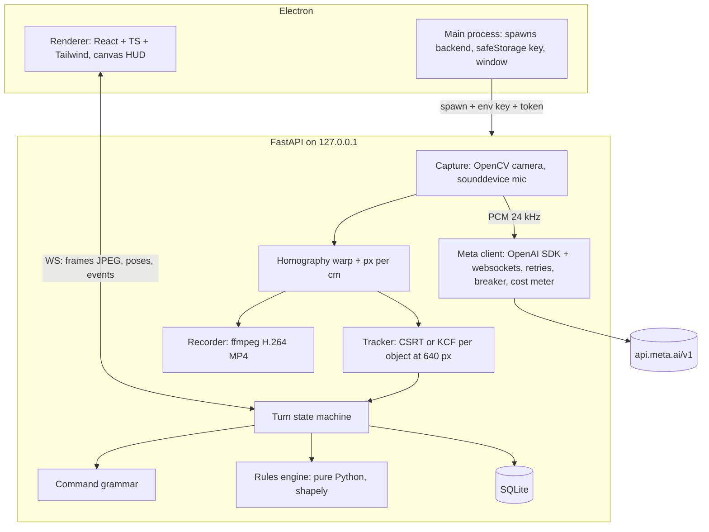

# Architecture overview

DeskTop is an Electron app with a React renderer and a Python FastAPI backend that runs on 127.0.0.1 as a child process. The backend owns the camera, mic, rules, database and every Meta API call.

## Key facts

| Fact | Value |
|---|---|
| Processes | Electron main, Electron renderer, Python backend (uvicorn) |
| Local transport | WebSocket `/ws` plus HTTP on 127.0.0.1:8765 with a per-launch token |
| External | api.meta.ai/v1 (Responses, Files), wss://api.meta.ai/v1/asr/realtime |
| Database | SQLite in the Electron user data folder (`%APPDATA%\DeskTop\`) |
| Authoritative logic | `backend/rules` (pure Python) |
| Current code | M0 to M11 and Phases 12 to 14 built and tested offline (2026-10-29) |

## Components

## Data flow per phase

| Phase | Flow |
|---|---|
| Calibration | Camera frame, optional SAM concept call, homography saved |
| Summon | Voice (endpointing) gives the name. Warped snapshot plus name plus known boxes to Spark. Box to SAM with all known boxes. Rules clamp. Card to renderer. Background sprite job to Muse Image |
| Player phase | Camera to tracker at 10 Hz+, poses to renderer at about 25 Hz. Mic to voice (diarization). Transcripts to grammar. Intents to chips |
| End Turn | Snapshot, one SAM call, reconcile, validate, `resolve_turn`, events to renderer, GM narration in background, autosave |
| Sunrise | Recap call. With consent: highlights, proxy, upload, SAM video, delete upload, local render |

## Trust boundaries

| Boundary | Rule |
|---|---|
| Renderer to backend | Untrusted input. Token on every request, Pydantic validation, state checks |
| Backend to Meta | Key in env only. Standard mode. Only frames, crops, live audio, consented proxy leave the laptop |
| Meta to backend | Untrusted output. Strict schemas, enum IDs from live state, clamps, repair then fallback |
| Main to renderer | Preload exposes `getConfig`, `getKeyStatus`, `saveKey` and `showReel` only (ADR-0103) |

## Key decisions

| Decision | ADR |
|---|---|
| Turn-based | ADR-0001 |
| Hybrid tracking, Spark plus SAM box prompts | ADR-0002 |
| Rules engine authoritative | ADR-0003 |
| SQLite | ADR-0004 |
| Chroma key sprites | ADR-0005 |
| Local-first | ADR-0006 |
| Voice with fallbacks | ADR-0007 |
| Backend owns devices | ADR-0008 |
| ffmpeg H.264 | ADR-0009 |
| OpenAI SDK for Meta | ADR-0010 |

## Runtime data (not in the repo)

SQLite database, sprites made during play and recordings live in `%APPDATA%\DeskTop\`. Electron main passes this path to the backend at spawn. Delete campaign removes only files under this root (FR-52).
