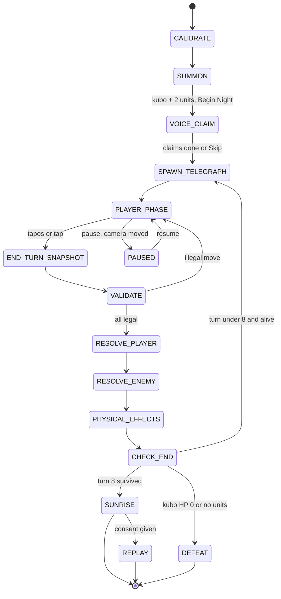

# Turn state machine

The backend runs one state machine per night as an enum with a single `transition(event)` function. Every state change writes a `turn_log` row with `t_ms` so latency can be measured.

## Key facts

| Fact | Value |
|---|---|
| Module | `backend/game/state_machine.py` |
| States | 15 |
| Requirement | FR-31 (every transition occurs in order in a scripted test) |
| Logging | One turn_log row per transition |
| Autosave | One transaction at CHECK_END |

## Diagram

## States

| State | Entry | Exit | Timeout | Phase banner |
|---|---|---|---|---|
| CALIBRATE | First launch or camera moved | Homography saved | None | n/a |
| SUMMON | Start Night | Begin Night with valid roster | None | n/a |
| VOICE_CLAIM | Roster valid | All players claimed or Skip | 60 s then Skip | n/a |
| SPAWN_TELEGRAPH | Turn start | Arrows drawn | Instant (local) | Dumarating sila |
| PLAYER_PHASE | Telegraph done | End Turn | None, players set the pace | Galaw at Utos |
| END_TURN_SNAPSHOT | End Turn | SAM result or fallback | 10 s then tracker positions with "?" badge | Sinusuri |
| VALIDATE | Snapshot | All moves legal | None | Sinusuri |
| RESOLVE_PLAYER | Valid | Events emitted | Instant | Labanan |
| RESOLVE_ENEMY | Player done | Events emitted | Instant | Labanan |
| PHYSICAL_EFFECTS | Push or steal event | Object at target or removed | 20 s then accept | Labanan |
| CHECK_END | Effects done | Next state | Instant | Labanan |
| SUNRISE | Turn 8 survived | Replay, Next Night or Quit | None | n/a |
| DEFEAT | Kubo HP 0 or no units | Try Again or Quit | None | n/a |
| REPLAY | Consent given and Replay tapped | Export or close | SAM video 120 s | n/a |
| PAUSED | Pause, camera moved, backend restart | Resume | None | n/a |

## Turn order inside one turn

1. Spawn and telegraph. Enemies spawn, move by AI, intent arrows drawn.
2. Narration (merged with the previous resolution narration).
3. Player phase. Hands move objects, orders queue as chips.
4. End Turn. Input frozen, wait up to 3 s for hands to leave, SAM re-anchor.
5. Validate. Any unit beyond its move circle blocks End Turn with `endturn.blocked` and a start ghost (FR-33).
6. Resolve player intents in confirmed order: powers, heals, attacks.
7. Enemies attack telegraphed targets only if still in range, else "Nakaiwas!".
8. Physical effects (tikbalang push, duwende steal).
9. Resolution narration, never blocking. 20 s timeout then a local line.
10. Check win and lose. Autosave.

## Rules for implementers

- Reject any intent or action that is not valid in the current state, server-side.
- PAUSED keeps all state. Resume returns to PLAYER_PHASE.
- Crash restore resumes at the start of the current turn's PLAYER_PHASE (FR-41) within 15 s (NFR-17).
- The state machine calls `backend/rules` for every number and never computes one itself.
- Test: a scripted night passes through every transition in order, including the illegal-move loop and pause.
