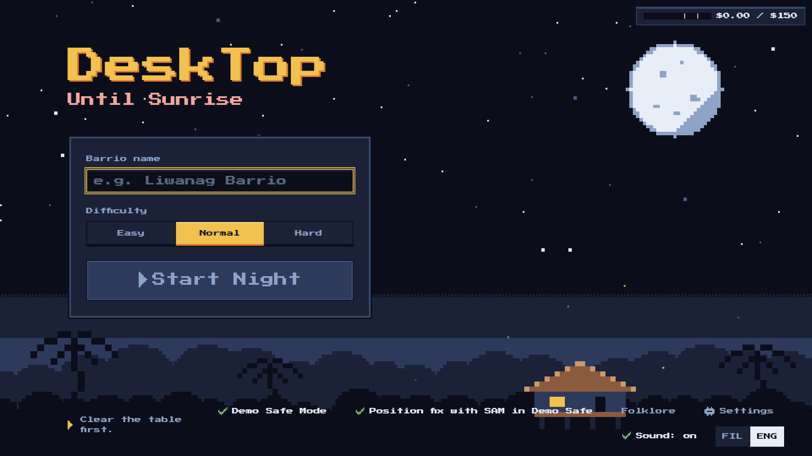

# How to run DeskTop: Hanggang Umaga

Hi! This guide gets you from a fresh Windows laptop to your first night against the aswang. With the zip it takes a few minutes. From source, expect about 20 minutes the first time, mostly downloads. After that, starting a game takes a minute.

You don't need to know how the code works. If you can copy a command into PowerShell and press Enter, you're good.

## What you need

**On the table**

- A Windows 10 or 11 laptop.
- A webcam you can point straight down at the table, about 45 to 70 cm above it. A cheap clip-on webcam on a stand, a bent desk lamp or a stack of books works fine. The camera should see the whole play area and nothing much beyond it.
- One plain A4 sheet of paper. You only need it for a few seconds to calibrate.
- A handful of everyday objects: a mug, a coin, keys, a pen, an eraser, a phone. Anything small and easy to tell apart works.
- Decent light. A dim room makes tracking shaky.

**On the laptop**

With the zip you need nothing else. It carries its own Python. ffmpeg is still optional.

From source you need these:

| Tool | Why | How to check it is installed |
|---|---|---|
| Git | To download the game | `git --version` |
| Node.js 20.19 or newer | Runs the app window | `node -v` |
| Python 3.13 | Runs the game brain in the background | `py -3.13 --version` |
| ffmpeg (optional) | Only for recording a night and making the replay reel | `ffmpeg -version` |

If a check prints an error, install that tool first. Node.js and Python both have normal Windows installers. The easiest way to get ffmpeg is `winget install Gyan.FFmpeg`. Or download a Windows build, unzip it somewhere, and either add its `bin` folder to your PATH or see "Using ffmpeg without PATH" below.

**An API key (optional)**

The game uses four Meta models: Muse Spark, SAM 3.1, Muse Image and Muse Voice Transcribe. With a Meta Model API key you get the full experience: objects recognized from the camera, pixel sprites drawn for them, live narration and voice orders.

No key? You can still play a whole night offline in **Demo Safe Mode**. Objects get class-default cards and placeholder sprites. You give orders by tapping instead of talking. Lines come from a built-in line bank. You still need the webcam, because the game watches your real objects either way.

## Option A: play from the zip

1. Download `DeskTop-1.0.0-win.zip` from the [Releases page](https://github.com/EHIBE/DeskTop-Hanggang-Umaga/releases) once it is attached.
2. Check that the download is intact. The hash it prints must match the SHA-256 in [release and packaging](delivery/release-and-packaging.md).

   ```powershell
   Get-FileHash .\DeskTop-1.0.0-win.zip -Algorithm SHA256
   ```

3. Unzip it into a folder you can write to, like `Documents\DeskTop`.
4. Double-click `DeskTop.exe`. The build is unsigned, so Windows SmartScreen may ask you to confirm. Choose More info, then Run anyway.

Then skip to "Your first launch, screen by screen".

## Option B: install from source (one time)

Open PowerShell in the folder where you keep projects, then run these one at a time.

```powershell
git clone https://github.com/EHIBE/DeskTop-Hanggang-Umaga.git
cd DeskTop-Hanggang-Umaga
npm --prefix app install
py -3.13 -m venv backend\.venv
backend\.venv\Scripts\python -m pip install -r backend\requirements.txt
```

What each line does, in plain words:

1. Downloads the game.
2. Moves into its folder.
3. Installs what the app window needs. This one takes a few minutes the first time.
4. Makes a private Python space just for this game, so it never touches anything else on your laptop.
5. Installs what the game brain needs into that private space.

If step 5 complains about the Python version, make sure you really have 3.13 (`py -3.13 --version`).

## Start the game from source

From the `DeskTop-Hanggang-Umaga` folder:

```powershell
npm --prefix app run dev
```

A window opens. Behind it, the app quietly starts the game brain on your own laptop. Nothing listens on your network, only on this machine.

To stop the game, just close the window.

## Your first launch, screen by screen

### 1. Pick your language

The very first time, the game asks for Filipino or English. Captions and buttons follow your pick. You can switch any time with the **FIL** and **ENG** toggle on the Start, key and calibration screens, or with Caption language in Settings.

### 2. Connect the AI

You'll see "Paste your Meta Model API key."

- **Have a key?** Paste it and press Save. It is encrypted with Windows safeStorage and handed only to the game's background process. It never shows up in the window, the logs or the project files.
- **No key?** Choose "Play offline". That turns on Demo Safe Mode.

### 3. Start



- **New campaign**: type a barrio name, pick Easy, Normal or Hard (Madali, Normal or Mahirap in Filipino), and press **Start Night**. Normal is the right first try.
- **Continue Campaign**: pick up a barrio you played before. It remembers your units, their badges and scars, and the barrio level.
- **Demo Safe Mode** lives here too, if you ever want to play offline on purpose. A second switch lets SAM still fix positions at End Turn when you have a key.
- **Folklore** opens a short glossary of the creatures and words in the game.
- **Settings** lets you pick the camera and microphone, the caption language, the difficulty for new campaigns, and switches for the replay, showing real objects on cards, strict ownership and the generated barrio map. The generated map sends one photo of the empty desk to Muse Image, about $0.01 once per campaign. It is off until you turn it on.
- **Sound** turns the game sounds on or off. The sounds are made in code, and nothing important depends on hearing them.

### 4. Calibration

This teaches the game where your table is.

1. Pick your camera from the list.
2. Lay the A4 sheet flat in the middle of the table.
3. Tap the four corners of the sheet on screen.
4. Set the play area size if you want something other than the default 60 by 40 cm.
5. Take the sheet away and press Done.

Wrong campaign or not ready? **Back** returns you to Start. If a camera does not show up, press Rescan.

Once you calibrate, don't bump the camera. If it moves during a night, the game pauses and asks you to fix it. Recalibrating the same campaign later is quick.

### 5. Summon your units

Now the fun part. Place **one object at a time**, take your hand out of the frame, and say or type what it is.

- **The first object is always the bahay kubo**, the little house you are protecting. Pick something sturdy like a mug.
- Every object after that becomes a unit with a class, stats and a power on its card. With a key, a pixel sprite appears a few seconds later. Offline, you get a placeholder.
- After each summon, a short panel shows what each model did: the box Muse Spark found, the outline from SAM 3.1, and the sprite from Muse Image. It fades on its own, and "Show how it was made" brings it back.
- If the game isn't sure which object is new, it asks you to tap it.
- Don't love a card? You can re-roll it once or rename it.
- Playing a campaign again? Put the same objects down and the game recognizes them. They come back with their sprite, badges and scars.

You need the kubo plus at least two other units. Twelve objects is the most it handles. When you're ready, press **Begin Night**.

### 6. Claim your units

Each player says who they are and what they control:

> "Ako si Migs, hawak ko ang Mug at Stapler."

You can also tap a unit, then a name. Claims close by themselves after 60 seconds.

On the same screen, everyone answers whether tonight can be recorded for the replay, Payag or Hindi. Saying no is completely fine. The night plays the same, just without a recording.

### 7. The night

Eight turns until sunrise. Each turn goes like this:

On the first night, short hints walk you through turns 1 to 3. Press "Got it" to close one, or "Skip all hints".

1. **Enemies appear** at the edges with red arrows showing who they'll hit and for how much.
2. **You plan and move.** Slide your real objects. The ring around each unit shows how far it can move: solid with a check means fine, dashed with an X means too far.
3. **You give orders.** Say them out loud ("Stapler, atake sa aswang!") or tap a unit and pick an action. Each order shows up as a chip. Say "Hindi" or tap the X to cancel one.
4. **End the turn.** Say "Tapos na" or press End Turn. Keep your hands off the table for a moment while the camera takes its snapshot.
5. **Watch it play out.** Hits, dodges and narration happen, then the next wave comes.

Some creatures change the table itself:

- **Tikbalang** can shove a unit. A ghost outline shows where it landed. Slide the object onto the ghost, or tap Done.
- **Duwende** can steal a unit. Take that object off the table. Defeat the duwende and you get it back. Put it on the mark that appears.
- **Kapre** blows smoke clouds. A unit inside a cloud shows "In smoke" and cannot hit an enemy outside the clouds. A unit with the Liwanag power clears smoke within 12 cm.

If an object slides off the play area, the game says "[unit] is off the table! Put it back." and marks it Lost until you do.

If you need a break, press Pause. From the pause screen you can also open Folklore or Settings, or choose Quit to go back to Start. Your night is saved. If the camera gets bumped, the game pauses by itself.

### 8. Sunrise (or defeat)

Survive all eight turns and the sun comes up. You'll see your score and the Bayani ng Gabi, the hero of the night. Pick a badge for one unit: Extra HP or Short cooldown. A unit that went down picks up a scar, which costs it 1 max HP. If the night was recorded and ffmpeg is installed, press **Make the Replay** for a short highlight reel, then **Show in folder** to find the file.

Then pick Next Night to keep the campaign going. Every night you survive raises the barrio level, up to 5. The next night opens with "Last night...", a short Kagabi recap of what happened.

## Talking to the game

Voice works only with an API key, and it's off in Demo Safe Mode.

- **Open mic** listens all the time. **Push to talk** listens only while you hold Space (or the on-screen hold button). Push to talk is better in a noisy room.
- Speak naturally in Taglish or English: "Albularyo, gamutin si Spearman", "Anting-anting, protektahan ang kubo", "Tapos na".
- If two people talk at once, the game asks "Isa-isa lang!" and drops both orders. Just say it again.
- If the mic stops working, a banner says so and tapping still works. "Voice problems" tries to reconnect.

## Where your stuff lives

Your game data stays on your laptop, in `%APPDATA%\DeskTop`. Paste that into the Explorer address bar to open it. Only the items listed under Privacy and safety in the [README](../README.md#privacy-and-safety) are sent to Meta.

- Your campaigns, units and turn history are in a small database there.
- Recordings and replay reels are under `campaigns\<your campaign>\recordings`.
- If something goes wrong, the game's log is at `%APPDATA%\DeskTop\logs\backend.log`. It never contains your key.

To wipe a campaign completely, use **Delete** on the Start screen. It removes that campaign's database rows, files, recordings, reels, map and the sprites no other campaign uses.

## Using ffmpeg without PATH

If you'd rather not touch PATH, point the game straight at ffmpeg before you start it:

```powershell
$env:DESKTOP_FFMPEG = "C:\tools\ffmpeg\bin\ffmpeg.exe"
npm --prefix app run dev
```

Change the path to wherever you unzipped it. This only lasts for that PowerShell window.

## When something goes wrong

| What you see | What to try |
|---|---|
| The window opens but stays on a loading or reconnecting state, then says "The game could not start" | Close it and start it again. Check `backend.log` for the reason. From source, most often the Python install step was skipped |
| The camera light is on but the picture is black, or a camera is marked "no picture" | Another app is holding that camera. NVIDIA Broadcast is the usual one: it takes the real webcam and offers its own virtual camera instead. Pick the camera that is not marked "no picture" (often the 1280x720 one), or quit NVIDIA Broadcast and use the real webcam directly |
| "No camera found" or the camera is busy | Close other apps using the webcam (Zoom, Teams, the Camera app), then pick the camera again |
| "Too dark. Add more light." | Turn on a lamp. Tracking needs even light |
| "The camera moved! Calibrate again." | Put the camera back where it was and press Resume, or recalibrate from the pause screen |
| A unit's ring shows dashed with an X and End Turn is blocked | That object moved farther than it's allowed. Slide it back inside its ring |
| An object shows a "?" | The camera lost track of it, usually because a hand covered it. Move your hand away and it relocks |
| "Walang recording ngayon" when the night starts | ffmpeg isn't installed or can't be found. The night still plays. See the ffmpeg section above |
| "Credits are running low. Demo Safe Mode is on." | Your API spending hit the safety limit. The game switched to offline mode by itself so the night can finish |
| Voice shows "Voice down" | Check your internet and your mic, then press Voice problems. Tapping always works |
| A crash in the middle of a night | Just start the game again and continue the campaign. Resume Night picks up from the start of the turn you were on |
| "[unit] is off the table! Put it back." | The object left the play area. Slide it back inside and the game says it is back |

## Optional: local Glimmer recap

If you run from source and have [Ollama](https://ollama.com) on this laptop, the Kagabi recap can come from a local model. Put `DESKTOP_GLIMMER_URL=http://127.0.0.1:11434` in `backend\.env` before starting. Only addresses on this machine are accepted. The zip does not support this yet. Without it, the recap uses Muse Spark or the built-in line bank.

## For tinkerers

If you want to check the code yourself, these run from the project folder:

```powershell
backend\.venv\Scripts\python -m pytest backend/tests -q
npm --prefix app run typecheck
npm --prefix app run lint
backend\.venv\Scripts\python eval\run_eval.py --help
```

The first runs the backend tests, all offline and free. The last one lists the evaluation commands. Paid evals always ask before they spend anything.

Developers can also put `MODEL_API_KEY=` followed by the key in `backend\.env` instead of using the key screen. That file is ignored by git and never leaves your laptop.

That's it. Ingat, and hold on until morning.
