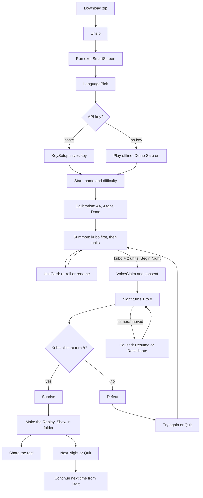

# User journey

This is the path a player takes from the downloaded zip to a shared replay reel, as the finished product will work on 2026-11-03. It covers 13 steps and marks what is new today (tutorial hints, sound, glossary, speaker chip) and what is not yet verified on real hardware.

## Key facts

| Fact | Value |
|---|---|
| Delivery | Pre-built unsigned Windows zip with the Python backend bundled. Large download accepted |
| Players | 1 to 4, co-op, one table |
| Setup target | Under 5 minutes from first window to first night (PG-1). Canonical: `docs/game/core-loop.md` |
| Night | 8 turns, 90 to 120 s per turn, about 12 to 18 min |
| Router | `App.tsx` picks the screen from language, key status and backend phase |
| Languages | Filipino or English, chosen once, switchable with the FIL / ENG toggle |
| New today | First-night hints, folklore glossary, speaker chip, synthesized sound. Spec: `docs/design/onboarding-and-tutorial.md` |
| Unverified | KeySetup, Calibration, Night, Sunrise and Defeat have not been seen in the running app. Packaged zip not yet run. Verify each in Playtest 2 |

## Flowchart

## Steps

Times are targets, not measurements. Rows marked Proposed have no source number yet. Verify all in Playtest 2.

| # | Step | Screen file | Target |
|---|---|---|---|
| 1 | Download zip | None (browser) | Proposed 2 min on home Wi-Fi |
| 2 | Unzip | None (Explorer) | Proposed 1 min |
| 3 | Run and SmartScreen | None (Windows) | Proposed 30 s |
| 4 | LanguagePick | `screens/LanguagePick.tsx` | 5 s |
| 5 | KeySetup or Play offline | `screens/KeySetup.tsx` | Proposed 30 s |
| 6 | Start | `screens/Start.tsx` | 15 s |
| 7 | Calibration | `screens/Calibration.tsx` | Proposed 60 s |
| 8 | Summon and UnitCard | `screens/Summon.tsx`, `screens/UnitCard.tsx` | About 3 min with 4 units (core-loop setup figure) |
| 9 | VoiceClaim and consent | `screens/VoiceClaim.tsx` | Up to 60 s (claim timeout) |
| 10 | Night turns 1 to 8 | `screens/Night.tsx` | 90 to 120 s per turn |
| 11 | Sunrise or Defeat | `screens/Sunrise.tsx`, `screens/Defeat.tsx` | 30 s to read |
| 12 | Make Replay | `components/ReplayPanel.tsx` | Up to 60 s reel length. Render time Unverified |
| 13 | Continue next time | `screens/Start.tsx` | 15 s |

## Step detail

### 1 to 3. Download, unzip, SmartScreen

- Player does: download the zip, right-click Extract All, double-click the app exe.
- Game shows: Windows "Windows protected your PC" because the build is unsigned. Player taps More info, then Run anyway.
- Failure path: zip blocked by antivirus or Run anyway missing. The README download section explains both. No in-app copy key.
- New today: README gets a short SmartScreen note with the two clicks. Unverified until the zip is built (`docs/delivery/release-and-packaging.md`). Release page URL Unverified.

### 4. LanguagePick

- Player does: taps Filipino or English. Autofocus is on Filipino.
- Game shows: title mark over the night scene, two big buttons with hints "Tara, laro!" and "Let's play!".
- Failure path: none. Choice is saved in localStorage key `desktop.lang`. If storage fails, the pick shows again next launch.
- New today: nothing. The FIL / ENG toggle appears on later screens.

### 5. KeySetup or Play offline

- Player does: pastes the Meta Model API key and presses Save, or presses Play offline.
- Game shows: masked field, lock line `key.short_privacy`, saved line `key.saved`. Offline turns Demo Safe on and continues.
- Failure path: empty or bad key shows `key.invalid` with a cross icon. Offline is always one tap away. Backend not ready shows the `restore` Connecting screen.
- New today: nothing. Skipped on later launches once the key is stored (safeStorage).

### 6. Start

- Player does: types a barrio name (1 to 40 chars), picks Madali, Normal or Mahirap (Normal default), presses `start.begin`. Saved campaigns list under `start.saves` with Delete and a confirm tap.
- Game shows: footer tip `start.tip` ("Clear the table first."), Demo Safe switch, FIL / ENG toggle.
- Failure path: name empty disables Begin. Delete asks for a second tap that expires in 4 s.
- New today: Folklore button in the footer opens the glossary. Sound switch beside the toggle. Spec in the onboarding file.

### 7. Calibration

- Player does: picks a camera, lays the A4 sheet flat, taps its four corners, sets the play area (default 60 x 40 cm), removes the sheet, presses `calib.confirm`.
- Game shows: live feed with a step list (place, tap, remove) that fills with check icons, `calib.aim` ("Itutok ang camera sa mesa lang.").
- Failure path: `calib.dark` too dark, `calib.no_camera`, `calib.no_picture` on black-frame cameras, camera busy. Reset restarts the taps.
- New today: nothing in code. Real ruler check and live feed at 20 FPS or more are Manual: EHIBE.

### 8. Summon and UnitCard

- Player does: places one object, takes the hand away, says or types its name. First object is the kubo. Taps the card to re-roll (1 per unit) or rename. Presses `summon.begin` when the kubo plus 2 more units exist (12 max).
- Game shows: warped feed, `summon.prompt`, roster sidebar, placeholder card in about 8 s then the real sprite, and the how-it-was-made panel naming Muse Spark, SAM 3.1 and Muse Image (`made.show` brings it back).
- Failure path: `summon.which` when unsure (tap the object), `summon.full`, `summon.stack`, `summon.kubo_first` on early Begin. Models down gives class-default cards and placeholder sprites. A failed sprite shows no error.
- New today: glossary term link on class names is out of scope. Gong sting is not used here.

### 9. VoiceClaim and consent

- Player does: each player says "Ako si Migs, hawak ko ang Mug at Stapler" or taps a unit then a name. Each claimed player taps Payag or Hindi for recording. Skip or the 60 s timeout ends the step.
- Game shows: `claim.prompt`, countdown, player chips, `rec.consent` and `rec.no_ok`.
- Failure path: voice failed leaves tap and drag. `claim.duplicate` on double claims. No answer counts as no. No consent means no recording and no replay panel.
- New today: speaker chip with P1 to P4 label, colour and shape is introduced here so players see their mark before the night. Spec in the onboarding file.

### 10. Night turns 1 to 8

- Player does: reads the red arrows, slides real objects inside the green rings, speaks or taps orders, says "Tapos na" or presses End Turn, keeps hands off for the snapshot, resolves a tikbalang push or duwende steal on the table.
- Game shows: phase banner (Dumarating sila, Galaw at Utos, Sinusuri, Labanan), order chips, unit strip, captions, GM narration, REC dot if consented. Pause overlay on camera move.
- Failure path: `endturn.blocked` with a ghost, `cam.moved` pause with Resume, Continue anyway and Recalibrate, `voice.down_banner`, `net.down`, `credits.low` which turns Demo Safe on. Crash restore resumes at the saved turn.
- New today: one-line hints in turns 1 to 3, speaker chip on captions and chips, sound cues (ambience, gong, bell, hit, dodge), Folklore and Sound controls in the pause overlay.

### 11. Sunrise or Defeat

- Player does: reads score and Bayani ng Gabi, picks Next Night or Quit. On Defeat picks Try Again or Quit.
- Game shows: dawn scene and `sunrise.title` with `win`, or the fallen kubo with `defeat.title` and `lose`. Narration recap line.
- Failure path: recap model down uses the line bank.
- New today: rooster-like rising chime on Sunrise, low tone on Defeat.

### 12. Make Replay

- Player does: presses `replay.make`, waits, presses `replay.show` to open the folder, then shares the mp4 by hand.
- Game shows: `replay.making`, then `replay.done`. Panel hidden without consent. Without any recording shows `replay.none`.
- Failure path: `replay.no_ffmpeg` (install with `winget install Gyan.FFmpeg`), `replay.failed` with retry, `replay.missing`. SAM video failure falls back to a box or a 10 s clip.
- New today: nothing. Real reel needs ffmpeg and the key and is Manual: EHIBE.

### 13. Continue next time

- Player does: launches again, taps a saved barrio under `start.saves`.
- Game shows: Summon with `summon.resume_banner` and `summon.resume_button` if a night was in progress, else a fresh Summon with sprites reused.
- Failure path: kill at turn 5 resumes at the start of that turn. Campaign progression is cut, so a new night starts from Summon.
- New today: first-night hints do not repeat for a campaign that already saw them.

## First 60 seconds: Bea the first-timer

Bea has the zip, no key, a laptop webcam and no idea what an aswang is. Goal: she is placing her first object in under a minute of play and never feels lost.

| Second | What Bea sees | What she does | Design rule |
|---|---|---|---|
| 0 to 5 | Night scene, title, two language buttons | Taps Filipino | One choice, no jargon |
| 5 to 15 | KeySetup with a lock note and a Play offline button | Has no key, taps Play offline | Offline is as big as Save |
| 15 to 30 | Start with a name field and Normal selected | Types "Baryo Luntian", presses Begin | Defaults are safe |
| 30 to 60 | Calibration steps 1, 2, 3 with check icons | Lays a paper, taps four corners | Step list tells her the next action |

- Success check: Bea reaches the A4 taps without reading the README.
- If she is stuck: the footer tip on Start and the step list on Calibration are the only help. Folklore glossary is one tap on Start for the curious.
- Unverified: whether 60 seconds is realistic. Verify in Playtest 2 with a stopwatch and record the result in `docs/playtests.md`.

## Judge path

Fastest route to see all four Meta models in under 3 minutes. Needs a valid key and a camera with the desk already set.

| Step | Action | Model shown | Proposed budget |
|---|---|---|---|
| 1 | LanguagePick, paste key, Save | None | 20 s |
| 2 | Start with default name and Normal | None | 10 s |
| 3 | Calibration, 4 taps, Done (calibration saved from a prior run is reused if present) | None | 30 s |
| 4 | Summon the kubo by saying its name aloud | Muse Voice Transcribe, Muse Spark | 30 s |
| 5 | Summon two more objects, read the how-it-was-made panel | SAM 3.1 (outline), Muse Image (sprite) | 60 s |
| 6 | Begin Night, Skip claim, show the turn 1 narration | Muse Spark (GM line) | 30 s |

- Total target: 180 s. Unverified. Time it on the demo laptop.
- Prior calibration reuse is Unverified. Verify by relaunching after a saved campaign.
- Judges need not finish a night. Turn 1 is a single aswang.

### Offline Demo Safe route

- Press Play offline on KeySetup (or the Demo Safe switch on Start), Wi-Fi off.
- Calibrate, summon with typed names, tap intents, End Turn.
- Cards are class defaults, sprites are placeholders, lines come from the line bank, voice is off.
- Show the Demo Safe badge so judges see it is deliberate.
- Verify with the skill `desktop-demo-safe-check` and Playtest 1.
